<p align="center">
  
</p>

<h1 align="center">Courtside</h1>

<p align="center">
  Private game video for a basketball club's junior teams.<br>
  Stream the game live from a phone's browser, watch it back, cut the highlights, keep the photos.
</p>

<p align="center">
  <a href="LICENSE"></a>
  
  
  
</p>

<p align="center">
  <a href="INSTALL.md"><b>Set it up for your club</b></a> ·
  <a href="docs/admin/README.md"><b>Documentation</b></a> ·
  <a href="docs/spec.md">What it does</a> ·
  <a href="docs/architecture.md">How it works</a> ·
  <a href="docs/admin/30-technology-decisions.md">Why it's built this way</a>
</p>

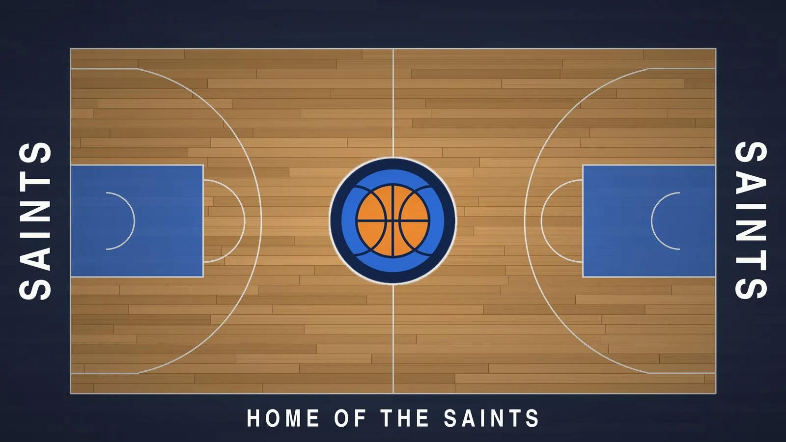

A parent films the game on their phone and streams it live from the site's Go live page, right there in the phone's
browser with nothing to install, or uploads the video when they get home. Everyone on the team's list signs in with a
code sent to their email, watches the game live or later, downloads it, cuts highlight clips and adds photos. Team
managers run their team's fixture, people, squad and game-day roster. A site admin looks after the whole club from an
admin area with its own documentation, costs, log and alerts.

It was built for one club's teams by a parent who films, and made generic so any club can run it: the club's names,
colours and words live in one file, where it runs in another, and an AI coding agent can set it up in an afternoon.

## What it does

<table>
<tr>
<td width="50%" valign="top">

**Families**

Watch every game live, about a second behind the court, or afterwards, in the browser or full screen on a TV.
Download the HD video. Cut highlight clips and tag the players in them. Star favourites. See, add and download the
team's photos, newest first. Ask for a video, clip or photo to be removed. Sign in once a month with an email code.

</td>
<td width="50%" valign="top">

**Whoever films**

Tap Go live, point the phone at the court, and families are watching. Pause for the break and they see a Game break
card. A locked phone or a closed page doesn't end the game: Resume camera and Carry on streaming pick it up, and the
parts are joined into one video. Or record on the phone and upload later, over a weak signal, carrying on where it
left off.

</td>
</tr>
<tr>
<td valign="top">

**Coaches and team managers**

Private coaching notes on each game. The fixture by hand, from a PlayHQ link, from any public fixture page read by
AI, or from a spreadsheet, with final scores filled in by themselves. The people and their roles, the squad with
numbers, a game-day roster with a ready-made WhatsApp message, the line under each game's title, and a Help page
that answers questions for their team.

</td>
<td valign="top">

**Site admins**

Insights, Teams, Support tickets with alerts that raise only when something needs doing, Platform limits, Costs with
Cloudflare's own bill reconciled, one Log of everything, the Changelog, and the Documentation, with an AI assistant
that answers from it.

</td>
</tr>
</table>

Everything is private. Every page and file sits behind the sign-in; nothing about a child or a family is ever public,
and the site holds no names but the ones a team manager types. Footage goes straight from the filming phone to the
club's own Cloudflare account on short-lived signed links, is stored and played from there behind the same sign-in,
and reaches only the people on the team's list, so children's game video has a private home instead of reliance on
social media. The made-up Saints club and players named after NBA
stars stand in for real people throughout the code, the tests and these docs.

## What it looks like

<table>
<tr>
<td>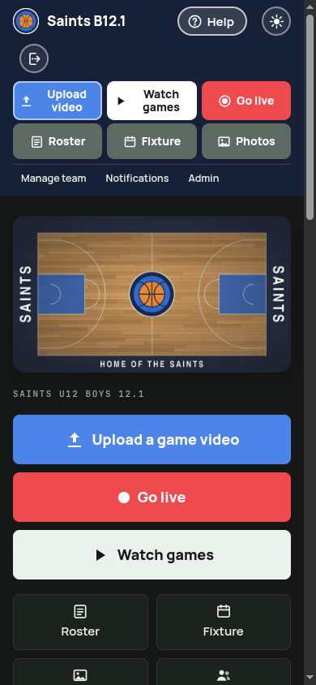</td>
<td>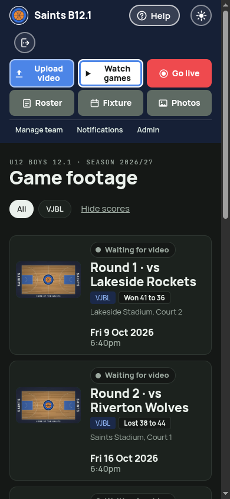</td>
<td>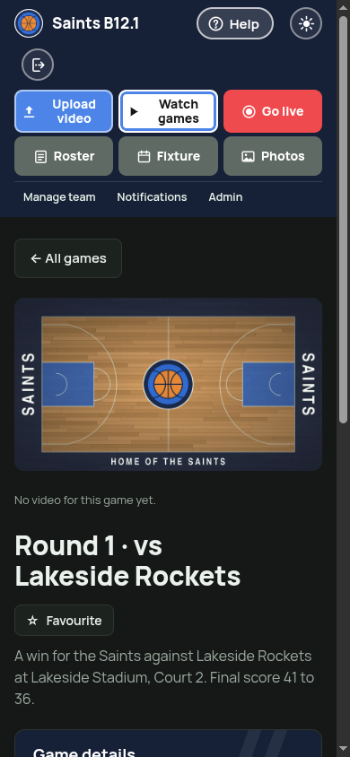</td>
<td>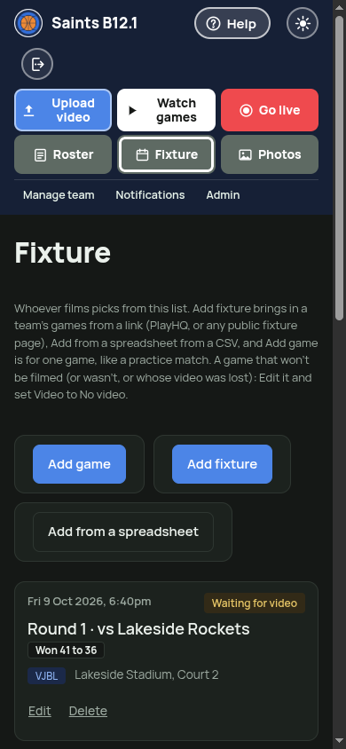</td>
<td>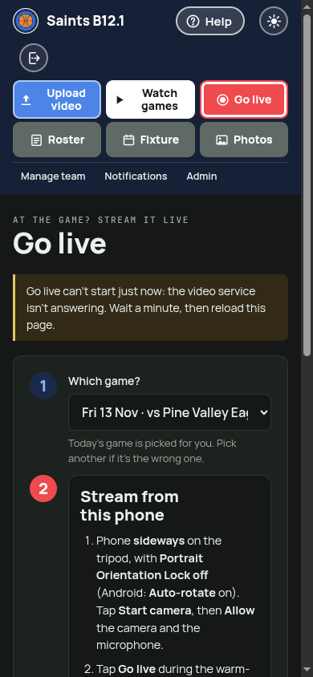</td>
</tr>
</table>

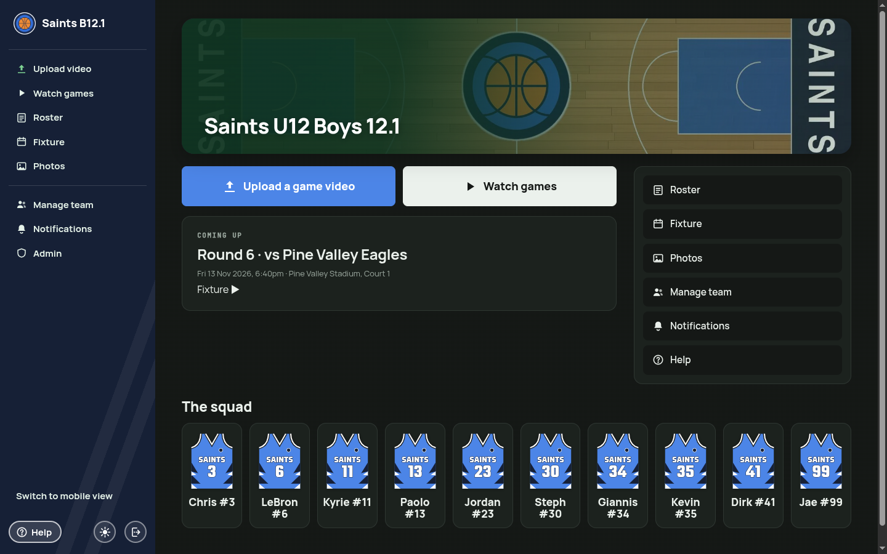

<table>
<tr>
<td width="50%">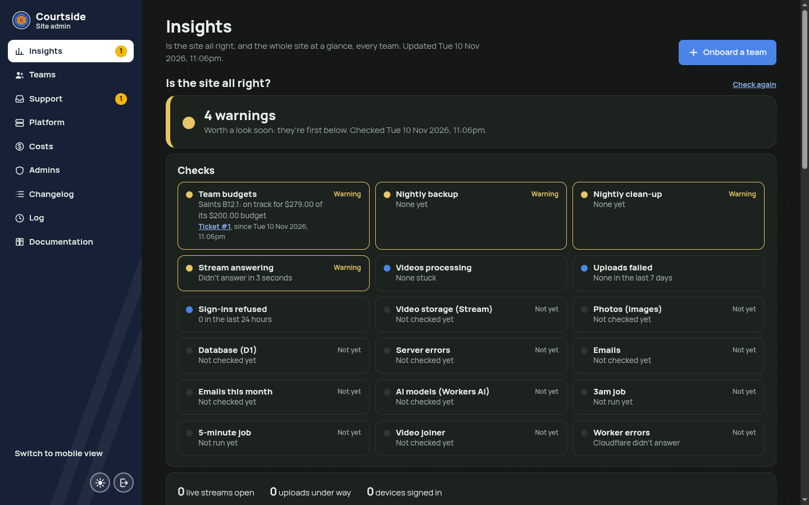</td>
<td width="50%">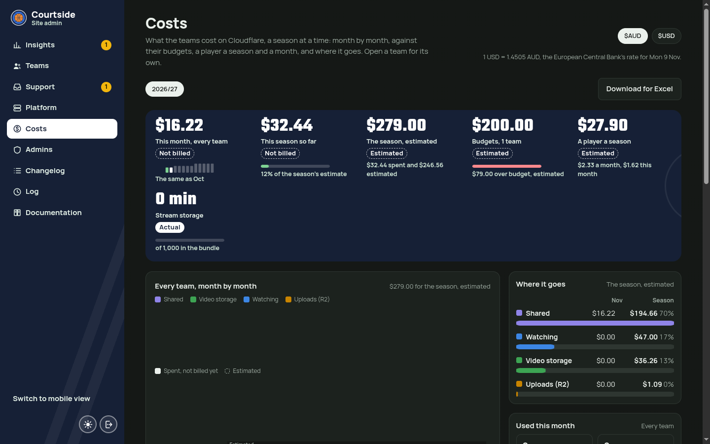</td>
</tr>
<tr>
<td>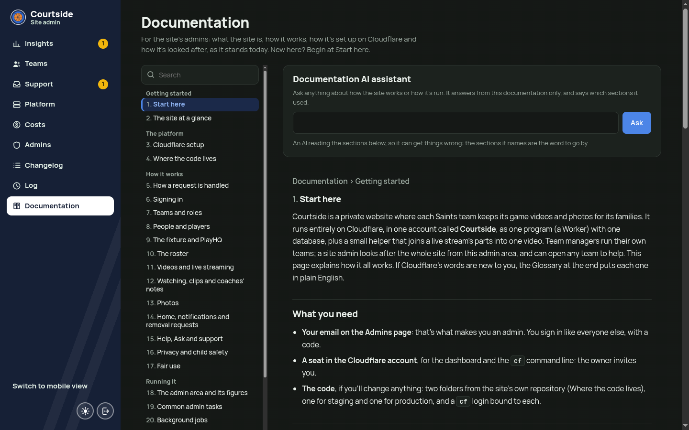</td>
<td>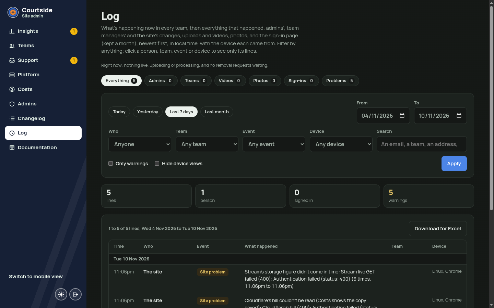</td>
</tr>
</table>

<sub>The example Saints club, with players named after NBA stars and made-up opponents, from the local dev server's seed (<code>npm run dev:seed</code>).</sub>

## How it's built

One Cloudflare Worker, server-rendered, with the platform's own storage, video, images, AI and email behind it: D1
for the data, R2 for uploads, Stream for live video and playback, Containers for the ffmpeg that joins a game streamed
in parts, Images for photos, Workers AI for the helpers, Email Sending for the codes, and Artifacts with Workers Builds
for the code and the deploys. There are no servers, no third-party services and nothing in the video path but the
phone and the platform. The reasoning behind each choice, and what was turned down, is in
[Technology decisions](docs/admin/30-technology-decisions.md).

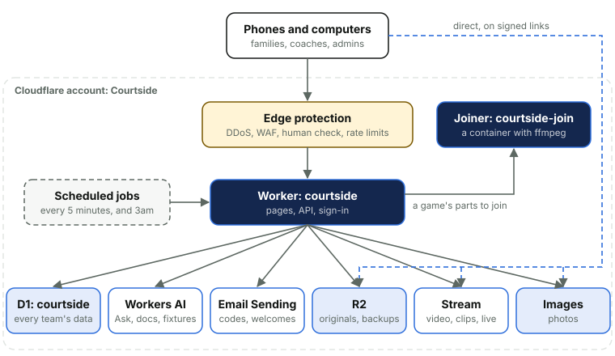

## Getting started

**A club.** [INSTALL.md](INSTALL.md) is written for an AI coding agent to follow with you: getting the tools and the
`cf` command line going, starting the agent, the questions it asks (your club's name, colours and logo, your domain,
your email), and the steps it does with a dry run and your yes before each. When it's done the whole site runs in
your own Cloudflare account, code and deploys included.

**A developer.** The short form is below; [Setting up a computer](docs/admin/24-setting-up-a-computer.md) is the
long one, and [AGENTS.md](AGENTS.md) has the rules every change follows.

```bash
npm install
cp .dev.vars.example .dev.vars        # stand-in secrets for local development
npm run dev:db && npm run dev:seed
npm run dev                           # http://localhost:5173, signed in as the development address in deploy.config.ts
npm run check                         # types, every unit test, line limits and rules
npm run e2e                           # the browser suite: Go live on Android, iPhone and Firefox, in podman
```

## Documentation

The admin area carries its own Documentation, thirty sections from what the site is to what to do when something
goes wrong, and the same text is exported here with its diagrams, so it reads without a sign-in.

| Read | For |
| --- | --- |
| [The Documentation](docs/admin/README.md) | Everything, in order. The deployment guide is [Environments and releases](docs/admin/26-environments-and-releases.md); the setup is [Cloudflare setup](docs/admin/03-cloudflare-setup.md); the fixes are [When something goes wrong](docs/admin/27-when-something-goes-wrong.md) |
| [Technology decisions](docs/admin/30-technology-decisions.md) | What it's built on, why each piece, and what was turned down |
| [docs/spec.md](docs/spec.md) | What the site does and why, page by page: the source of truth |
| [docs/architecture.md](docs/architecture.md) | How it works, with diagrams: a request's path, uploads, live streaming, photos, the jobs and the data model |
| [docs/development-standards.md](docs/development-standards.md), [docs/cloudflare-standards.md](docs/cloudflare-standards.md) | The rules the code and the Cloudflare setup follow |
| [docs/runbooks/](docs/runbooks/) | The Cloudflare setup, staging and the maintenance page, step by step |
| [docs/child-safety.md](docs/child-safety.md) | The site against the Child Safe Standards used in Australian junior sport |
| [docs/agent-setup.md](docs/agent-setup.md), [AGENTS.md](AGENTS.md) | Working on the site with an AI coding agent: the brief, and the rules |

## How a change ships

Every change is built on a branch off `staging`, tested first (the unit tests, and the browser suite for anything a
phone does), merged into `staging` and deployed there with `npm run staging`, and tried signed in on real phones. Then
`main` is fast-forwarded and `npm run release` runs every check again, refuses while anyone is uploading or streaming,
and pushes `main` to Cloudflare Artifacts, where Workers Builds checks it once more and deploys it. Never on a game day
unless it fixes something broken.

## What's where

| Folder | What |
| --- | --- |
| `src/club.ts`, `deploy.config.ts` | The club, and where it runs: the only two files that name either |
| `src/` | The Worker: `app/` the request path, `auth/` the sign-in, `features/<feature>/` each part of the site, `platform/` the Cloudflare clients, `jobs/` the 5-minute and 3am jobs, `ui/` the layout |
| `public/` | The pages' scripts and styles, the fonts, and the club's images |
| `migrations/` | The D1 schema |
| `infra/` | The provisioning bodies `cf` applies: R2 rules, Images variants, the zone's protections |
| `join/` | The video joiner: a Worker, a Durable Object and the container that runs ffmpeg |
| `maintenance/` | The Back soon page's Worker |
| `tests/` | Vitest on Node with a `node:sqlite` stand-in for D1; `tests/e2e/` the browser suite; `tests/isolation/` two teams through every route |
| `scripts/` | The release, staging, maintenance, joiner, docs and club commands |
| `docs/` | Everything above |

## Licence

[Apache 2.0](LICENSE).
