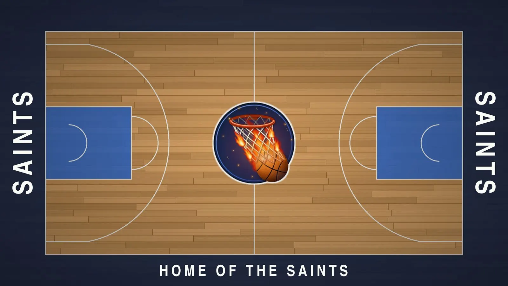
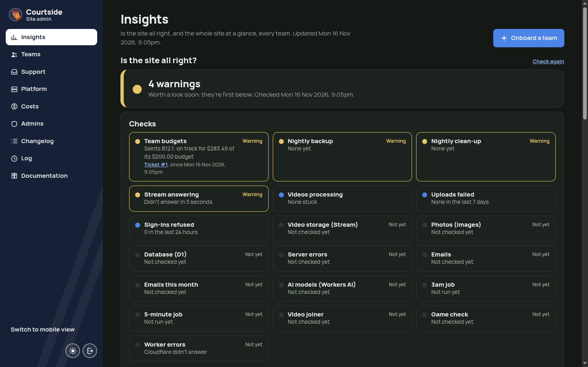

<p align="center">
  
</p>

<h1 align="center">Courtside</h1>

<p align="center">
  A private website for your basketball club's junior teams.<br>
  Stream the game, watch it back, and keep the team organised in one place.
</p>

<p align="center">
  <a href="LICENSE"></a>
  
</p>

<p align="center">
  <a href="INSTALL.md"><b>Set it up for your club</b></a> &nbsp;|&nbsp;
  <a href="docs/admin/README.md"><b>Documentation</b></a>
</p>

<br>



<br>

## Why it exists

Junior basketball families want to see the game. Grandparents can't always get there, parents miss games for work,
and kids love watching themselves play.

Posting kids' games on social media isn't the answer. Courtside gives each team its own private place for game video
and photos, seen only by the families on that team.

It was built by a parent and team manager at a VJBL club who wanted a better way to run a junior team than the way
it's usually done. It's now generic, so any club can run it.

<br>

## How filming works

Pick whichever suits you.

**A phone on a tripod.** Any phone on a cheap phone tripod at the side of the court. Open the website, tap Go
live, and families are watching about a second later. Nothing to install.

**An AI camera that follows the ball.** If your camera's app can stream to an RTMPS address (some apps just call it
RTMP), it works. The site gives you the two details to paste into the app.

**Upload it later.** Filmed on a phone without streaming? Upload the video when you get home. If the signal drops,
it carries on where it left off.

The phone also keeps its own recording while it streams, so a patchy signal at the stadium doesn't cost you any of
the game.

<br>

## What everyone gets

**Families**

- Watch live, or catch up later on a phone, computer or TV
- Download the full game
- Cut highlight clips of their child and tag who's in them
- Share team photos

**The person filming**

- One tap to go live
- Pause at half time
- If the phone locks or the page closes, carry on and it's still one video at the end

**Coaches and team managers**

- The season's fixture, added by hand, from PlayHQ, or from a spreadsheet
- The squad, the families, and a game-day roster with a WhatsApp message ready to send
- Private notes on each game

**The club's admins**

- One place to look after every team
- A clear picture of what the site costs each month
- A heads-up only when something actually needs fixing

<br>

## Child safety

Courtside makes best efforts to meet [Basketball Victoria's child safe practices](https://www.basketballvictoria.com.au/resources/child-safe-standards).

<br>

## What it doesn't do

- **Stats.** Download the game and use something like [Superstat](https://superstat.com.au) for that.
- **Live scores.** PlayHQ and My Hoops already do this well.
- **Chat.** Your team's WhatsApp group is still the place for that.

<br>

## Have a look

<table>
<tr>
<td></td>
<td></td>
<td></td>
<td></td>
<td></td>
</tr>
</table>


<table>
<tr>
<td width="50%"></td>
<td width="50%"></td>
</tr>
<tr>
<td></td>
<td></td>
</tr>
</table>

<sub>Everyone in these screenshots is made up. The example club is the Saints, and its squad is named after the 1992
Dream Team.</sub>

<br>

## Setting it up for your club

You'll need a Cloudflare account and a web address for the site. It runs entirely in your club's own account, so
you own everything.

[INSTALL.md](INSTALL.md) walks you through it with an AI coding assistant. It asks for your club's name, colours, logo
and email, then sets things up one step at a time, checking with you before each one. Most clubs can be up and running
in an afternoon.

What it costs depends on how much your teams film and watch. The admin area shows you exactly where the money goes.

<br>

## For developers

Courtside is one Cloudflare Worker with no other servers. It uses Cloudflare's own storage, video, images, AI and
email services.

```bash
npm install
cp .dev.vars.example .dev.vars        # stand-in secrets
npm run dev:db && npm run dev:seed    # a local database with the example club
npm run dev                           # http://localhost:5173, already signed in
npm run check                         # types, unit tests and code rules
npm run e2e                           # browser tests on Android, iPhone and Firefox
```

Good places to start:

- [How it works](docs/architecture.md), with diagrams
- [What it does](docs/spec.md), page by page
- [Why it's built this way](docs/admin/30-technology-decisions.md)
- [AGENTS.md](AGENTS.md), the rules every change follows

Changes are tried on a test copy of the site first, then on real phones, before going live. Nothing goes live on a
game day unless it fixes something.

<br>

## Contributing

Courtside is used every Friday night, so every change gets a real test.

Bug reports, ideas and pull requests are all welcome. For anything bigger than a small fix, open an issue first so we
can talk it through.

<br>

## Licence

Free to use and change under [Apache 2.0](LICENSE).
