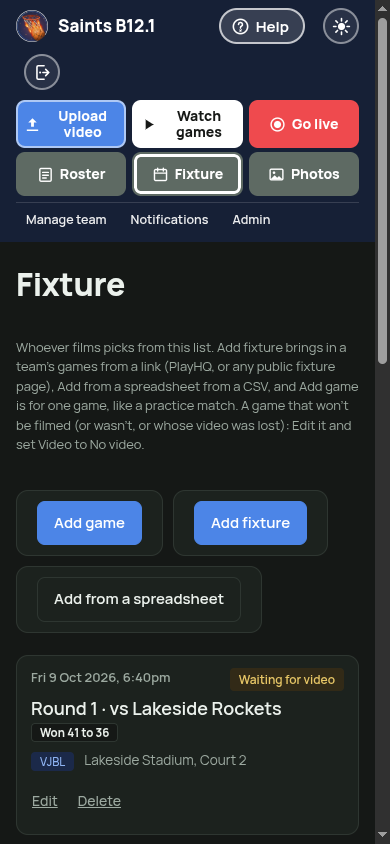
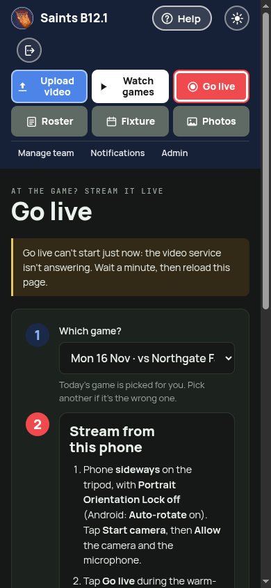

<p align="center">
  
</p>

<h1 align="center">Courtside</h1>

<p align="center">
  A private website for your basketball club's junior teams.<br>
  Stream the game, watch it back, and keep the team organised in one place.
</p>

<p align="center">
  <a href="LICENSE"></a>
  
  
  
  
</p>

<p align="center">
  <a href="INSTALL.md"><b>Set it up for your club</b></a> &nbsp;|&nbsp;
  <a href="docs/admin/README.md"><b>Documentation</b></a>
</p>

<br>


<p align="center">
  
  
  
</p>
<p align="center">
  
  
</p>

<sub>Everyone in these screenshots is made up. The example club is the Saints, and its squad is named after the 1992
Dream Team.</sub>

<br>

## Why it exists

Junior basketball families want to see the game. Grandparents can't always get there, parents miss games for work,
and kids love watching themselves play.

Posting kids' games on social media isn't the answer. Courtside gives each team its own private place for game video
and photos, seen only by the families on that team.

It was built by a parent and team manager at a VJBL club who wanted a better way to run a junior team than the way
it's usually done. It's now generic, so any club can run it.

<br>

## What everyone gets

**Families**

- Watch live, or catch up later on a phone, computer or TV
- Download the full game
- Cut highlight clips of their child and tag who's in them
- Share team photos

**The person filming**

- One tap to go live
- Pause at half time
- If the phone locks or the page closes, carry on and it's still one video at the end

**Coaches and team managers**

- The season's fixture pulled directly from PlayHQ, with final scores filling themselves in. Or from a spreadsheet, or
  typed in.
- Any other fixture page works too. Paste the link and Workers AI reads the games off it.
- A game-day roster that shares out scoring and the other duties fairly between families, follows the fixture as it
  changes, and writes the WhatsApp message for you
- The squad, the families and who can do what
- Private notes on each game

**Everyone**

- A Help page with a chat assistant, named after your team manager, that answers questions about using the site.
  It runs on Workers AI and only answers from the Help page.

<br>

## How filming works

Pick whichever suits you.

**A phone on a tripod.** Any phone on a cheap phone tripod at the side of the court. Open the website, tap Go
live, and families are watching about a second later. Nothing to install.

**An AI camera that follows the ball.** If your camera's app can stream to an RTMPS address (some apps just call it
RTMP), it works. The site gives you the two details to paste into the app.

**Upload it later.** Filmed on a phone without streaming? Upload the video when you get home. If the signal drops,
it carries on where it left off.

The phone also keeps its own recording while it streams, so a patchy signal at the stadium doesn't cost you any of
the game. If the phone drops out, locks or the page closes mid-game, carry on from the same phone. Cloudflare
Containers and Durable Objects join the pieces back into one video afterwards.

<br>

## The admin area

One admin area runs every team in the club.


- **Teams.** Start a team for the season and add its team manager. Each team closes by itself once its season and the
  time its footage is kept are over, or sooner if you choose.
- **Costs.** What each team costs on Cloudflare month by month, checked against Cloudflare's own bill, with a budget
  for each team.
- **Alerts.** Video storage, the database, emails, the nightly backup and the background jobs are all watched. You
  only get an email when something needs doing.
- **Game check.** Eight hours before each live game it checks everything that game needs is ready.
- **Platform and the Log.** Usage against Cloudflare's limits, traffic and errors from Cloudflare's analytics, and one
  log of everything that happened, by team, person or device.
- **Support.** Requests from families and access requests land in one place.
- **Documentation.** The whole site explained, with an AI assistant that answers from it.

<table>
<tr>
<td width="50%"></td>
<td width="50%"></td>
</tr>
</table>

<br>

## Privacy

Courtside makes best efforts to meet [Basketball Victoria's child safe practices](https://www.basketballvictoria.com.au/resources/child-safe-standards).

Every page, video and photo needs a sign-in, and Cloudflare guards the site before anyone gets that far.

- **No passwords.** People sign in with a code sent to their email, and only addresses a team manager has added can
  get one. Cloudflare Turnstile checks it's a person asking, not a script.
- **Each team sees only its own.** Families on one team can't see another team's games or photos.
- **Links that expire.** Videos and photos play only through signed links that run out, so a copied link soon stops
  working.
- **Protection at the front door.** DDoS protection, Cloudflare's managed firewall rules, rate limiting, and a "verify
  you're human" check for anyone not signed in.
- **Hidden from search and AI.** AI crawlers are blocked and no page is shown in search results.
- **Encrypted all the way.** HTTPS only, with HSTS.
- **Your club's own account.** The video and data live in the club's Cloudflare account, not someone else's.

More in [Privacy and child safety](docs/admin/16-privacy-and-child-safety.md) and
[Cloudflare setup](docs/admin/03-cloudflare-setup.md).

<br>

## What it doesn't do

- **Stats.** Download the game and use something like [Superstat](https://superstat.com.au) for that.
- **Live scores.** PlayHQ and My Hoops already do this well.
- **Chat.** Your team's WhatsApp group is still the place for that.

<br>

## Setting it up for your club

You'll need a Cloudflare account and a web address for the site. It runs entirely in your club's own account, so
you own everything.

[INSTALL.md](INSTALL.md) walks you through it with an AI coding assistant. It asks for your club's name, colours, logo
and email, then sets things up one step at a time, checking with you before each one.

You can be up and running in a couple of hours, or about four and a half beers.

It's affordable to run. Cloudflare is cost effective, and many of the products the site uses have generous free
tiers. What you pay depends on how many teams you have, how many games they film and how much families watch. See
Cloudflare's current pricing for [Workers](https://developers.cloudflare.com/workers/platform/pricing/) (which
covers the database and storage too), [Stream](https://developers.cloudflare.com/stream/pricing/) and
[Images](https://developers.cloudflare.com/images/pricing/).

The admin area's Costs page shows what you're really spending, checked against Cloudflare's own bill, broken down by
team and by player, with a budget for each team.

<br>

## How it fits together

Everything runs in your club's own Cloudflare account. Phones talk to one Worker, behind Cloudflare's edge protection,
and send video straight to storage on short-lived signed links.

![How the site fits together, in four layers. The club's domain: Turnstile, edge protection, rules and DNS. Workers: the maintenance Worker, Cron Triggers, the courtside Worker, and the joiner's Durable Object and Container. Data, media, AI and email: D1, R2, Stream, Images, Workers AI, Email Sending and Email Routing. Code, deploys and what the admin area reads: Artifacts, Workers Builds, Previews, Workers Logs, GraphQL Analytics and the Billing API. Phones send video straight to R2, Stream and Images, and an AI camera streams to Stream over RTMPS](docs/admin/diagrams/02-1.svg)

<br>

## For developers

Courtside runs entirely on Cloudflare's developer platform, with no servers of its own to look after. One Worker
serves the site, and Cloudflare's own database, storage, video, images, AI and email do the rest.

```bash
npm install
cp .dev.vars.example .dev.vars        # stand-in secrets
npm run dev:db && npm run dev:seed    # a local database with the example club
npm run dev                           # http://localhost:5173, already signed in
npm run check                         # types, unit tests and code rules
npm run e2e                           # browser tests on Android, iPhone and Firefox
```

Good places to start:

- [How it works](docs/architecture.md), with diagrams
- [What it does](docs/spec.md), page by page
- [Why it's built this way](docs/admin/30-technology-decisions.md)
- [AGENTS.md](AGENTS.md), the rules every change follows

Every change has to pass all 2,060 unit tests and 217 browser tests before it ships. The unit tests include two teams
going through every page to prove neither can see the other's. The browser tests run Go live on Android, iPhone and
Firefox.

Changes are tried on a test copy of the site first, then on real phones, before going live. Nothing goes live on a
game day unless it fixes something.

<br>

## Contributing

Courtside is in use every Friday night with multiple teams, so every change gets a real test.

Bug reports, ideas and pull requests are all welcome. For anything bigger than a small fix, open an issue first so we
can talk it through.

<br>

## Licence

Free to use and change under [Apache 2.0](LICENSE).
