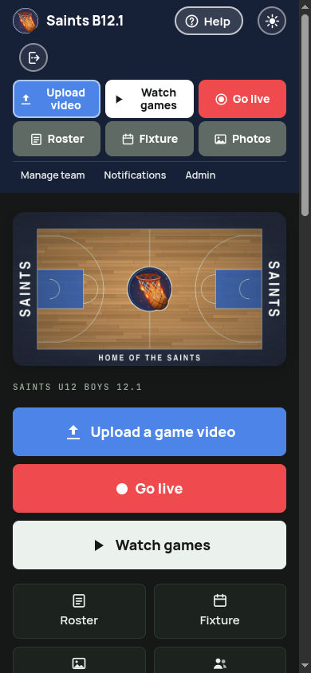
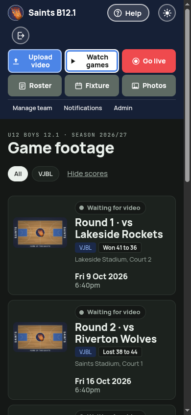
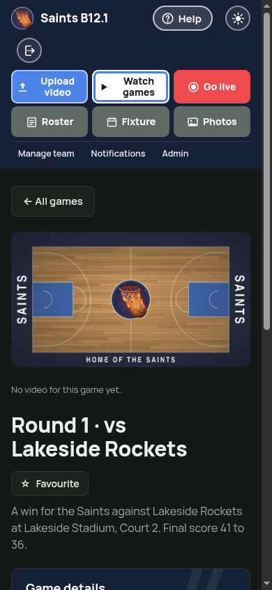
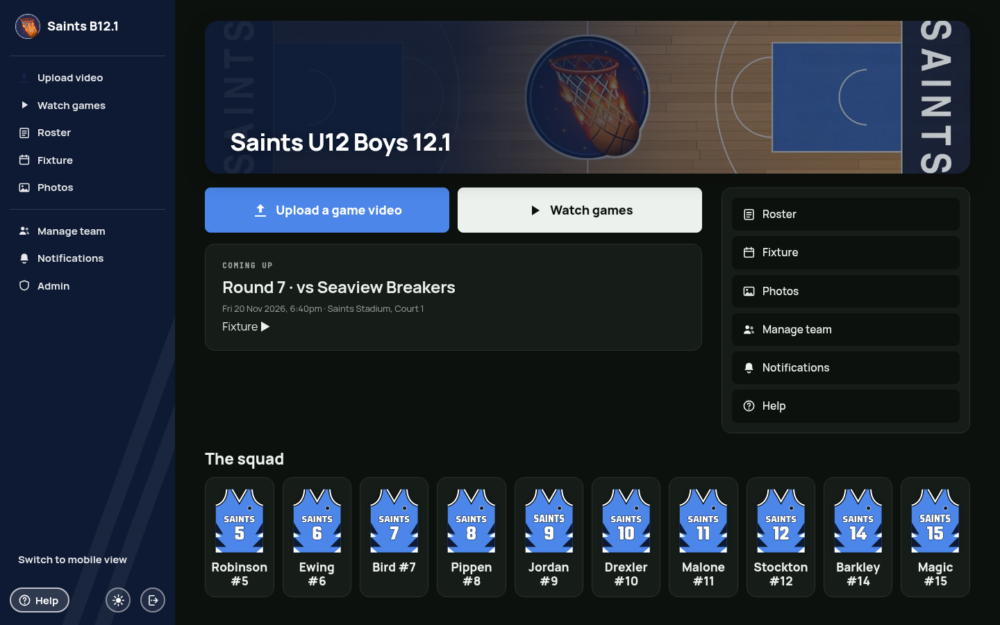
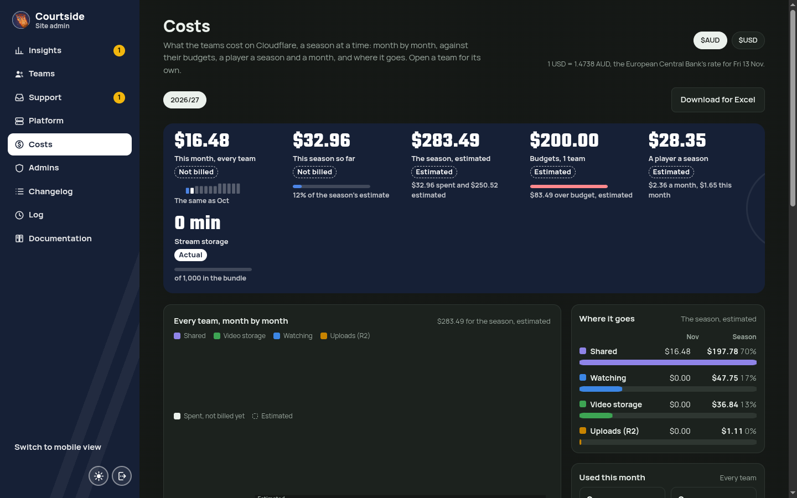
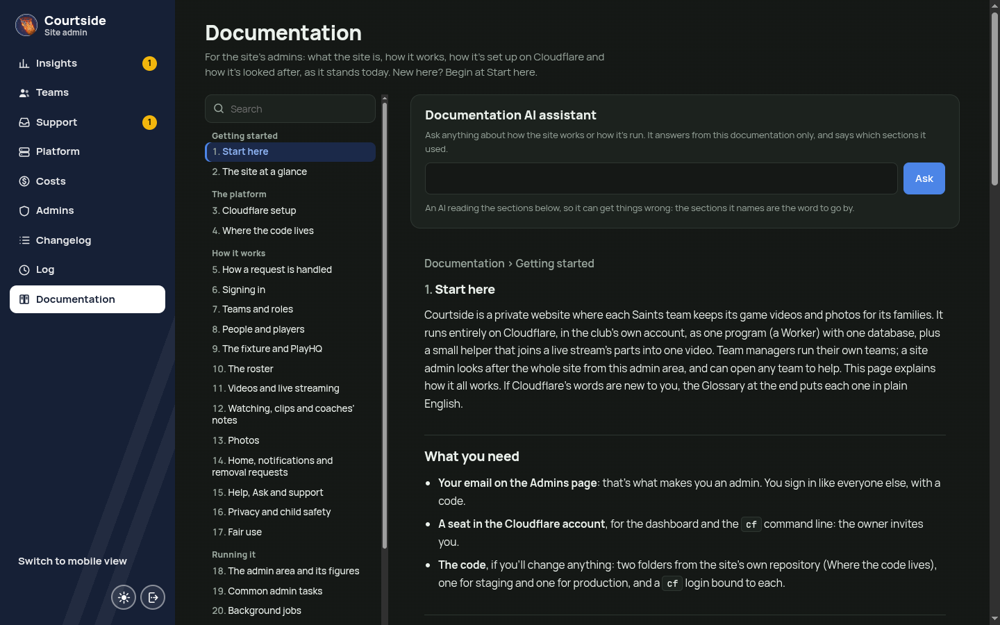
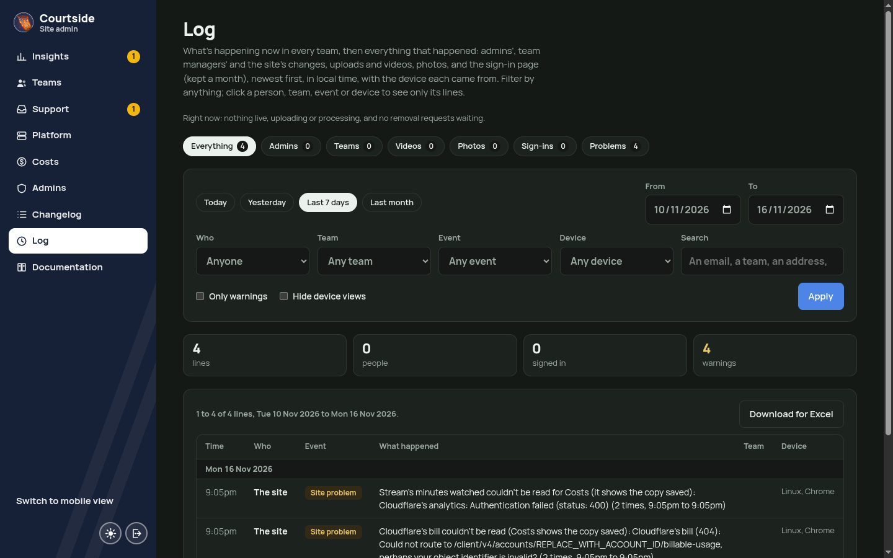
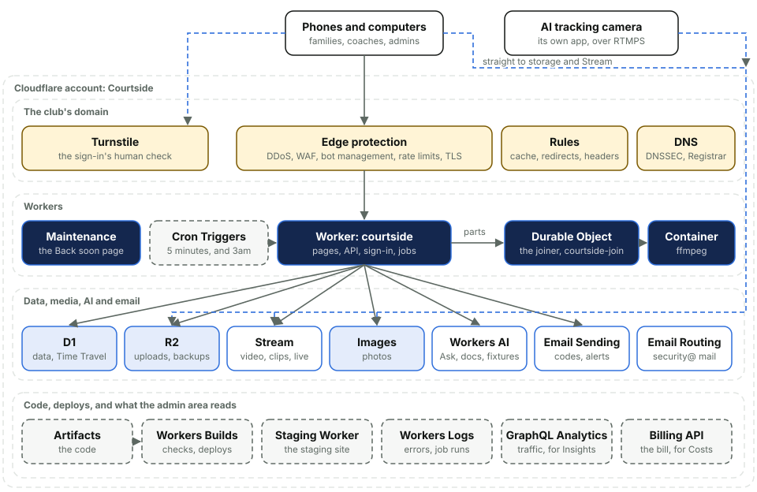

<p align="center">
  
</p>

<h1 align="center">Courtside</h1>

<p align="center">
  Private game video and team management for a basketball club's junior teams.
</p>

<p align="center">
  <a href="LICENSE"></a>
  
  
</p>

<p align="center">
  <a href="INSTALL.md"><b>Set it up for your club</b></a> &nbsp;|&nbsp;
  <a href="docs/admin/README.md"><b>Documentation</b></a> &nbsp;|&nbsp;
  <a href="docs/spec.md">What it does</a> &nbsp;|&nbsp;
  <a href="docs/architecture.md">How it works</a>
</p>

<br>


<br>

A parent streams the game live from a phone's browser, with nothing to install. Families sign in with a code sent to
their email and watch live, about a second behind the court, or later. They can download the game, cut highlight
clips and share photos.

Team managers run the fixture, the squad, the people and the game-day roster in the same place. A site admin looks
after the whole club from an admin area with costs, alerts and a log.

The club's names, colours and words live in one file, so any club can run it in its own Cloudflare account.

<br>

## Filming

You need one of these.

- **A phone on a tripod.** Any phone, on an inexpensive phone tripod at the side of the court. Open the Go live page
  and tap Go live. The phone records the game as it streams, so a dropped signal doesn't lose any of it.
- **An AI tracking camera.** Any camera whose app can stream to an RTMPS (secure RTMP) address. The Go live page gives
  the Server and Stream key to paste into the app.

No camera on the day? Film on any phone and upload the video afterwards. Uploads carry on where they stopped over a
weak signal.

<br>

## What it does

**Families**

- Watch live or afterwards, in the browser or full screen on a TV.
- Download the game in HD.
- Cut highlight clips, tag the players and star favourites.
- See and add the team's photos.
- Ask for a video, clip or photo to be taken down.

**Whoever films**

- Go live in one tap. Pause at the break and families see a Game break card.
- A locked phone or closed page doesn't end the game. Carry on streaming picks it up and the parts are joined into
  one video.

**Coaches and team managers**

- The fixture by hand, from a PlayHQ link, from a spreadsheet, or from any fixture page read by AI. Final scores fill
  themselves in.
- The squad, the people and their roles, and a game-day roster with duties and a ready-made WhatsApp message.
- Private coaching notes on each game, and a Help page that answers questions.

**Site admins**

- Insights, Teams, Support, Platform limits, Costs checked against Cloudflare's own bill, one Log and a Changelog.
- Alerts that only raise a ticket when something needs doing.
- A check 8 hours before each live game that everything it needs is ready.
- Documentation with an AI assistant that answers from it.

<br>

## Private by design

Every page and file sits behind the sign-in. Footage goes straight from the phone to the club's own Cloudflare
account and reaches only the people on the team's list. Children's game video gets a private home instead of social
media.

The example club, the Saints, and a squad named after the 1992 Dream Team stand in for real people throughout the
code, tests and docs.

<br>

## What it isn't

- **Stats or game analysis.** Download the game in HD and put it into [Superstat](https://superstat.com.au).
- **Live scores.** PlayHQ and My Hoops have them. The site takes the final score once it's entered.
- **A chat.** The team's WhatsApp group stays the team chat.

<br>

## What it looks like

<table>
<tr>
<td></td>
<td></td>
<td></td>
<td></td>
<td></td>
</tr>
</table>



<table>
<tr>
<td width="50%"></td>
<td width="50%"></td>
</tr>
<tr>
<td></td>
<td></td>
</tr>
</table>

<sub>The example Saints club from the local seed (<code>npm run dev:seed</code>).</sub>

<br>

## How it's built

One Cloudflare Worker, rendered on the server, with no other servers and no third-party services.

| Piece | Cloudflare product |
| --- | --- |
| Data | D1 |
| Uploads | R2 |
| Live video and playback | Stream |
| Joining a game streamed in parts | Containers, running ffmpeg |
| Photos | Images |
| AI helpers | Workers AI |
| Sign-in codes and alerts | Email Sending |
| Code and deploys | Artifacts and Workers Builds |

Why each was chosen, and what was turned down, is in [Technology decisions](docs/admin/30-technology-decisions.md).



<br>

## Getting started

**For a club**, [INSTALL.md](INSTALL.md) is written for an AI coding agent to follow with you. It asks for your
club's name, colours, logo, domain and email, and does each step with a dry run and your yes first.

**For a developer**:

```bash
npm install
cp .dev.vars.example .dev.vars        # stand-in secrets
npm run dev:db && npm run dev:seed    # a local database with the example club
npm run dev                           # http://localhost:5173, signed in
npm run check                         # types, unit tests, line limits and rules
npm run e2e                           # the browser suite on Android, iPhone and Firefox, in podman
```

[Setting up a computer](docs/admin/24-setting-up-a-computer.md) has the long form, and [AGENTS.md](AGENTS.md) the
rules every change follows.

<br>

## Documentation

| Read | For |
| --- | --- |
| [The Documentation](docs/admin/README.md) | Everything, in order, as the admin area shows it |
| [Technology decisions](docs/admin/30-technology-decisions.md) | What it's built on and why |
| [docs/spec.md](docs/spec.md) | What the site does, page by page |
| [docs/architecture.md](docs/architecture.md) | How it works, with diagrams and the data model |
| [docs/runbooks/](docs/runbooks/) | Cloudflare setup, staging and the maintenance page |
| [docs/child-safety.md](docs/child-safety.md) | The site against the Child Safe Standards used in Australian junior sport |
| [AGENTS.md](AGENTS.md), [docs/agent-setup.md](docs/agent-setup.md) | Working on it with an AI coding agent |

<br>

## How a change ships

1. Built on a branch off `staging`, with tests first.
2. Merged into `staging`, deployed with `npm run staging` and tried on real phones.
3. `main` is fast-forwarded and `npm run release` runs every check again. It refuses while anyone is uploading or
   streaming, then Workers Builds deploys it.

No releases on game days unless they fix something broken.

<br>

## What's where

| Folder | What |
| --- | --- |
| `src/club.ts`, `deploy.config.ts` | The club, and where it runs |
| `src/` | The Worker |
| `public/` | Page scripts, styles, fonts and the club's images |
| `migrations/` | The D1 schema |
| `infra/` | What `cf` provisions: R2 rules, Images variants, the zone's protections |
| `join/` | The video joiner |
| `maintenance/` | The Back soon page |
| `tests/` | Unit tests, `tests/e2e/` the browser suite, `tests/isolation/` two teams through every route |
| `scripts/` | Release, staging, docs and club commands |

<br>

## Contributing

Courtside is in use every Friday night, and each change goes through those games before it lands here.

Bug reports, wording fixes and pull requests are welcome. For anything bigger than a fix, open an issue first.
[AGENTS.md](AGENTS.md) has the rules, and `npm run check` has to pass.

<br>

## Licence

[Apache 2.0](LICENSE).
