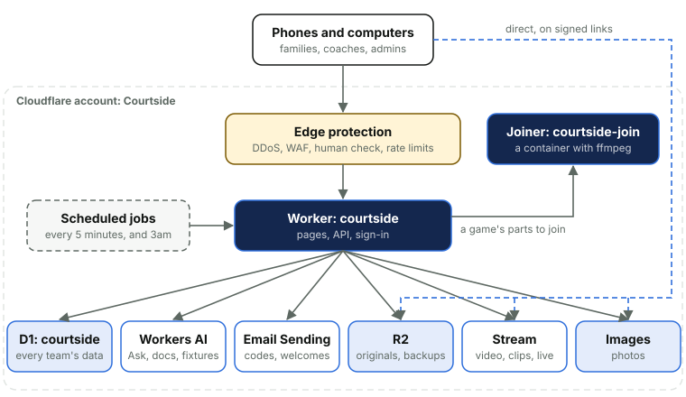

# 2. The site at a glance

*Courtside Documentation › Getting started. [Contents](README.md).*

Courtside (saints.example) is a private site where each team keeps its game videos and photos. Families sign in with a code sent to their email, watch and download the games, and add photos. Those set to Watch and film upload a game's video or stream it live from their phone's browser. Team managers run their team, and site admins look after the whole site from this admin area.

The whole thing is one Cloudflare Worker, called `courtside`, in one Cloudflare account, Courtside. It draws the pages on the server and answers a small API for the upload, Go live, Photos and Ask pages. Everything it keeps lives in Cloudflare too: the data in D1, uploaded videos in R2, playback copies in Stream and photos in Images.

It has one helper, the video joiner: a second small Worker, `courtside-join`, that runs ffmpeg in a container on Cloudflare Containers. When a live stream was stopped and carried on, it joins the parts into one video (Videos and live streaming). Nothing else runs outside the main Worker.

*Solid lines go through the Worker. Dashed lines are the phone going straight to storage on short-lived signed links, so big files never pass through the Worker.*

- **One database for every team.** Every team's rows carry its team, and every query names it.
- **Big files skip the Worker.** Phones send videos straight to R2 and photos are signed links from Images, so the Worker only ever handles small requests. The joiner is handed signed links too, never the files.
- **Nothing waits on a callback.** A job every five minutes asks Stream how each video is going, so no outside service needs a way in.
- **Everything is safe to run twice.** Jobs read the current state each time, and a phone retrying a step that already worked is told it's done.
