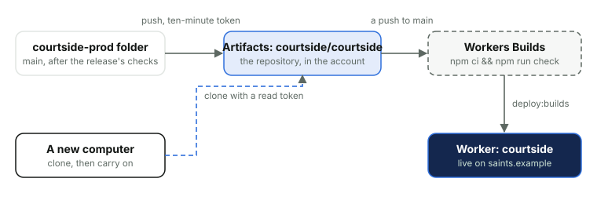
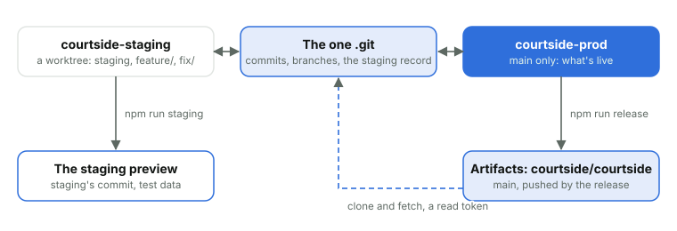

# 4. Where the code lives

*Courtside Documentation › The platform. [Contents](README.md).*

The code the site deploys from is a git repository hosted by Cloudflare itself, on **Cloudflare Artifacts**, inside the club's own account, guarded by the same login that runs the site. The project itself is published on GitHub, and the club keeps its own copy wherever it likes; what reaches Artifacts is only ever `main`, pushed by the release. **Workers Builds** watches that repository and turns a push to its main branch into a deploy.

*Only the release pushes, only to main, and only Workers Builds deploys. A read token is all a new computer needs to get the code.*

| What | Where |
| --- | --- |
| The repository | Namespace and repository both the Worker's name, `courtside`, default branch `main` |
| Its address | `https://.artifacts.cloudflare.net/git/courtside/courtside.git`: the release pushes to it by address, with a token made for the moment |
| In the dashboard | Compute, Artifacts: the repository and its branches; Workers & Pages, courtside, Deployments: each build and what it deployed |
| From the command line | `cf artifacts namespaces repos list --namespace courtside`; `cf builds list --worker ` (the tag from `cf workers scripts search --name courtside`); `cf builds logs ` |

### On a computer: one repository, two folders

*Both folders share one set of commits, branches and the staging record, so a branch made in one is there in the other. Only main ever leaves the computer.*

A computer that works on the site has one clone of the repository and two folders. `courtside-prod` is the clone itself (it holds the `.git` folder) and stays on `main`, what's live, so it's always clear what the release will push. `courtside-staging` is a git worktree of the same repository, where `staging` and every `feature/` and `fix/` branch are worked on. Both share one set of commits and branches, so nothing moves between them by push or pull: `main` in `courtside-prod` is simply fast-forwarded to `staging` for a release. Setting up a computer shows how to make them; Environments and releases how a change moves through them.

| Folder | Branch | Holds | Used for |
| --- | --- | --- | --- |
| `courtside-prod` | `main` | The repository (`.git`), the secrets files, its own `node_modules` | `npm run release` and nothing else |
| `courtside-staging` | `staging`, or a `feature/` or `fix/` branch | A worktree: its own files and `node_modules`, `.dev.vars`, links to the secrets files | All the work: tests, `npm run dev`, `npm run staging` |

### Getting at the code

Artifacts takes no passwords and no long-lived keys. Each fetch or push uses a token made for the moment: the release makes a write token that lasts ten minutes and revokes it straight after, and a person fetching by hand makes a read token the same way (`cf artifacts namespaces tokens create courtside --repo courtside --scope read --ttl 600`). The token reaches git through the environment, never on a command line or in a config file, so nothing is left on a computer that could push later. Only `main` is ever pushed, and only by the release; it's never forced, so a commit on Cloudflare that a computer doesn't have refuses the push.

### What Workers Builds does

| Setting | Value | Why |
| --- | --- | --- |
| Watches | `main` only; other branches build nothing | Staging is deployed from the computer; only production goes through Builds |
| Build command | `npm ci && npm run check` | The same checks the release ran, again on Cloudflare: types, every unit test, the line limits and the rules |
| Deploy command | `npm run deploy:builds` | Deploys with the newest changelog line as the deployment's message and the commit as its tag, so the dashboard and the Changelog page agree |
| Deploys with | The token `courtside-workers-builds` | A token that can deploy this Worker and nothing else; the Worker's secrets stay as they are, as a deploy sends none |
| Build caching | Off | Each build starts clean, so a stale cache can't make a build pass that shouldn't |
| Also deploys | `courtside-maintenance` and `courtside-join`, each from its own trigger on `main` | Each builds only when its folder, its tests or the deploy step change, runs the same checks and deploys with the same message and tag; the maintenance page is deployed on or off as it is |

The release follows the build to its end and only calls the deploy done when the live deployment carries the changelog line. A build that fails deploys nothing: the site stays as it was, the release says what failed, and the fix goes through staging and the release again. If a build needs running again by hand, `cf builds create --branch main` does it; the trigger id is in the Cloudflare runbook. Builds can't run the browser tests, which need phones and cameras, so the release runs them before it pushes.

### If a computer is lost

What's live is never lost with it: the repository on Artifacts has every commit of `main`, and a new computer clones it with a read token and carries on (Setting up a computer). Only `main` is pushed, so work not yet released (on `staging` or a branch) is on that computer alone: release it, or at least merge it into `staging`, before a computer is retired.
