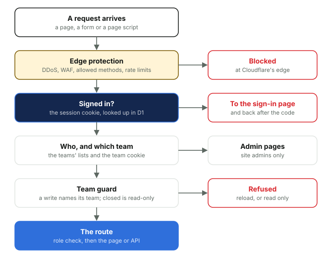

# 5. How a request is handled

*Courtside Documentation › How it works. [Contents](README.md).*

Every page, form and page script call goes through the same checks, in the same order, before the page itself runs. The pages are plain HTML drawn on the server, with small scripts for the pages that need them (uploading, Go live, Photos, Ask) and no framework.

*Each check happens in order; the first one that says no answers the request. A page's own route then checks the person's role.*

- **Before the sign-in:** a write from another website is refused, and only the sign-in pages, their few files, the opening spinner and security.txt answer without a session. Even the site's static files need one.
- **The current team** comes from a cookie, so every team shares the same addresses. Someone in one team just has it; someone in several picks with Switch team.
- **Every write names its team.** Each form and page script says which team it was made for, so a page left open on one team can never save into another. A closed team is read-only.
- **Errors** come back as a plain page (or a JSON answer for the API), are logged with their team, and every server error is counted by the hour for Platform's alert.
