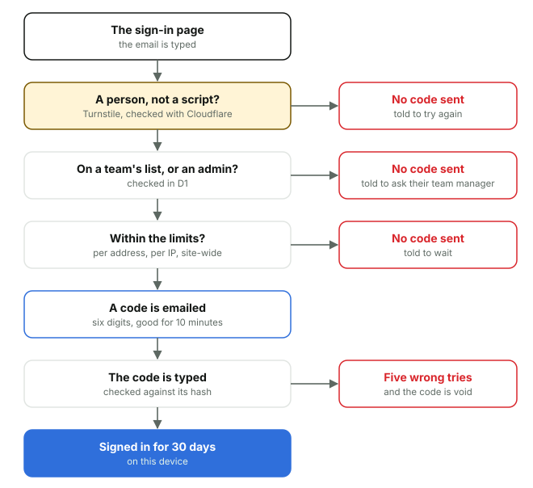

# 6. Signing in

*Courtside Documentation › How it works. [Contents](README.md).*

There are no passwords. Someone types their email, gets a six-digit code by email, types it, and stays signed in for 30 days on that device. A code is only ever sent to an address on a team's list, or a site admin's, and only once Cloudflare Turnstile says a person, not a script, asked: the check is invisible unless Cloudflare wants a tap, and if Cloudflare can't be reached the code still goes, with the limits below holding.

Someone not on a list can tap **raise an access request here** at the foot of the sign-in page: their name, their team and their email, behind the same Turnstile check, open one of the site's own tickets on the support desk (Access request: the name, the team), emailed to the admins. An address gets one open request at a time, an address already on a list is told to sign in, and the whole site takes ten an hour. Nothing is ever emailed to the address typed: an admin adds it to the team's list (Manage team) and resolves the ticket, and the person signs in as everyone does. The ticket shows who asked (their name, team and email, with Copy email); to write to them, an admin uses their own email.

An address Email Sending won't send to (its emails bounced, or its owner marked one as spam, so it's on Email Sending's suppression list: a day for a short bounce) can't get a code. The sign-in page says the address is bouncing and to ask the team manager for another, not to try again, and the admins get one ticket (Emails to the address are bouncing) while it's open. Add another address for them, or lift it sooner on Email Sending's suppression list.

*Nobody gets a code unless their email is on a team's list (or they're a site admin). Sessions are per device, so a phone and a computer each sign in once.*

| Limit | Why |
| --- | --- |
| 10 codes an hour for one address (then a 15-minute wait, again while the hour still has 10), and 20 a day (then a day's wait) | Stops one inbox being flooded, and code after code being guessed. A team manager can end the wait from Manage team |
| 15 wrong codes a day for one address, then a day's wait | However many internet addresses try, a code can't be guessed. A team manager can end the wait |
| 30 codes in 15 minutes from one internet address | Stops one device asking for everyone's codes; generous enough for a gym's Wi-Fi |
| 10 unknown addresses in 15 minutes from one internet address | Makes guessing who's on a list slow |
| 200 codes an hour across the whole site | Past it, codes pause and the admins get a Sign-in flood ticket |
| 30 wrong codes an hour from one internet address, and five a code | Makes guessing a code hopeless |

The session's token lives in a secure, HttpOnly cookie, and only its hash is kept in D1, with the device's name and, once its first page says (a second cookie the page sets), which view it uses: the mobile view, or the desktop view on a computer. The Log says when that's first seen or changes, and Insights sets mobile against desktop, counting each device once a week. On every request the Worker checks the teams' lists again, so taking someone off a list works straight away. When a session has under four hours left, Go live asks for a new code first, so it can't run out part way through a game.
