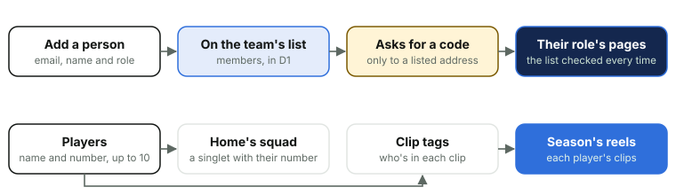

# 8. People and players

*Courtside Documentation › How it works. [Contents](README.md).*

Manage team is where a team manager runs the team's people. Who's on its list decides who can sign in and what they see, so the list is the site's whole idea of who's allowed in: there's nothing else to set up for a new parent.

*Taking someone off the list works straight away: their next page checks it. Players are the squad only, never people who sign in.*

### People

- **Add a person**, one row at the foot of People: their email, their name and their role (Watch and film unless another is picked). An email already on the list never changes that person, and a name with no email, or an address that isn't one, is refused with nothing added. There's no limit on people: the site signs people in itself, so nobody costs a seat.
- **Add from a spreadsheet**, under Add a person: a template to download (`/members/sample.csv`: Name, Email, Role, with made-up people), filled in and saved as CSV, read by `members-csv.ts`. Columns in any order and case; a blank role is Watch only, and the usual wordings of each role are understood. Every row is shown first: new, on the team already (left exactly as they are), or a problem with its row number (no email, not an email, a role it can't read, a repeat). The new people are then added as Add a person adds one and logged the same way; 200 a sheet at most.
- **Who films** needs Watch and film (or Coach or Team manager): Watch only can't upload a game's video or Go live. People says so beside Add a person, and the team manager's Help says it where it explains roles and video duty.
- **Names and roles** change in place: a row's Save shows only once something on it differs from what's saved. A team always keeps at least one team manager, and a team manager can't remove themselves.
- **Removing someone** works at once: every request checks the list, so their next page no longer lets them into this team.
- **Waiting to sign in** appears at the top while anyone on the team is held by the sign-in's limits (too many codes, or too many wrong ones), with when they can ask again and **Let them sign in**, which ends the wait now.
- **Who's using the site** counts the people by role and by when they last opened the site (in the last 7 days, 8 to 30 days ago, longer, or not yet), from each person's Last seen, written at most hourly. The list sorts by name, role or Last seen.
- **Site admins** open a team through a hidden membership that Manage team doesn't list and a team manager can't change. **View as** lets an admin try the team as Watch only, Watch and film or a coach for that browser session; what they do meanwhile is recorded as their own. Coaches' notes stay out of sight under View as coach: they're the coaches' own.

### Players

The squad: a name (a first name or a full name, as the team manager likes, in letters of any language with spaces, hyphens and apostrophes) and a jersey number, at most 10 players, each number one current player's. Players never sign in. Home shows the squad as singlets with their numbers, highlight clips are tagged with the players in them, and at the season's end each player's clips are listed under their name.

### Getting the team ready, and the end of the season

- **The setup checklist** sits at the top of a new team's Manage team: at least 7 players in the squad; someone set to Watch and film, the coach and a team manager; the fixture in; and the roster made. It goes once all four are done, and the admin area's Teams shows each running team's "3 of 4" and what's left.
- **End of season: keep it all**, at the very bottom, closed teams too: the day the season's footage goes, every game's HD video to download with **Get every HD copy ready** (Stream makes a game's HD copy the first time it's asked; this asks for them all at once), each player's highlight clips under their name, and links to save the photos and the roster.

| Table | Holds |
| --- | --- |
| `members` | Each person on each team: email, name, role, Last seen, whether they hide scores, and whether it's an admin's hidden membership |
| `players` | The squad: name and number |
| `clip_players` | Who's in each highlight clip |
