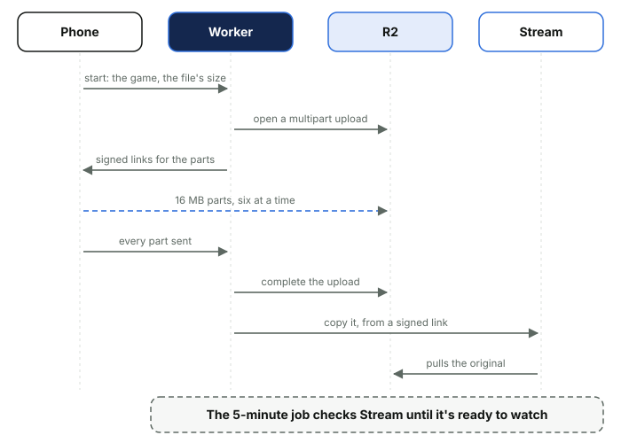
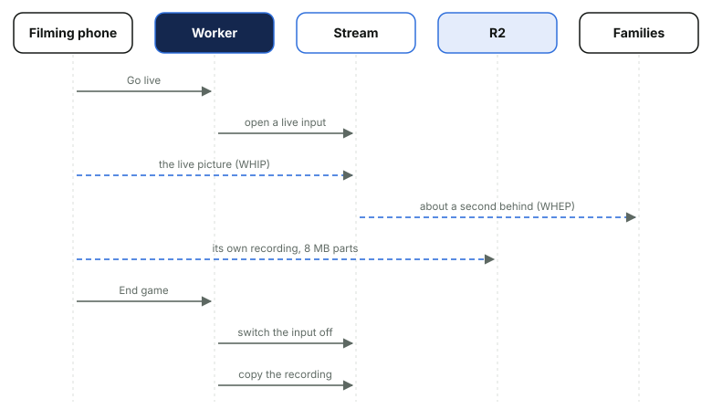
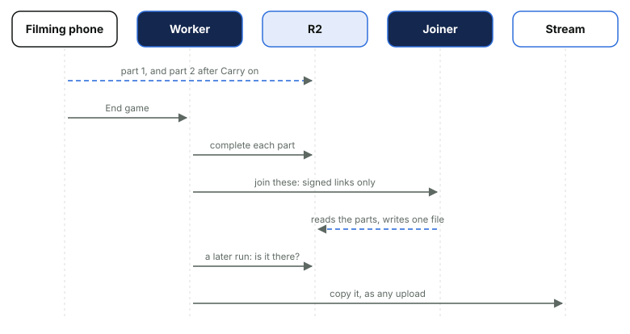

# 11. Videos and live streaming

*Courtside Documentation › How it works. [Contents](README.md).*

Each game has one video. It either comes from a phone's camera, uploaded after the game, or from a live stream, which the filming phone records as it goes (or, from an external app, which Stream records).

### Uploading

*The video never passes through the Worker: the phone sends 16 MB parts straight to R2, and a dropped connection carries on where it stopped.*

Stream makes the playback copy, and the 5-minute job asks it how it's going: about 20 to 25 minutes later the game is ready to watch, and its HD MP4 download about 10 to 15 minutes after that. The original in R2 is deleted after 30 days, as Stream has its own copy by then.

### Live streaming

*Stream can't record a stream sent from a browser, so the phone records the game itself and uploads it as it goes. That recording becomes the game's video, at full quality whatever the signal was like.*

- **Go live** runs in Safari or Chrome, never the Home Screen app, where a locked phone can lose its microphone.
- **Which game:** the one being filmed, else today's next game still to finish (one starting within half an hour before one under way that nobody is streaming), else the next one coming up.
- **Pause** (the warm-up, half-time) shows families a Game Break card and leaves the break out of the recording.
- **The camera stopping ends nothing.** The phone locks, a call comes or another app takes the camera: families see the Game Break card and the recording waits (on a laptop, another tab does the same). A camera that comes back carries on by itself. One the phone switched off for good comes back with **Resume camera**, a tap on every phone, as an iPhone starts a camera only from one. It's the same video, with the gap left out.
- **Why a new camera can take over:** the phone records the preview drawn onto a canvas and the microphone through Web Audio, not the camera itself. The recording is always landscape, whichever way the phone was held when the camera started. A recording that hands over nothing for 20 seconds says so on the camera screen with Reload and carry on, and takes the warning back if it carries on by itself.
- **Only End game ends a stream, and it's final.** Under a minute recorded (pauses left out), or nothing recorded at all, counts as a test and is thrown away, so a try at home leaves the game free to stream. On a weak signal the page says how many minutes of the game are still only on the phone.
- **Watching** uses short-lived signed links, so only signed-in members can play anything. A picture that freezes asks whether the game has ended: if so the page shows the Full time card (the Game Break card's look) within seconds, otherwise "Live stream will resume shortly". The player then asks for the picture again by itself every 15 to 20 seconds, so a stream that's carried on comes back without a tap; the card's line to refresh after five minutes is a last resort.
- **The live bar:** while a game is streaming, a red LIVE NOW bar with Watch live runs along the top of the team's pages (not Home or Watch games, which have the Live now card, nor Go live or that game's page). It reads only the database: a stream the 5-minute job saw sending in the last 8 minutes and not ended.

### If the page closes mid-game

A closed tab, a phone that restarts or a flat battery doesn't lose the game. The same phone, opening Go live again, is offered two buttons, at the top of the card and on screen without scrolling.

- **Carry on streaming** puts the live picture back for families and keeps recording, as the same game's video. Only the phone that was filming is offered it. It first makes sure the closed page has really stopped, which can take up to two minutes, with a countdown.
- **Save what was recorded** ends the game there, with whatever reached R2 (it waits, asking again every 20 seconds, while a part arrived in the last two minutes or Stream still sees a phone). If nobody taps either, the 5-minute job saves it by itself: half an hour after End game with nothing more from the phone (it had only its last parts to send), or, where the page died mid-game with no End game, after 12 quiet hours, so a phone has the night to reach Wi-Fi or better signal. Each save's outcome is a `live_save` line in Workers Logs.
- **What the closed page hadn't sent is kept.** What a page has recorded but not yet sent sits on the phone (IndexedDB, `golive-store.js`). The reopened page sends it while the game streams again, and keeps it through a second close too (`golive-kept.js`).
- **Each start is its own part.** The recording after Carry on is a new part of the same video (a segment: a row in `recording_segments`, with its own upload in R2 beside the first). A game can have several.
- **End game** completes every part. A part nothing reached R2 for is dropped, and if only one part has anything in it, that part is the video and nothing needs joining.
- **It takes about ten minutes longer.** A carried-on game is ready to watch about ten minutes longer after End game than one streamed in one go, as its parts are joined first.

### How the parts become one video

*No run waits for a join. One run asks for it and a later run finds the joined file in R2; the parts are deleted only then.*

The parts are joined by the **video joiner**: a second small Worker, `courtside-join`, that runs ffmpeg in a container on **Cloudflare Containers**. It's the one piece of the site that isn't the main Worker, as a Worker can't run ffmpeg. The site hands it short-lived signed links to the parts in R2 and one to write the joined file to, and nothing else: no team, no names, no database.

- **Asked for, not waited for.** A join takes a few minutes (two 590 MB parts took under three), so the 5-minute job asks for it and moves on. Every later run looks in R2 for the joined file first. Once it's there it becomes the video's original, the parts are deleted, and Stream is asked for its copy as for any upload. The Log says so with a `video_joined` line: how many parts, how big, how long it took.
- **Nothing is deleted on trust.** The parts go only once the joined file has been read back from R2, and a joined file far smaller than its parts is refused rather than saved.
- **A join that fails**, or is lost because the container restarted, is tried again every ten minutes. After six tries the site stops: the team manager gets **Keep the first part** on the game's page, the Log's Problems has a line, and the admins get the Video joiner alert as urgent. Keep the first part clears it.
- **The picture isn't touched.** ffmpeg copies each part as it is into one transport stream (a cut-off last frame dropped, each part's own decoder settings carried along, one clock), then wraps that as the MP4. Nothing is encoded again, so the video is exactly what the phone recorded. (Parts that aren't H.264, which only a test browser records, are joined one after the other instead, still as they are.)
- **Tested every night.** The 3am job has the joiner join two small test files that ship in its image, so a broken joiner is known before a game needs it (Background jobs).

### From an external app (RTMPS)

An AI tracking camera films through its own app, so the page can't have the phone's camera. On the Go live page, below the red Start camera button (don't tap it), is a smaller green **Use an external app instead**. It only helps if the camera's app can stream to a custom RTMPS server with a stream key. XbotGo and Trackd are two examples of many, as they stood at the time of writing: XbotGo's app can, Trackd's can't yet, so a Trackd game is recorded in its app and uploaded afterwards. Makers change their apps, so Help says to check.

- **Choosing it** sets the game to the app and shows its RTMPS server and stream key to copy. The key is that game's password: it's shown only there, to people who film, and never logged. Going back to the phone's camera works until the app has streamed. Who chose it, went back or stopped it is in the Log.
- **Stream records it**, so there's no recording on a phone and no original in R2: Stream's copy is the only one, and it's only as good as the signal was.
- **Families watch** in the same player as a saved video, about half a minute behind the court (a camera stream is about a second behind). Home, Watch games and the Log's Right now show it the same way.
- **Saving:** after End game, or by itself 20 minutes after the app stops. Stream finishes its recording 10 minutes after the app stops sending, and the 5-minute job then makes it the game's video. A gap under 10 minutes stays one recording; after a longer one the longest part is the video and the others are clips. Under a minute is a test.
