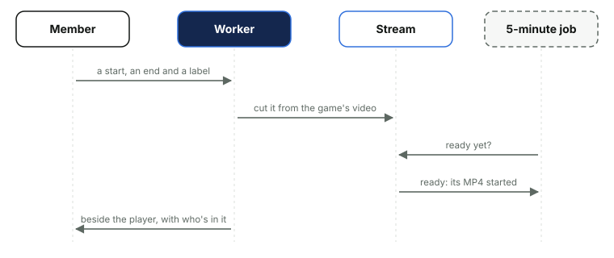

# 12. Watching, clips and coaches' notes

*Courtside Documentation › How it works. [Contents](README.md).*

### Watch games and a game's page

- **Watch games** lists the season's games oldest first, upcoming ones at the bottom, filtered by competition, each card showing its state: ready to watch, processing or uploading, upcoming, waiting for video, or No video. A video a member hasn't opened is tagged New for 21 days (not for whoever uploaded it), from who opened what, kept 30 days. Each member's starred games and clips sit at the top.
- **A game's page** plays the video through a signed link that runs out, remembers how far in the phone or computer got (Carry on from), and has Watch full screen for a computer on the TV.
- **Download HD video** is Stream's HD MP4, made the first time anyone asks (the page says it's being prepared). Every download is logged with who took it, a clip's and a photo's too, and the log is kept two years. On an iPhone or iPad a clip's Save opens the share menu so it lands in Photos; a whole game, 1 to 3 GB, goes to Files with how to move it to Photos.
- **Team managers** can move a video to another of the team's games without one, and delete it: it leaves the site at once, but its media is kept a day in case that was a mistake.

### Highlight clips

*A clip is its own video in Stream, deleted with the game's video or by a team manager. Its maker or a team manager can change who's in it.*

- **Making one:** any member marks a start and an end while watching, 3 seconds to 5 minutes apart, and gives it a label; a game has 50 clips at most. Stream's clip API isn't on the Worker's binding, so the Worker asks Stream's REST API, with a token that can only use Stream (`STREAM_API_TOKEN`).
- **Ready:** each 5-minute run asks Stream how processing clips are going; a ready one has its MP4 started, so it can be downloaded, and a failed one is marked failed.
- **Who's in it:** players ticked when it's made, or later by its maker or a team manager. At the season's end the pack lists each player's clips under their name.
- **Removing:** only a team manager deletes a clip; anyone else, its maker included, asks for it to be removed. Deleting takes Stream's copy first, so a failure leaves the clip to try again, and a game's clips go with its video.

### Coaches' notes

Private notes on a game, for members whose role is exactly Coach: not Watch only, Watch and film or team managers, and the panel says so. A note can be at a time in the video, or about the whole game. Either coach can delete any coach's note, and a game's notes export to Excel, in the order the page shows them.

| Table | Holds |
| --- | --- |
| `clips` | Each clip: its video, start and end, label, Stream copy, state and maker |
| `favourites` | Each member's starred games and clips |
| `downloads` | Every game's video downloaded, with who took it: kept two years |
| `media_downloads` | Every clip and photo downloaded (each photo in a zip too), with who took it and the file it came as: kept two years |
| `video_views` | Who opened which video, for the New tag: kept 30 days |
| `coach_notes` | The coaches' notes, with their time in the video if they have one |
