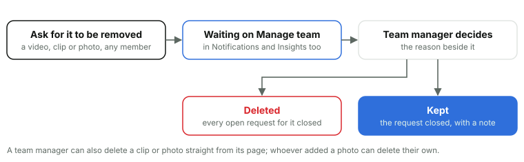

# 14. Home, notifications and removal requests

*Courtside Documentation › How it works. [Contents](README.md).*

### Home

The landing page after sign-in: the court picture with the team's name, big Upload video and Go live buttons for those who film, Watch games, then the Roster, Fixture, Photos and Help, the latest game with its score, what's coming up, and the squad. Each game's line on its page ("The Saints take on Northside 2 at Saints Stadium, Court 1.") comes from templates, not AI, so nothing is made up about the players and a game always gets the same line: the club's, or the team's own for any group its team manager changed (Manage team, Game lines, `game_lines`), checked as they're saved and in the Log. Team managers see when the season's videos and photos go, pointing to the end-of-season pack.

### On a computer, and on the Home Screen

- **The desktop view** is one stylesheet (`public/desktop.css`) whose every rule sits inside one media query: a window at least 1024px wide, a pointer as fine as a mouse, and real hover. A phone or a touch tablet fails it and keeps the phone's view to the pixel, and so does a narrow window on a computer. The page's HTML is the same either way; the top bar becomes a sidebar and Go live is left out, as nobody streams from a desktop.
- **Switch to mobile view** on a computer turns the desktop view off at any width, and Switch to desktop view turns it back on. The choice is kept on that device in a cookie for 30 days (`public/view.js`), which also tells the site which view each device uses: the Log notes it when it's first seen or changes, and Insights counts them.
- **On a phone's Home Screen** the site opens full screen like an app, on a green launch screen. A page can be pulled down to refresh, except mid Go live, mid upload or while photos are being added. Go live opens in Safari or Chrome instead, as a phone locked for a moment in the Home Screen app can lose its microphone for good.

### Notifications

For team managers: what's uploading, processing or waiting for its HD MP4 now, and the last 30 days of uploads, videos ready or failed, HD copies ready, clips and removal requests, refreshed every 2 minutes. It's read from the team's activity feed (`activity`, kept 90 days). The admin Log shows the same for every team: what's happening in its Right now, and the feed as lines in its Videos and Photos.

### Removal requests

*Families can always ask; only a team manager decides. A request stays on record even after what it named has gone.*

Any member can ask for a video, a clip or a photo to be removed, with a reason: a family whose child shouldn't be shown, say. The team manager sees it on Manage team (a photo's request shows the photo) and in Notifications, and the admins see every team's waiting requests on Insights. Deleting closes every open request for it; keeping closes them with the team manager's note. Requests are kept even after what they named has gone.

| Table | Holds |
| --- | --- |
| `removal_requests` | Requests to remove a video: who asked, why, and how it was settled |
| `clip_removal_requests` | The same for clips |
| `photo_removal_requests` | The same for photos |
