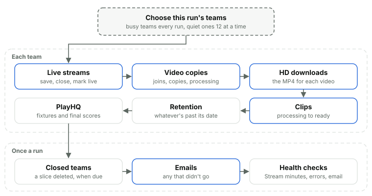
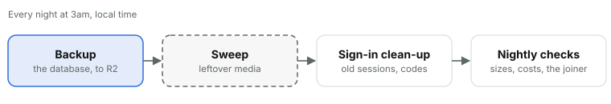

# 20. Background jobs

*Courtside Documentation › Running it. [Contents](README.md).*

Two scheduled jobs keep things moving: one every five minutes, and one at 3am local time. Every step reads the current state, so running one twice does no harm; every record is processed even if one fails; and one team's or one step's failure never stops the rest. A run's failures are thrown together at its end, so the run shows as failed in Workers Observability; each one is also a problem in the admin Log, under the team whose step it was (the same one every run counts on one line). Each job watches the other: an alert is raised if the 5-minute job hasn't run for 15 minutes or the 3am job for 26 hours.

### The 5-minute job

*Busy teams (a game today, something streaming or processing) get a turn every run; quiet teams take turns, 12 a run, so every team is reached within the hour. One team's or one step's failure never stops the rest.*

**Whose turn it is.** One query reads which teams are busy (a game today, a live stream open, a video or clip being processed, an HD copy awaited). Every busy team runs every run; the quiet teams take turns, 12 a run, so each is reached within the hour. A different team goes first each run, so one busy team can't use up the run's outside calls. With 12 teams or fewer, every team runs every five minutes. A deleted team's leftover work takes one turn a run, after everyone else's.

**Each team's steps, in order.** A running team gets them all. A closed team's streams, videos and clips still finish and its retention still runs, but there's no PlayHQ or scores. A team being deleted has no steps of its own.

| Step | What it does | A run |
| --- | --- | --- |
| Live streams | For each open stream: notes when the game is live (LIVE NOW and the activity feed), saves a recording whose phone stopped long ago from whatever reached R2, saves an external app's stream from Stream's recording once it's over (the longest part as the game's video, others as clips), and closes a live input that was set up but never used a day after Go live was last opened for it. | Every open stream |
| Stream copies | A video uploaded to R2 that Stream hasn't been asked to copy yet is asked for again. | 12 videos |
| Joins | A live stream that was stopped and carried on has its parts joined into one video first, by the video joiner (Cloudflare Containers). A run looks in R2 for the joined file: there, it becomes the video, the parts are deleted and Stream is asked for its copy. Not there, the joiner is asked how it's going, and asked to begin again if ten minutes have passed since the last try. No run waits for a join. After six tries the team manager is handed Keep the first part and the admins the Video joiner alert. | Every game waiting |
| Processing to ready | Asks Stream how each processing video is going: ready stores the duration and asks for the HD MP4; a Stream error marks it failed and raises a ticket; a copy Stream has lost is requested again from the original. A stream under a minute is thrown away as a test. | 12 videos |
| HD downloads | For ready videos without a confirmed HD MP4: ready means note the time (Notifications shows it); none means ask Stream again. | 5 videos |
| Clips | Processing clips become ready, and get their MP4 started, or failed. | A batch |
| Retention | Deletes videos past their date (the Stream copy, the R2 original, then the row softly), cancels uploads abandoned for 7 days, and takes the media of videos a person deleted once their day of grace is up. Drops download log rows older than 2 years, activity older than 90 days and who-watched-what older than 30 days. | 15 of each |
| Photos' retention | Photos past their season's date go, Images first. | 50 photos |
| Tombstones | Rows deleted over 90 days ago, their media long gone, go for good with their children, unless something kept names them: the download log or a removal request keeps a video, a request or a favourite keeps a clip, a kept video keeps its game. | A few rows |
| PlayHQ fixtures | Each fixture still being checked is read again once its last check is 8 hours old; a tournament every hour while it's on. New games are added, changed ones updated, dropped ones marked gone (never deleted). Checks stop six weeks after the last game. | Those due |
| Final scores | PlayHQ games are asked for their score from half an hour after tip-off: every run until 3 hours after it, then hourly, until 3 days after tip-off (a fixture's Check now asks at once). A final score ends In progress straight away. Only a FINAL status with both scores is entered, and never over a score already there. | 4 games |

**After every team's steps**, the run sets to No video every running team's games nobody uploaded or streamed in the week after tip-off (one read for every team: no video of any kind, none a person deleted, and no live stream that was used; a Go live only opened is closed; one a team manager set back to Video waits a week from then, and a week's or a PlayHQ fixture's Video switch leaves the site's No video alone; a line in the Log by the site), deletes a slice of any closed team whose date has passed (media first, 20 calls a run, then the rows), sends any ticket email that didn't go (one failing again is logged, never failing the run), records that the run happened, and runs the checks below. Steps share one budget of 200 calls to outside services a run; work past it isn't a failure, it's counted as deferred and the next run picks it up.

| Check, every run | Warns | Urgent | Clears |
| --- | --- | --- | --- |
| Stream's minutes left (at most hourly) | Under 400 minutes | Under 100 | 450 or more |
| Server errors this hour and last |  | 10 or more | Under 3 |
| Emails waiting (a ticket's or an alert's) |  | One waiting over an hour | None waiting |
| The month's emails, of the 3,000 included | 2,400 | 2,850 | Under 2,300 |
| The 5-minute job itself |  | Six failed runs in a row (a ticket too) | A good run |
| The 3am job's heartbeat |  | No run for 26 hours | Its next good run |
| The video joiner (as a join gives up) |  | A game's join given up on after six tries | Keep the first part, on that game |

### The 3am job

*Each step stands on its own: a failure is reported on Platform and raises a ticket, and the next night runs again.*

Cron triggers are UTC only, so two fire, 16:00 and 17:00 UTC, and the job runs on whichever is 3am in the club's time zone that day. The backup goes first, so a run cut short still has it; every later step runs even if an earlier one failed, and any failure fails the night.

| Step | What it does |
| --- | --- |
| The backup | A plain SQL copy of the whole database (every table, then every row, parents first, then the indexes) to `backups/d1/courtside-.sql` in the originals bucket, kept 14 days by the bucket's rule. The sign-in's tables go without their rows, so a copy holds nothing anyone could sign in with. Each file is checked: a row line for every row read, R2 holding exactly those bytes (a SHA-256 on the way in, the size read back), no key table (teams, members, games, players) emptied since last night, and no more than half the rows gone. The counts and checksum are saved on the file. Platform shows the last backup and warns when it's missing, a day old or failed. |
| The sweep | Reads every team's records in one trip, then lists Stream and Images and deletes what no row points to any more: Stream videos and clips, live inputs of streams no longer open (an external app's is kept while a recording made from it is on the site), and images no photo points to, each once it's two days old (a week for staging's labelled test things). It deletes nothing and fails loudly if most of Stream or Images looks unknown, a sign the database is wrong, or if any team's records can't be read. At most 20 deletes a night. How it went is written to `backups/sweep.json` for Platform. R2 needs no sweep: its rules delete originals after 30 days and unfinished uploads after 7. |
| The sign-in's leftovers | Sessions that are over (signed out, or past their 30 days), codes older than a day, holds that have lapsed, sign-in events and problems older than a month (31 days) and the devices-a-week tally past 12 weeks are deleted. |
| Photos against Images | The sweep's own count of images stored, against the 100,000 included: 80,000 warns, 95,000 is urgent, under 78,000 clears. |
| The database's size | From the database's own answer: 4 GB of the 10 it can hold warns (5 GB are included in the plan), 9 GB is urgent, under 3.8 GB clears. |
| Server errors | Counts older than two days are forgotten; the hourly check above keeps the last two hours. |
| Team budgets | Each running team's season so far and estimate against its budget, read as Costs reads them (Stream's minutes watched and the day's exchange rate): over budget so far or estimated to go over is the Team budgets alert. |
| The video joiner | The joiner is asked to join two small test files that ship in its image, which wakes its container and runs ffmpeg end to end. Joined: the alert says how many seconds it took. Not answering, or the join failed: a warning, so it's known before a game needs it. An urgent alert from a game's join is left as it is. |
| AI models | The site's one model (Ask Virtual Team Manager, the Documentation assistant, reading fixture pages) against Cloudflare's catalog: a planned retirement warns, two weeks before it (or a model gone from the catalog) is urgent, a current model clears. |
| How the night went | The 3am job's own alert: urgent the night its backup, sweep or deletions fail; a good night clears it. Then the 5-minute job's heartbeat is checked. |
