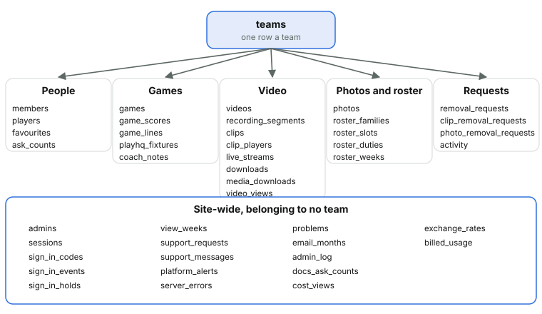

# 21. The data

*Courtside Documentation › Running it. [Contents](README.md).*

D1 holds everything but the media itself. Times are kept in UTC, apart from a game's start and a photo's date, which are local time as people see them. Changes to the database are numbered migrations, applied to the live database before the release that needs them, and never edited afterwards. Each adds beside what's there rather than changing it in place: the live site keeps running on the database between the migration and the release, so a new value or column goes in next to the old, the release reads either, and a later migration drops the old once the release is known good.

*Every team table carries a team_id, and every query names it, so one team can never read another's rows. The site-wide tables belong to no team.*

| What | How long it's kept |
| --- | --- |
| Videos, clips and photos | Until the end of 31 December of the year the team's season ends |
| A deleted video | Gone from the site at once; its copies are kept one more day, in case it was a mistake |
| A deleted video, clip, game or photo's row | 90 days, unless the download log or a removal request names it |
| Uploaded originals in R2 | 30 days (unfinished uploads 7 days) |
| Download log | Two years |
| Notifications' activity | 90 days |
| Sign-in codes and events | A day, and a month (the Log shows the events) |
| Problems (anything that failed) | A month (the Log's Problems) |
| Devices a week, by view | 12 weeks (Insights' Mobile and desktop) |
| Database backups | 14 days |
