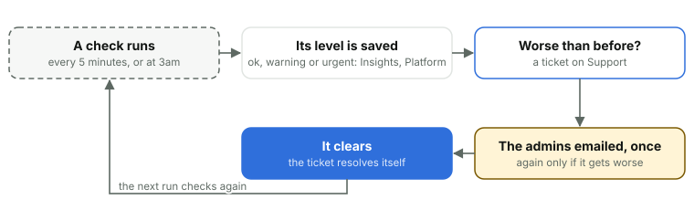

# 22. Monitoring and support

*Courtside Documentation › Running it. [Contents](README.md).*

The site watches itself and raises a ticket on the Support desk only when something needs doing, emailing the admins once. It emails again only if things get worse, resolves the ticket by itself when it clears, and never sends reminders.

*Admins are emailed once, and again only if things get worse. Nothing nags: a check that clears closes its own ticket.*

The admin area's **Log** starts with what's happening right now in every team, then shows what admins and team managers change (teams, people and players, letting someone sign in, games added, changed or deleted, and videos deleted or moved), the teams' videos and photos (uploads, processing, clips, Go live, photos added and deleted, removal requests), and every sign-in attempt from the last month, with the internet address it came from: a code sent, a wrong code, an email on no list, a limit reached, a failed robot check. It also says which view each signed-in device uses, the mobile view or the desktop one, when a device's first page says and whenever it switches, and which device every line from a person came from. Its **Problems** are anything that failed: a page or request that failed, a job's step, an email that didn't send, Stream, PlayHQ, Images, Cloudflare or the AI not answering, and what the phones report (Go live's camera or sound lost, its connection dropping, an upload or photos that stopped). The same problem again within half an hour counts on its line, so an outage is a line. Filter it by group, and by day in the club's time zone: the last 7 days unless today, yesterday or the last month is chosen, or any two dates typed in (the newest 5,000 of each kind of line at most). What admins and team managers changed is kept for good; the teams' videos and photos lines 90 days; the sign-in's lines and problems, a month.

| Watched | Warns | Urgent |
| --- | --- | --- |
| Stream's minutes left | Under 400 | Under 100 |
| Photos in Images (of 100,000) | 80,000 | 95,000 |
| The database's size (of 10 GB) | 4 GB | 9 GB |
| Server errors |  | 10 or more in an hour |
| Emails waiting over an hour |  | Any |
| The month's emails (of 3,000) | 2,400 | 2,850 |
| The 3am job |  | A failed night, or not run for 26 hours (the 5-minute job watches it) |
| The 5-minute job |  | Six failed runs in a row, or not run for 15 minutes (the 3am job watches it) |
| A team's costs (Costs) | Its season estimated over its budget | Over its budget so far |
| An AI model (Workers AI) | A planned retirement date | Two weeks before it, or gone from the catalog |
| The video joiner | Not answering its nightly test, or the test join failed | A game's parts couldn't be joined after six tries (Keep the first part clears it) |
| The game check (each live game 8 hours before tip-off, and Platform's button) | A game's Go live input gone from Stream, the joiner not answering, another alert at a warning | Stream not answering or short of minutes for the coming games, the 5-minute job stopped, another alert at urgent |

A team manager's question is a ticket too: answered on the site, emailed both ways, with private notes only admins see. Tickets are New, Open, Waiting (on the team manager) or Resolved. A ticket's emails are saved before they're sent, and the 5-minute job sends any that didn't go. Platform shows every one of these figures, with Cloudflare's own for the last 30 days. Insights' Alerts section puts them all in one answer: all green, or each problem first, with the backup, Stream, stuck or failed videos, the Worker's errors and refused sign-ins checked as it opens. What each team costs, and the Team budgets alert, are in Costs and billing.
