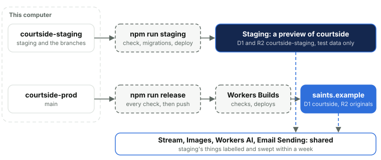
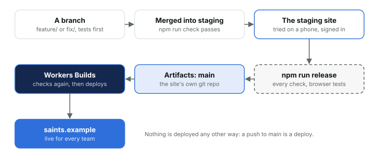
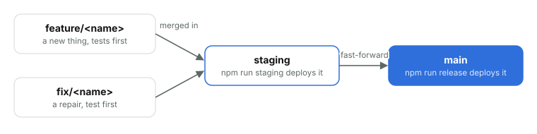

# 26. Environments and releases

*Courtside Documentation › Changing it. [Contents](README.md).*

There are two environments, running the same code. Every change is tried on staging before it goes live.

|  | Production | Staging |
| --- | --- | --- |
| Address | saints.example | staging-courtside.<subdomain>.workers.dev |
| What it is | The courtside Worker | A preview of the same Worker, with an orange strip on every page |
| Database | D1 `courtside` | D1 `courtside-staging`, test data only |
| Bucket | R2 `courtside-originals` | R2 `courtside-staging`, emptied after 7 days |
| Stream, Images, AI, email | The account's | Shared, with staging's things labelled and swept within a week; its emails go only to admins |
| Jobs | Every 5 minutes, and 3am | The 5-minute job, run by hand from Platform; the 3am job never runs |

### Environments

Staging is the same Worker deployed as a Worker Preview of `courtside`, told it's staging at build time, so it uses its own database, bucket, Turnstile widget and keys, and labels anything it puts in the shared Stream and Images. The two are deployed differently: staging straight from the computer in a minute, production only through the release.

|  | Staging deploy | Production deploy |
| --- | --- | --- |
| Command | `npm run staging` | `npm run release` |
| From | The `staging` branch, committed | `main`, fast-forwarded to `staging` |
| Checked first | `npm run check`: types, unit tests, line limits | Everything in Releases below, the browser tests included |
| Migrations | Applied to staging's database by the command itself | Must already be on the live database; the release refuses otherwise |
| How it's deployed | `cf previews deploy --preview-name staging` from the computer, then the commit is recorded as `refs/courtside/staging` | Pushed to Cloudflare Artifacts; Workers Builds checks it again and deploys it |
| Keys | Staging's own, set once with `npm run staging -- setup` and kept on the preview | The Worker's own secrets, untouched by a deploy |
| Changelog | Not needed | The deploy's line at the top, which becomes the deployment's message |
| When | Any time, as often as needed | Not on a day a team plays, unless it fixes something broken; never while anyone is uploading or streaming |
| Who sees it | Admins and the test accounts, signed in | Every team |



*Staging is deployed from the computer in about a minute, as often as needed. Production is deployed only by Workers Builds, from a push the release makes once every check has passed.*



*Staging and production run the same commit. Anything changed after it's been tried on staging goes back to staging first.*

### Branches

One repository, two working folders: one for `staging` and the branches, one for `main`. A change is built on its own branch, `feature/` or `fix/`, off `staging`, its tests written first. When it's ready it's merged into `staging`, the staging environment's branch, and `npm run staging` puts that branch on the staging site: it checks the code, applies staging's migrations, deploys the preview and records the commit it deployed as `refs/courtside/staging`. `main` is production. Nothing is committed on it directly: it's only ever fast-forwarded to `staging` for a release, so what goes live is exactly what was tried. A merged branch is deleted.



*Every branch comes off staging and is merged back once its tests pass, then deleted. Nothing is committed on main directly.*

### A change, start to finish

Every change takes the same path, in the `courtside-staging` folder until the release. A branch's name says what it is: `feature/` for something new, `fix/` for a repair.

```
cd ~/git/personal/courtside-staging
git switch -c feature/<name> staging     # a branch off staging
# the test first, watched failing; then the code
npm run check                            # types, every unit test, the line and rule checks
npm run e2e -- "<scenario>"              # a page script or the phone: its browser scenario
git commit -am "What changed, in plain words"   # with its CHANGELOG.md line at the top, if it'll go live
git switch staging && git merge --no-ff feature/<name>
npm run staging                          # staging's migrations, then the preview, then refs/courtside/staging
# try it on the staging site, signed in, on a phone
cd ../courtside-prod
git merge --ff-only staging              # main becomes exactly what was tried
npm run release -- --check-only          # every check and a dry run, nothing pushed
npm run release                          # the browser suite, then main to Artifacts, then Workers Builds
cd ../courtside-staging && git branch -d feature/<name>
```

A release with a new migration needs it on the live database first, right before: `npx cf d1 migrations apply --dir migrations --dry-run`, then the same without `--dry-run`. Migrations only ever add, and one that has run is never edited.

### Working in two folders

- **One repository.** `courtside-prod` holds it (its `.git` folder); `courtside-staging` is a worktree of it, made with `git worktree add`. Commits, branches and `refs/courtside/staging` are shared, so a branch merged in one folder is there in the other at once, with nothing to push or pull between them.
- **Each folder has its own files:** its own branch checked out, `node_modules`, `.dev.vars` and local database. The secrets files live in `courtside-prod` and are linked into `courtside-staging`.
- **`courtside-prod` stays on `main`** and is never committed on: it's only fast-forwarded. Git won't check one branch out in both folders, which keeps `main` out of the working folder.
- **The stash is shared too**, so set work aside with a commit on its branch rather than `git stash`.
- **Only `main` leaves the computer**, pushed by the release. Work not yet released lives only here, so it's released, or at least merged into `staging`, before a computer is retired.

### Releases

`npm run release` runs every check in turn and stops at the first that fails: the code is committed on `main`, staging ran this commit (or one that differs only in docs, tests or notes), the type checks and unit tests pass, the browser tests pass on Android, iPhone and Firefox, every migration is on every database, nobody has uploaded or streamed on the live site for 15 minutes, the changelog's newest line isn't what the site already runs, and a dry-run deploy works. No release lands on a day a team plays unless it fixes something broken.

### Builds

Nothing is built on a computer and uploaded. The release pushes `main` to the site's own repository on Cloudflare Artifacts, `courtside/courtside`, with a write token that lasts ten minutes. Workers Builds watches that repository's main branch only: for each push it runs `npm ci && npm run check` on Cloudflare, then `npm run deploy:builds`, which deploys with the newest changelog line as the deployment's message and the commit as its tag, so the Cloudflare dashboard and the admin area's Changelog say the same thing. The release follows the build to the end and won't call it done unless the live deployment carries that line. Builds can't run the browser tests (they need phones and cameras), which is why the release runs them before it pushes. A deploy sends no secrets: they stay on the Worker. Staging is deployed from the computer by `npm run staging`, not by Builds.
