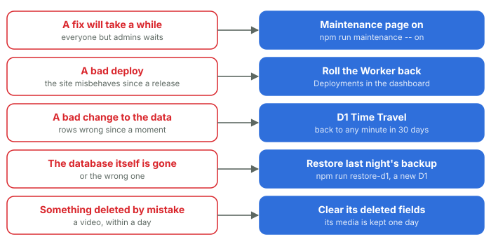

# 27. When something goes wrong

*Courtside Documentation › Changing it. [Contents](README.md).*

First, find out what: the top of Insights says what's wrong, and the Log's Problems has each failure with its team, person and device (a job's with its step and the video or game it was for). The Worker's own logs (`npm run logs`, kept 7 days) have every request and job run: a 5xx is a `request_error` line, a job's failure a `job_failed` one, each with its ids and the error's cause, and an error page shows a Reference (its Ray ID) that finds its line. The phones add their side: the filming phone's events, each family's player trouble (the live picture not coming or stopping, and when it came back) and an upload that stopped, with how far it got. Traces time every database query and outside call. The incident runbook, `docs/runbooks/incident.md`, goes through it in order. Then one of these, each spelt out step by step in the Cloudflare runbook. Anything that deletes or restores data needs the owner's go-ahead first.

*Each answer is in the Cloudflare runbook step by step. Anything that deletes or restores data needs the owner's go-ahead first.*

| Problem | What to do |
| --- | --- |
| A fix will take a while | Switch the maintenance page on: everyone but admins sees Back soon, and admins see the real site to check it (the sign-in still opens, so an admin can sign in) |
| A bad deploy | Roll the Worker back to its previous version in the Cloudflare dashboard (its secrets and bindings stay) |
| A bad change to the data | D1's Time Travel puts the database back to any minute in the last 30 days |
| The database itself is gone | Restore the newest nightly backup from R2 into a new database, with the restore script |
| Something deleted by mistake | A video is kept for a day after it's deleted, and can be brought back in that time |
