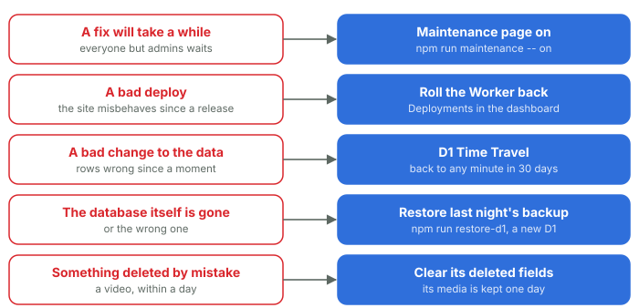

# 27. When something goes wrong

*Courtside Documentation › Changing it. [Contents](README.md).*

First, the top of Insights says what's wrong. Then one of these, each spelt out step by step in the Cloudflare runbook. Anything that deletes or restores data needs the owner's go-ahead first.

*Each answer is in the Cloudflare runbook step by step. Anything that deletes or restores data needs the owner's go-ahead first.*

| Problem | What to do |
| --- | --- |
| A fix will take a while | Switch the maintenance page on: everyone but admins sees Back soon, and admins see the real site to check it |
| A bad deploy | Roll the Worker back to its previous version in the Cloudflare dashboard (its secrets and bindings stay) |
| A bad change to the data | D1's Time Travel puts the database back to any minute in the last 30 days |
| The database itself is gone | Restore the newest nightly backup from R2 into a new database, with the restore script |
| Something deleted by mistake | A video is kept for a day after it's deleted, and can be brought back in that time |
