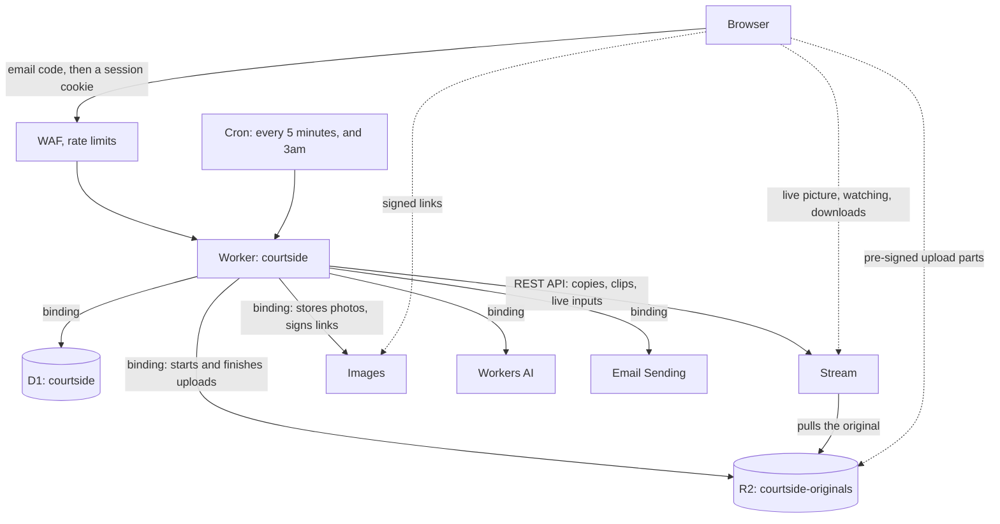
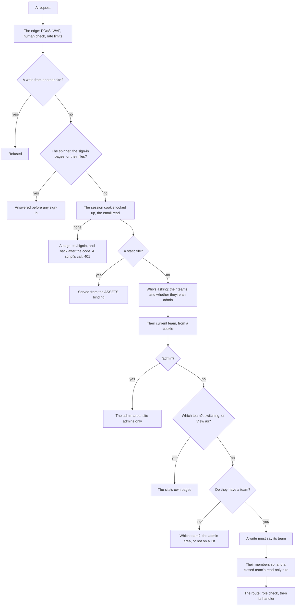
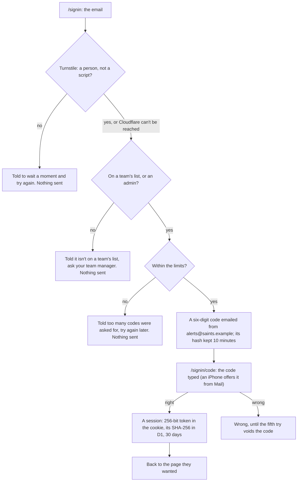
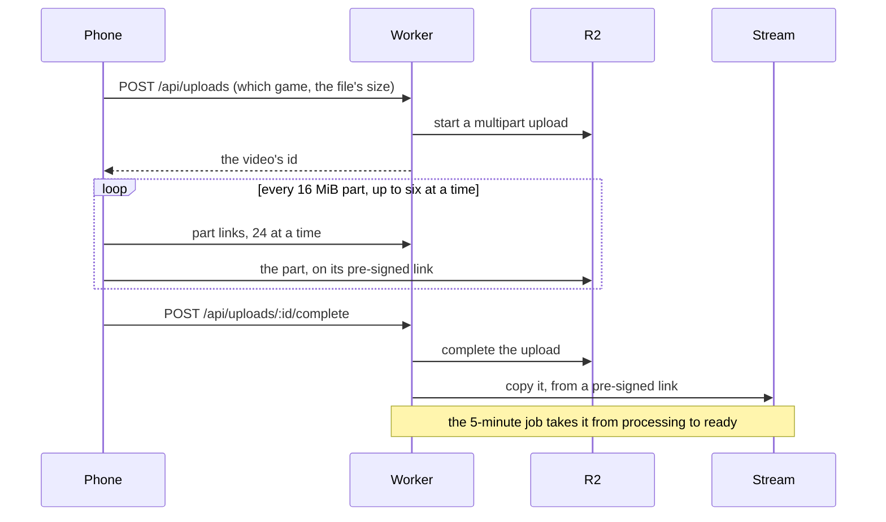
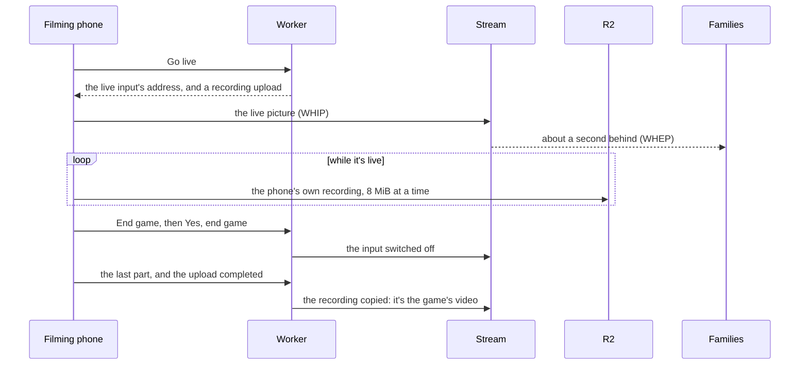
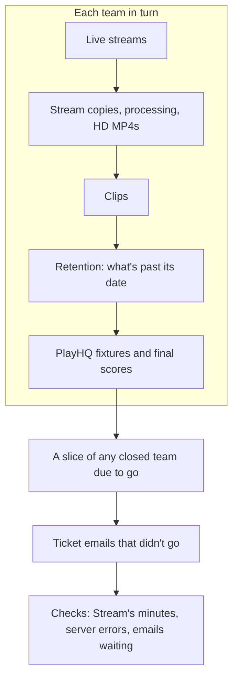
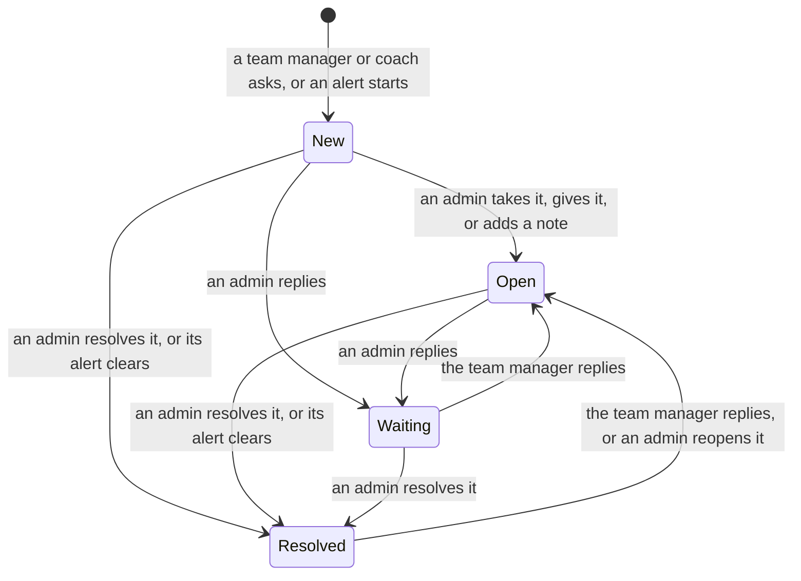
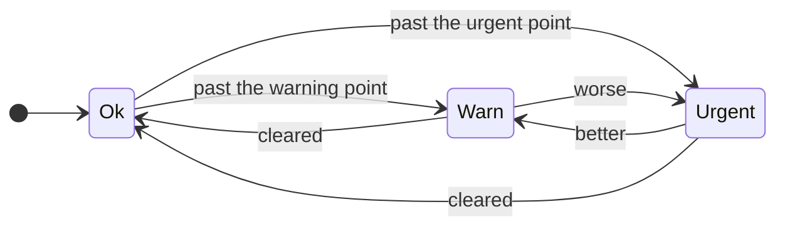
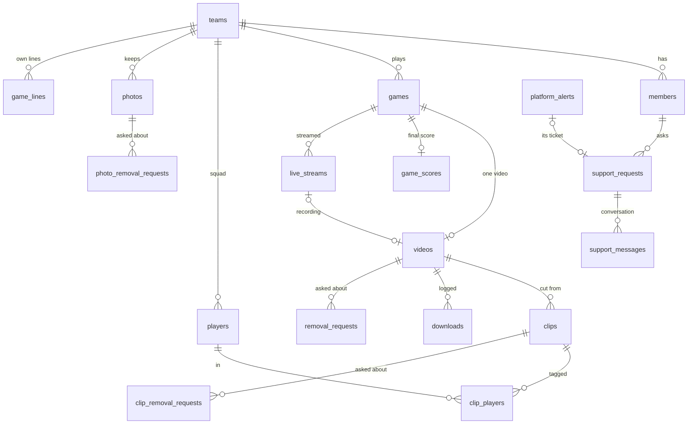

# How the site works

This is for anyone changing the code. `docs/spec.md` says what the site does; this says how. It's kept current: a
change to how something works changes this file in the same commit.

The whole site is one Cloudflare Worker. It renders the pages on the server and answers a small JSON API for the
upload, Go live and Photos pages and Ask Virtual Team Manager. The data lives in D1, uploaded originals in R2, playback copies
in Stream, and photos in Cloudflare Images. Everything sits behind the site's own sign-in on saints.example, with the zone's
DDoS protection, WAF and rate limiting in front, and all of it runs in one Cloudflare account, Courtside.

It serves several teams: one Worker and one database, every row with its team,
and the same addresses for every team, with the site remembering which team each person is looking at.



Solid lines are the Worker's own calls. Dotted ones are the browser going straight to R2, Stream or Images, on links
the Worker hands out (pre-signed or signed, and short-lived), so big files never pass through the Worker.

A few ideas hold the whole thing together:

- **Pages are plain.** Server-rendered HTML and small page scripts, no framework, no build step for the browser.
- **The site signs people in, and the teams' lists decide what they can do.** A code by email, only for an address on
 a team's list, then a 30-day session per device (`src/auth/`). The Worker checks the team's list on every request, so
 removing someone works straight away, and roles come only from D1.
- **One database, every row with its team.** Every query names `team_id`, apart from a short list of site-wide ones
 in `scripts/rules.mjs`, each with its reason.
- **Big media never passes through the Worker.** Phones upload straight to R2 on pre-signed links; Stream pulls the
 original from there. Photos are the one exception: a few megabytes each, checked on the way in.
- **Polling, not webhooks.** A job every 5 minutes asks Stream how things are going, so nothing outside needs a
 public way in.
- **Everything is safe to run twice.** Jobs read the current state each time, and the phone's retries are answered as
 done when they already worked.

## What happens on a request



1. **The edge.** DDoS protection, the WAF's managed rules, a list of allowed methods, a human check (Turnstile's
 managed challenge on page loads until someone's signed in, told by the `courtside_session` cookie; never on `/api/*`,
 static files or WhatsApp's link previews, which get the sign-in page's preview card), and rate limiting.
2. **The Worker's first checks.** A write (anything but GET or HEAD) from another site is refused before anything
 else. The spinner (below), `security.txt` (`app/security-txt.ts`: where to report a security problem, the one page
 anyone can read), the sign-in's own pages (`/signin`, `/signin/code`, `/signout`, `/signin/whoami`:
 `features/signin/`) and the few files they need (`app/static-files.ts`) are answered without a sign-in. Then the
 session cookie is hashed and looked up (`auth/session.ts`), and the email read from its row; without a live session
 a page is sent to `/signin?next=…` (and comes back after the code), and a page script's call gets 401 JSON, which it
 shows as its own sign-in note. Static files come next, from the `ASSETS` binding: the Worker runs before them, so
 they need the sign-in too. See **Signing in**, below.
3. **Opening the site** (`/?app`, the Home Screen app's start address, or `/` opened from outside the site) gets the
 spinner page at once, before any sign-in or lookup (`src/app/landing.ts`). It then opens Home in its own place, so
 the app never shows a white screen (and Home asks for the sign-in if there's none).
4. **Who's asking** (`src/auth/viewer.ts`): their memberships in every team that isn't deleted, and whether they're a
 site admin, in one D1 round trip. An admin's hidden memberships count only while they're still an admin.
5. **The current team** (`src/app/current-team.ts`). For an admin, `admin_team` (a visit to a team they aren't in, for
 this browser session only) comes first. Otherwise the `team` cookie (kept a year) when it names a team they're in;
 else their only team, or their only current one when their other teams' seasons are over; else they choose.
6. **The admin area** (`/admin` and everything under it, and `/changelog`, its old address) is for site admins only,
 and comes before anything of a team's: anyone else gets "Page not found", whether they asked for a page or posted
 a form. It has its own router (`src/app/admin-router.ts`) and its own frame, made once a request: who's asking,
 their current team, and the counts beside Support and Platform.
7. **The site's own pages**: Which team? (`/teams`) and switching (`POST /teams/switch`, back to a page on this site
 with `next`), and View as (`POST /view-as` and `/view-as/stop`, admins only). Which team? opens the team straight
 away when there's only one to choose.
8. **No team?** Someone in several teams goes to Which team?, an admin in none to the admin area, and anyone else gets
 the "not on a team's list" page (403).
9. **A write must say its team** (`src/app/team-guard.ts`). Every post form carries `_team` (`layout` adds it to
 every form written `method="post"`) and every page script call sends `X-Courtside-Team` (`upload-net.js`, `ask.js`).
 A form for a team other than the current one is refused (409, "reload"). A page script's write runs as its page's
 team when the person can open it, so an upload or a live stream survives switching team in another window. A write
 that names no team (a page from before multi-team) asks for a reload.
10. **The membership** (`src/app/team-context.ts`): the person's own in that team, or for an admin a hidden team
 manager one, made on their first visit (logged as `team_opened`) and shown as Site admin. An admin viewing the team
 as another role (the `viewas` cookie, naming the team and the role, for the browser session) gets that role, still
 as their own membership; anyone else's cookie counts for nothing. A closed team is read-only: only writes marked
 `closedTeams` get through. A team being deleted is nobody's any more, so nobody lands on a team half deleted (an
 admin can still open it from Teams while it goes).
11. **The route.** The router checks the route's lowest role and calls the handler with the team, the membership,
 who's asking, View as, and `deps` for that team. Handlers stay thin: parse and check the input with zod, call a
 service, then render a page or redirect. A page that finds nothing in the current team, but is another of the
 person's teams' game, video, clip or photo, offers to switch (`src/app/other-team.ts`).
12. **Errors** are typed `HttpError`s, turned into an error page (or the JSON envelope under `/api/`) in one place and
 logged with the team. Every 5xx the site answers is also counted by the hour (`server_errors`), for Platform's
 "the site is failing" alert.

## Signing in

The site's own sign-in. Like for like with the Access page it replaced: type your
email, get a six-digit code, type it, and you're in for 30 days on that device.



- **A person, not a script**: every form that sends a code (the email
 step, and the code step's Send a new code) carries a Turnstile widget, managed and seen only if Cloudflare wants a
 tap. `public/signin.js` loads its script and waits for its token before the form posts; the Worker checks the token
 with Cloudflare (`siteverify`: the secret, the person's IP address; the token must be for action `signin` on this
 site's address) before anything else. Failed: no code, "couldn't confirm you're a person". Cloudflare not answering
 in 10 seconds (or its own trouble): the code still goes and `turnstile_unreachable` is logged, so an outage there
 doesn't stop families signing in; the limits hold. Only the sign-in pages' CSP allows `challenges.cloudflare.com`
 (script and frame). The live site and staging each have their own widget and secret (`TURNSTILE_SITE_KEY`,
 `TURNSTILE_SECRET`); `cf dev` uses Cloudflare's always-passes test keys.
- **Who gets a code** (`auth/sign-in-service.ts` `requestCode`): an address on any team's list that isn't deleted (a
 closed team's too, for its videos) or in the admins table. Anyone else is told it isn't on a list and gets nothing. The limits (`auth/sign-in-limits.ts`) make that slow to probe: 10 codes an
 hour for one address, then none for 15 minutes, and again while the hour still has 10; 20 codes a day, and 15 wrong
 codes a day from any IP addresses, then none for a day, 30 in 15 minutes from one IP address (a
 gym's Wi-Fi, or a phone company's shared address, is many families), 10 addresses on no list in 15 minutes from one
 IP address, 200 an hour for the whole site (past which codes pause and a
 **Sign-in flood** ticket is raised for the admins, once while it's open), and 30 wrong codes an hour from one IP
 address. Every request, code and check is a row in `sign_in_events` (a month, 31 days; the admin Log shows them) and a log line with the address
 masked (`signin_code_sent`, `signin_checked`, `signin_refused`); Platform's Sign-ins row sums the last 24 hours.
- **The code** (`sign_in_codes`): six digits, hashed with the email (so a code is good for its own address only),
 10 minutes, five wrong tries, and voided when a newer one is asked for. The page's Send a new code waits a minute
 (`public/signin.js`). The email (`auth/sign-in-mail.ts`, the one email to an address a visitor typed, after the check
 above) carries the code in its subject, so a phone shows it without opening the email, and large in the email itself
 (`auth/sign-in-email.ts`, in the site's style like the welcome).
- **The session** (`sessions`, `auth/session.ts`): the cookie `courtside_session` holds a random token (HttpOnly, Secure,
 SameSite=Lax, 30 days); the row holds its SHA-256, the email, a device label ("iPhone, Safari") and when it ends. A
 fixed 30 days from the code, per device, several devices at once. Each request looks the row up and
 then the viewer from the teams' lists, as before; last seen is written at most hourly, after the response has gone
 (`ctx.waitUntil`, cloudflare-standards.md). Which view the device uses
 (`view.js` sets the `courtside_view` cookie from desktop.css's media query, or the chosen mobile view) is noted on the row
 when it's first seen or changes, with a `desktop_view`/`mobile_view` event for the Log, and the device is counted once
 a local week in `view_weeks` (`auth/session-view.ts`, `device-view-repository.ts`). Signing out ends that row;
 the 3am job deletes ended and expired rows. Go live ends a session with under four hours left and asks for a new code
 first, so the recording's saving isn't cut off mid-game.
- **Everything behind it**: the Worker runs before static files (`runWorkerFirst`), so they're served through the
 `ASSETS` binding only once the session is checked; the sign-in page's own files are the exceptions
 (`app/static-files.ts`). The maintenance Worker asks `/signin/whoami` (with the request's cookies) who an admin is.
- **Local dev** keeps `DEV_AUTH_EMAIL` on localhost; the browser suite plays the sign-in page from its own harness.

## On the Home Screen

The site can be added to a phone's Home Screen and opens full screen like an app (Help: "How to install as an app").
It's the same pages, with nothing from an app store and no service worker, and it has to keep working both ways: in
the app, and in Safari or Chrome.

- **Except Go live**: in the app, an iPhone locked for a moment
 loses its microphone for good (a new one gives nothing either), and the recording breaks with it; in Safari it carries
 on. So in the app the Go live page says to go live from Safari or Chrome, with an Open in Safari
 (`x-safari-https://`) or Open in Chrome button, and offers no Start camera (`golive-check.js`). Tried and taken out
 that day: the microphone through a Web Audio mixer, and a new recorder after the lock in the same upload.

- **The manifest** (`public/manifest.webmanifest`): "Courtside", opening `/?app` (the spinner, then Home) full
 screen with a the club's deep colour launch screen. The spinner's look is in the page itself (`ui/launch-style.ts`, allowed by
 its hash in that page's CSP), as is the club's mark, so it needs no file to look right. Its `id` stays `/`, so apps installed before the spinner carry on. It never
 locks the phone upright, as Go live needs it sideways. The logo comes at 192 and 512 px, plus a padded one Android
 crops to its own shape. `layout.ts` links it with `crossorigin="use-credentials"`: every file is behind the
 sign-in, so it's fetched with the site's cookies; the human check leaves `webmanifest` files alone too (review, 31 Oct
 2026), for a phone adding the sign-in page itself to its Home Screen. iPhones use `apple-mobile-web-app-title` and `apple-touch-icon.png` (also served as `apple-touch-icon-precomposed.png`, the name iOS asks for first for a link preview).
- **Installing** (`public/webapp.js`, on every page): the install banner Chrome, Edge and Samsung Internet pop up by
 themselves is held back, as it could cover Go live's buttons, and Help shows an Install button while the browser
 offers one. A page can't offer it on an iPhone, so Help shows Safari's Share steps with mock screens
 (`faq-install.ts`, `faq-mock.ts`; Virtual Team Manager skips the mocks).
- **Pull down to refresh** (`public/pull-refresh.js`): Safari and Chrome do it, an iPhone's Home Screen app doesn't. In
 the app, a drag down from the top of a page shows "Pull down to refresh", then "Let go to refresh" past 80 px, and
 letting go reloads. Never while a reload would cut a job short: `awake.js` marks the page busy while anything keeps
 the screen on (Go live from Start camera to Saved, an upload, photos being added), and never while the camera fills
 the screen. With no address bar, back or reload button in the app, this is what makes "Reload the page" messages
 work. The not-a-member page, which has no top bar, has a Try again button.
- **Cookies**: on an iPhone the app keeps its cookies and storage apart from Safari's (iOS copies Safari's cookies once,
 when it's added). It may ask for a code the first time, and keeps its own "carry on" positions and upload progress.
 The sign-in page is the site's own, so the app stays where it is.
- **Go live in the app**: an iPhone app's browser name can lack Safari's "Safari/", so `golive-check.js` doesn't count
 it as another app's browser. A blocked camera can't be fixed from the app (there's no web address to tap), so the
 page says to go live from Safari or Chrome.
- **Sign out** (`public/signout.js`, every page): an exit door furthest right of the top bar, and the `data-signout`
 link on the not-a-member page. A page that went away would strand the app, so after asking "Sign out?" the page posts
 `/signout` in the background (the site ends this device's session and clears the cookie) and stays, showing Signed
 out with Sign in again, which opens the sign-in page. Without JavaScript the door is a plain page with the one
 button. The session lasts 30 days, in the app and out of it.

## Uploading a video



1. `POST /api/uploads` checks the game has no video yet, starts an R2 multipart upload (through the binding) and adds
 the video's row as `uploading`. A failed video, or an upload untouched for 24 hours, is cleared out of the way
 first.
2. The browser asks for pre-signed part links 24 at a time and puts 16 MiB parts straight into R2, up to six at once
 (fewer after a dropped connection). It remembers finished parts in `localStorage`, so choosing the same file again
 carries on where it stopped.
3. `POST /api/uploads/:id/complete` completes the upload (now `processing`), then asks Stream to copy the file from a
 pre-signed R2 link. If Stream can't take it just then, the 5-minute job tries again.

## Live streaming

`src/features/live/`, `public/golive*.js`. Every stream comes from the Go live page, the same on every phone. `/live`
(Watch and film people and team managers) makes or reuses one Stream live input per game, through Stream's REST API, with
signed links only, so only members can watch. Each stream has a row in `live_streams`: `open`, then `saved` or
`cancelled`. Stream can't record a WebRTC stream, so the phone records the game itself.



- **Go live:** `POST /api/live/:gameId/browser` opens the input and starts a recording upload (an ordinary `uploading`
 video, `Live <date>.mp4|webm`), linked on `live_streams.recording_video_id`, one at a time per game. The page sends a
 one-off `attempt` id (it's in the R2 key), so asking again after a lost answer gets the same recording. The browser
 sends the live picture by WHIP to the input's `webRTC.url` (capped at 1.5 Mbps) and records with `MediaRecorder`
 (MP4/H.264, or WebM; 2.5 Mbps) not the camera itself but a mix of it (`golive-mixer.js`): the preview drawn onto a
 canvas each frame (`requestVideoFrameCallback`, else each screen refresh) and the microphone through Web Audio, whose
 tracks never end, so a new camera can carry on in the same recording. The canvas is always landscape, the camera's
 longer side across: a camera started while the phone was upright (Carry on tapped before turning it) would otherwise
 record a tall segment that plays squashed once joined to a wide one. The recording is cut into 8 MiB parts (R2 wants equal parts) and uploaded through the
 normal part link and complete endpoints, retrying through any outage. Safari can hold on to recorded data, so
 `golive-rec.js` calls `requestData` when nothing has arrived for 4 seconds.
- **Pause** (`golive-pause.js`): `MediaRecorder.pause`, so the break is left out of the file. The live picture
 switches to a canvas card (`golive-slate.js`, redrawn each second so viewers' players don't think it has stalled) and
 silence.
- **End game** (it asks Yes, end game or Keep streaming) calls `POST /api/live/:gameId/end` (`stopBrowserLive`), with
 how long the phone recorded, pauses left out (`recordedSeconds`). Under 60 seconds since Go live, or under 60 seconds
 recorded while R2 holds no more than two parts (`live-test-rule.ts`: a minute is about 20 MB; R2 not answering counts as more, so the recording is kept), it's a test: the upload is aborted and deleted (`live_test`), the input disabled and the row
 cancelled with the reason, nothing is processed, and the game is free again (the next Go live reuses the input).
 Otherwise `endLive` sets `end_requested_at` and switches the input off (`switchOff`: the database first, Stream
 best-effort), so the game can't be streamed again. The phone finishes uploading, and completing it closes the row as
 saved (`closeBrowserLive`, `live_saved`). A recording under 60 seconds that slipped past (Stop didn't reach the server,
 or a pause) is dropped after processing instead (`dropShortTest`). The site still takes `cause: "camera"` from pages
 older than Resume camera.
- **The camera stopping** (`golive-recam.js`; the phone locks, a call comes, another app takes it: an iPhone ends the
 camera's track, Android may only mute it) ends nothing. While the page is hidden or the camera's track is ended or
 muted, the recording is held (`rec.pause("away")`, apart from a break's own hold) and the live picture shows the Game
 Break card; a camera that comes back lets go by itself (on a laptop, another tab holds it the same way). A camera
 ended, or still muted 3 seconds after the page shows (`whenCameraLost`), is let go of (an Android camera only muted
 still holds the device) and held for (`"camera"`) until **Resume camera**, which asks for the camera
 again (a tap on every phone: an iPhone starts a camera only from one), and the new one goes to the preview, the mix,
 the live picture (`useMedia`, `replaceTrack`) and the phone's watch. The recording carries on in the same file, the
 gap left out; a break under way carries on.
- **A weak signal:** the recording is sent behind the game when the phone's upload is slower than 2.6 Mbps (it shares it
 with the live picture), and the rest waits in the page. Once 2 minutes or more of the game are only on the phone, the
 camera screen and the Saving panel say how many, and that leaving the page loses them.
- **A phone that stopped part way** (the page closed, a flat battery, a start that didn't finish): reopening Go live on
 that phone (it remembers the recording, `courtside-live:<game>`), or any phone of the same person, offers Save
 what was recorded, or delete and start again (unless it was stopped). Saving is the server's job:
 `POST /api/live/:gameId/save` (`recording-save-service.ts`) completes the upload from R2's own list of the parts that
 reached it (S3 ListParts, `r2-presigner.ts`), as a run from part 1. While a phone is still streaming (Stream says so for up to 2
 minutes after one has gone), or a part came in during the last 2 minutes, it answers wait (`streaming`, `sending`,
 with `retryIn`) and the page asks again every 20 seconds, saying so beside the button, until it's saved; every
 answer is a `live_save` log line. If nothing reached R2, the recording is deleted and the game is free. The
 5-minute job does the same by itself once a recording is 24 hours old and has been quiet that long (a day for the
 phone to reach Wi-Fi or better signal and send the rest).
- **Carrying on after the page closed** (`browser-live-continue.ts`, `recording-segments-*.ts`, `join-service.ts`,
 `public/golive-recover.js`, `golive-stream.js`; design: the design notes): the same
 phone, reopening Go live while the stream is open and not ended, is offered **Carry on streaming** (the panel sits
 above the page's steps and is brought on screen, clear of the bar that stays at the top of a phone's page, so there's
 nothing to scroll for mid-game; on a screen too short for all of it, the button is what stays on screen). `POST
 /api/live/:gameId/continue` ({ videoId, mimeType }) checks it's the filmer's own recording, the same container (mp4
 with mp4, webm with webm), the input still exists, and that nothing is still arriving (Stream not seeing a phone, no
 part in the last 2 minutes; else it answers wait, as Save does); then it opens a new multipart upload beside the
 recording (`recording_segments`: `live-<date>.2.mp4`, `.3.mp4`…), re-enables the input and logs `live_continued` with
 the minutes lost (while it answers wait, the button counts the server's `waitLeft` down). The page then starts the
 camera (iPhone asks for it again) and shows the red button as Carry on: that tap makes the Web Audio context and
 starts the mix, the live picture and the recording into the segment, as Go live does. The context starts itself again whenever the phone says it has stopped (`statechange`), and
 at any tap (`soundForTaps` in `golive-mixer.js`); each change is a `sound <state>` line in the phone's notes. A
 recording that hands nothing over for 20 seconds while live says so on the camera screen (`golive-watch.js`
 `onRecordingQuiet`) and logs a problem, and the camera screen offers **Reload and carry on**; only real data counts
 (an empty piece, which Safari can answer `requestData` with, isn't recording), the count starts again when a hold
 ends, and a recording that carries on by itself takes the warning back (`onRecordingBack`). While it's quiet, the
 10-second check's line also says what the recording is made of (the recorder's state, the sound context's, and each
 recorded track).
 `part-urls` and `complete` take `segment`, 1 by default. **The recording is kept on the phone** meanwhile
 (`public/golive-store.js`, IndexedDB; design: the design notes): each part
 cut until storage confirms it, and the tail since the last cut piece by piece (every write and clear in the order
 asked, so a tail cleared after a piece was kept never keeps that piece twice); the next page sends what a dead page
 left (the parts never confirmed, then the tail as the segment's last part) before Save what was recorded asks the
 site to save, or alongside Carry on streaming, which End game waits for (`public/golive-kept.js`). The game's note
 on the phone (`courtside-live:<game>` in localStorage) holds one segment, the one being recorded, so a segment still
 going up when the page carries on is noted beside it (`courtside-live:<game>:kept`) with each part as it lands. A page
 closed again part way, or at the camera's prompt before the next segment starts, still knows which parts went, so
 the rest goes up under its own segment and the tail is numbered after the parts already sent, never over one.
 Families' player (`whep.js`, `whep-wait.js`) asks the game's page whether the stream is over once no frame has come
 for 3 seconds, and again every 5 seconds for the first 20 (and every minute, and when the page is looked at
 again): End game reloads it to the Full time card within seconds. Otherwise, from 5 seconds
 frozen, it shows "Live stream will resume shortly" over the last frame, as a dead page can't send the Game break
 card. The player gets the picture back by itself: Stream keeps a player's connection up with nothing on it once the
 phone has gone, and a phone that carries on comes back over a new connection of its own, so the player counts the
 frames decoded on its connection (`getStats`; the video's clock runs on with no picture in Firefox) and starts over
 once a picture that was arriving has stopped for 10 seconds, then every 15 to 20 seconds until it has one (not while
 the page is out of sight). The card still says to refresh the page if it hasn't come back after 5 minutes, as a last
 resort. End game completes the current segment and every earlier one from R2's
 part lists (`finishSegments`; one nothing reached is dropped); with two or more whole, the video is `processing` with
 no Stream copy and waits for the **join** (`join-service.ts`), which no request waits for. Each 5-minute run, for
 every waiting video, the Stream copies step first looks in R2 for `live-<date>.joined.mp4`: that file is the only
 proof trusted (R2 shows a PUT whole or not at all), so a joiner that restarts or forgets loses nothing. If it's
 there, one D1 batch points the video at it and deletes its segments' rows (`replaceSegmentsWith`), the segment
 objects go, the Log gets `video_joined` and Stream is asked for the copy as for any upload. If it isn't, the run asks
 the joiner (`platform/joiner.ts`: the `JOINER` Durable Object binding into the `courtside-join` Worker, `join/`),
 handing it the segments' two-hour links and a PUT link for the joined file, and is answered at once: `running` (begun
 by this ask, `started`, or still going), `done` or `failed` (told once, then forgotten), or `none`. An ask may begin a
 join (`start`) only when none has been tried or ten minutes have passed since the last began, and fewer than six have
 been; a try is counted when a join begins, or when a due ask is refused or not answered. In the container
 (`server.mjs`), `jobs.mjs` keeps the jobs by the output link's path, runs one at a time and stops one at 40 minutes;
 ffmpeg (`pipeline.mjs`) re-wraps each MP4 segment by stream copy into one transport stream (a cut-off last frame
 dropped, each segment's own decoder settings carried in-band, every timestamp in the one clock), which is then
 wrapped into the MP4; ffmpeg's concat demuxer, which stops at a segment a dead page left mid-frame and needs every
 segment's clock to match, is used only for WebM, and for an MP4 whose picture isn't H.264 (a browser without that
 encoder records VP9, which a transport stream can't carry: staging's test browser does). A run that stopped reading part way counts as failed whatever its
 exit code, and a copy far smaller than its segments is refused rather than saved; a re-encode is the fallback when
 the streams don't line up. The joiner logs `join_done` with how long the read, the join and the store took. After the
 sixth try fails (or is lost), the site sets `join_failed_at`, writes a Problems line, logs `join_failed` and raises
 the `joiner` alert, and the game page offers team managers **Keep the first part** (`keep-first-service.ts`: segment
 1 becomes the video, the rest deleted, `first_part_kept`); keeping it, or deleting the video, clears the alert. An
 End game that found the first upload empty makes the next whole segment the video's own file in one batch
 (`promoteSegment`). The joiner is tried every night (`joiner-checks.ts`). Another phone (the filmer's or a
 coach's) still gets Save what was recorded or delete and start again. A release counts a join in progress as busy.
- **Watching:** WHEP (`public/whep.js`, muted until Turn the sound on) with a signed token in place of the input's id
 (the bare id is refused, as the input needs signed links). "Live" means the input says `connected` and Stream last saw
 it in the last 2 minutes (`isConnected`: Stream keeps saying connected after the phone has gone, for good on a
 switched-off input), and the stream hasn't been stopped (Home and Watch games ask Stream; a failure reads as not live).
 Once End game is tapped the game's page shows the Full time card in the player's place (`live-player.ts`: the Game
 break card's look as a page, court lines, the club head, "The live stream has ended" and when the video is due,
 sized by the player's width) until the video is ready, reloading itself every minute. A lost connection's "Live
 stream will resume shortly" stays a plain green card: understated, as something's wrong.
- **The live bar** (`live-bar.ts`, `ui/page-slots.ts`): every team page's layout leaves `<!--live-->` at the top of
 `<main>`, filled after the page is built, as the team manager's alerts are. A stream counts when it's open, not ended
 and `last_live_at` (set by the 5-minute job while Stream says connected) is under 8 minutes old: a database read, no
 call to Stream. Not on `/`, `/games` (their Live now cards), `/live` or the live game's own page. A failed read
 leaves the bar off (`live_bar_failed`).
- **The 5-minute job** (`live-sync.ts`, its first step): connected, once the recording has started and until Stop, logs
 `live_started` once and bumps `last_live_at`; a recording quiet for 24 hours is saved; one that was deleted closes its
 row; an input nobody used closes after a day.

### From an external app (RTMPS)

`app-live-service.ts`, `app-live-sync.ts`, `app-live-routes.ts`, `views/app-live-card.ts`, `public/golive-app.js`,
`platform/stream-live-app.ts`. For an AI tracking camera, whose own app has to hold the camera (XbotGo's can stream to a
custom RTMPS server; Trackd's is locked down). Design and plan: the design notes.

- **Choosing it:** Go live's green Use an external app instead (`POST /live/:gameId/app`, the same checks as Go
 live's start) sets `live_streams.source` to `app` and the input's `recording.timeoutSeconds` to 600, so a drop or a
 restart within 10 minutes carries on the same recording. The card then shows the input's `rtmps.url` and
 `rtmps.streamKey` (read from Stream for that page only, never logged). `POST /live/:gameId/camera` goes back while
 nothing has streamed. Go live's own start is refused for an app game.
- **Live:** `appConnected` is Stream's `status.current.state` `connected` with an `ingestProtocol` that isn't `webrtc`
 and a `statusLastSeen` in the last 2 minutes (Stream keeps saying connected after a sender has gone). The card asks
 `POST /api/live/:gameId/app-status` every 10 seconds, which notes the game live the first time (`last_live_at`,
 the Log's Right now); the job does the same. An app game has streamed once `last_live_at` is set (`wasStreamed`).
- **Watching:** RTMPS in can't be played by WHEP, so the game's page shows Stream's own player (the iframe saved videos
 use) with a signed token for the input: HLS, about half a minute behind. Until it's live the page shows the court and
 reloads every 30 seconds.
- **Saving** (`advanceAppLive`, from the 5-minute job): Stream records each broadcast as a video under the input
 (`GET live_inputs/<uid>/videos`), `live-inprogress` until 10 minutes after the app stops sending, then `ready`. Once none is still live or processing, it saves at once
 if End game was tapped (`POST /live/:gameId/app-stop`, final), else 20 minutes after it was last seen sending.
 The longest part of a minute or more becomes the game's `videos` row (`processing`, its `stream_uid`, no R2 key), the
 other parts clips ("Live stream, more from 8:05pm"), the stream `saved` with `recording_video_id`, all in one batch;
 shorter parts are deleted from Stream. Nothing of a minute or more is a test: cancelled with why, the game free again.
 Only recordings made since the app was chosen count (a reused input keeps an earlier try's). A video uploaded before
 the app was seen sending stays the game's video, and the parts become its clips once it's in Stream.
- **Labels:** Stream gives a recording only a name, so the save puts the team on each part kept (`stream.label`, with
 staging's label on staging), and the nightly clean-up treats a recording as staging's when the input it came from is
 (Stream lists each recording's `liveInput`).
- **Logs:** `live_app_chosen`, `live_app_camera`, `live_app_live`, `live_app_stopped`, `live_app_saved` (parts, seconds),
 `live_app_not_saved` (why), `live_app_leftovers`; the admin Log has who chose it, went back, or stopped it.

Phone streaming apps (Moblin, Streamlabs, IRL Pro) were tried first, with the same recording, reconnect
window and wait. Those went when the page's camera became the way to stream; the external app is the same machinery
back, for the one case the page's camera can't cover.

## Photos

`src/features/photos/`, `src/platform/hosted-images.ts`, `public/photos.js`. Watch and film people, coaches and team
managers add them; everyone sees and downloads them. They aren't linked to games.

1. **On the phone or computer** (`photos.js`; chosen, or dropped on Add photos on a computer, `upload-drop.js`), each
 photo drawn one at a time and sent up to three at once (`photo-queue.js`), the first on its own so a refusal that
 would stop the rest stops before any more go, then three at once only if the first was in within 5 seconds, and
 one at a time after any dropped connection (`uploadLanes`: on a weak signal three share it and none may finish);
 a page left part way says how many weren't sent the next time Photos opens (`photo-unsent.js`, localStorage): when it was taken, from its EXIF DateTimeOriginal
 (`photo-date.js`, reading only the start of the file); then an `` from the file's `blob:` address (so the phone
 turns it upright) drawn on a canvas at most 2560 px along its longer side and saved as a JPEG (quality 0.88), which
 leaves off all the camera's metadata, its location included. `POST /api/photos` sends the JPEG and `takenAt` as a
 form (`apiForm`). Only trouble reaching the site is tried again (`isNetworkTrouble`); a refusal skips that photo and
 lists it, and being signed out or not allowed stops the rest. The screen stays on and the page busy until they've
 all gone.
2. **In the Worker** (`photos-service.ts`, `addPhoto`): the body must be 10 MB or less (Images' limit), and is checked
 as a whole JPEG, with its size read and any metadata segments taken out (`jpeg.ts`: APP1 to APP15 except the ICC
 colour profile, and comments). `taken_at` is the phone's date if it's a real one and not still to come, otherwise
 now. The photo goes with its team's season, whenever it was taken (`footageDue`), and once the team's photos are
 gone no more are taken. Then its row, reserved out of sight (`reservePhoto`: a `pending-` image id and `deleted_at`
 set) so the photo has its number; then `images.upload` (private, `requireSignedURLs`, metadata `{ teamId }`, the
 member as creator, named as it downloads: `saints-b12-1-<date>-photo-<id>.jpg`); then the row is filled in and shows.
 If Images refuses, the reserved row goes; if the row has gone meanwhile, the image is deleted again
 (`photo_cleanup_failed` is logged if that fails too, and the nightly sweep gets it). A row left reserved (the Worker
 stopped part way) is a deleted row to the pages, and the tombstone clean-up takes it.
3. **On the pages:** `/photos` lists them newest first by `taken_at` (then the newest added), 60 a page, under each
 day. Each thumbnail's link is signed by the binding (the `thumb` variant, 512 px square), and a photo's page shows
 `large` (1600 px). Links last 6 hours, and the same one is given for an hour per Worker instance (`imageUrlCache`),
 so a phone keeps them cached. If Images can't sign them, the page still opens and says so (`photo_links_failed`).
 `/photos/:id/download` streams the stored JPEG through the Worker as an attachment. **Select photos**
 (`photos-pick.js`) ticks several on a page: `GET /photos/download?id=…` sends them as one stored zip, written a
 photo at a time (`zip-stream.ts`), up to a page's 60; on an iPhone or iPad the page fetches each and opens the share
 menu with them all (Save Images). `POST /photos/delete` deletes them together, all or none: every one must be the
 member's to delete (`photos-pick-routes.ts`).
4. **Removal:** whoever added a photo, or a team manager, deletes it (Images first, then the row, closing its requests;
 it's final; `deleted_reason` 'admin' either way). Anyone else asks for it to be removed.
 Anyone else asks (`photo_removal_requests`, as for clips); requests show on Manage team with the photo and count in
 Notifications.
5. **Retention:** the 5-minute job deletes photos past `delete_after`, 50 a run. The nightly sweep removes images no
 team's live row points to, once they're two days old.

## Saving on an iPhone or iPad

On an iPhone a download lands in Files rather than Photos, and in the Home Screen app it opens a page with no way back.
So the page fetches the file itself and hands it to the share menu, whose Save Image or Save Video puts it in Photos
(`public/share-file.js`): a photo (`photo-save.js`, from `/photos/:id/download`) and a highlight clip (`video-save.js`:
`/api/clips/:id/download` gives the clip's signed Stream link as JSON, and Stream lets a page fetch it).

A whole game's HD MP4 is 1 to 3 GB (1.67 GB for a 41-minute game), more than a phone can hold for the share menu, so
it still goes to Files and the page says how to move it to Photos. In the Home Screen app,
`/api/videos/:id/download/hd` gives its link (logged as a download, like the link's own route), and the button becomes
Open in Safari: a real link a tap opens there, with no sign-in needed as the link is signed. Computers and Android
phones keep plain downloads.

## The 5-minute job

`src/jobs/sync-videos.ts`, every 5 minutes. Which teams a run works on: one trip reads which teams are busy (a game today, a live stream
open, a video or clip being processed, an HD copy awaited: `jobs/all-teams-repository.ts`) and every one of those runs
every run; the quiet teams take turns, 12 a run, each reached within the hour for its retention, PlayHQ check and the
rest. With 12 teams or fewer every team runs every five minutes. Each team's steps run with that team's deps
(`runTeams`, `src/jobs/teams.ts`), a different team goes first each run (so one busy team can't use up every run's
outside calls), and one team's or one step's failure never stops the rest.



A running team gets every step. A closed team's live streams, videos and clips still finish (a recording whose phone
stopped is saved, an unused input closed) and its retention runs, but there's no PlayHQ or scores. A closed team being
deleted has no steps of its own (see Deleting a team). A deleted team has its download log purged after two years, then
the videos, games and people only that log named.

1. **Live streams** (`live-sync.ts`): see Live streaming.
2. **Stream copies** retried for `processing` videos without a `stream_uid`; one whose segments aren't joined yet is
 looked for in R2 as a joined file, or the joiner is asked about it, instead (every one, every run: an ask is
 answered at once, `join-service.ts`).
3. **Processing to ready.** Read Stream's details, store the duration, and ask Stream to build the MP4 download. A
 Stream error marks the video `failed` (a team manager deletes it, which frees the game for another upload).
4. **HD MP4s.** For ready videos without `hd_ready_at`, check the download: ready means store the time and log it for
 Notifications; none means ask Stream again (which covers a failed request in step 3).
5. **Clips.** Processing clips become ready (and get their MP4 started) or failed.
6. **Retention and clean-up.** Delete videos past `delete_after` (the Stream copy, the R2 original if R2's 30-day rule
 hasn't already, then the row, softly). Cancel uploads abandoned for 7 days. Delete download log rows older than 2
 years, activity older than 90 days and `video_views` older than 30 days. A video a person deleted (a team manager,
 or a removal request) leaves the site at once, but its Stream copy, clips and R2 original are kept until
 `purge_after` (a day later), then deleted here. To bring one back before then, clear `deleted_at`, `deleted_reason`
 and `purge_after` on its row (and `deleted_at` on the game, if the whole game was deleted), as long as the game has
 no other video. Photos past `delete_after` go too, 50 a run (`enforcePhotoRetention`), Images first. Then the
 tombstones (`tombstones-service.ts`): a video, clip, game or photo deleted over 90 days ago, its media long gone,
 goes for good with its own child rows, a few a run, unless something kept names it: the download log (two years) or
 a removal request keeps a video, a request or a favourite keeps a clip, a kept video keeps its game.
7. **PlayHQ fixtures.** Each added fixture still being checked is read again once its last check is 8 hours old
 (`playhq-service.ts`). Games are matched by PlayHQ's game id (deleted games too, so a deleted game stays deleted), or
 else to a hand-added game on the same day and competition. New games are added, changed ones updated, and ones
 PlayHQ dropped get `playhq_gone_at` (never deleted). When a fixture is checked, and stops, is in one place
 (`playhq-checks.ts`), for the checks and Fixture's words alike. A tournament is read every hour from its first
 game's day to the end of its fourth (its last game's, if later), as it runs Friday to Monday and its finals appear
 as they're made, and isn't read after that night. Checks stop six weeks after a VJBL fixture's last game (2025/26
 had a four-week break, and finals came a week at a time), and 60 days after a fixture with no games was added. A
 fixture that keeps failing stops on the same days. PlayHQ is read from the public feed its own team pages use (`api.playhq.com/graphql`,
 `discoverTeamFixture`, sent with `Origin: https://www.playhq.com` and a `tenant` header). It isn't the official API
 (that needs a key from PlayHQ), so it may change; a failed read is shown on the fixture and the games stay as they
 were.
8. **Final scores** (`scores-service.ts`). A PlayHQ game with no score is asked about from half an hour after
 tip-off (`discoverGame`: status and both sides' scores) every run until 3 hours after it, then about hourly
 (`games.score_checked_at`) until 3 days after tip-off, then never; at most 4 a run. Only status `FINAL` with both
 scores enters it (ours is the side whose team id is the fixture's). A score already there is never replaced, even
 one a team manager typed while PlayHQ was being asked, and a game with a score is never asked about again. A failed
 read is only logged (`playhq_score_failed`), as the team manager can always enter the score on the game page. Only
 a typed score can be cleared (PlayHQ would put its own straight back); PlayHQ's is fixed by saving over it.

After every team's steps, the run sets games nobody filmed to No video (`no-video-after.ts`): one read of every active
team's games (`unfilmedGames`, all-teams-repository.ts) that started over a week ago, with no video row of any kind
(failed included) and none a person deleted (`admin` or `removal_request`: the game was filmed), no open live stream
that was used (noted live, ended, or with a recording), and not set back to Video by a team manager in the last week
(`games.waiting_since`, stamped by `BACK_TO_VIDEO` whenever a game goes from No video to Video, so footage that turned
up late gets a week to be uploaded). `games.no_video_auto_at` marks a No video as the site's until the game is set back:
a week's or a PlayHQ fixture's Video switch leaves the site's No video alone, `clearNoVideoUnlessSite`. Each is set to No video and stamped as the site's (`setNoVideoBySite`), a Go live that was only opened is closed
(`closeUnusedLive`), and a `game_changed` Log line by `site` says why. Then it deletes a slice of any closed team whose
date has passed (Deleting a team), sends
any ticket email that didn't go (a few a run; one that fails again is logged as `ticket_email_failed` and never fails
the run), and checks Stream's minutes (at most hourly), the site's server errors and emails waiting (Emails, the
support desk and monitoring).

Every record is processed even if one fails. Failures are thrown at the end as an `AggregateError`, so the run shows
as failed in Workers Observability, and six failed runs in a row raise a ticket. Batches are capped to stay inside the
run's 200 outside calls; work past that
waits for the next run and is logged as `deferred`.

## The 3am job: the backup, the sweep, the sign-in's leftovers and the nightly checks

Cron triggers are UTC only, so two fire, 16:00 UTC (3am in daylight saving) and 17:00 UTC (3am in winter), and the
job runs on whichever one is 3am in the club's time zone (`dailyDue` in `src/jobs/daily.ts`).

**The backup** (`src/jobs/backup-db.ts`) writes a plain-SQL copy of the whole database (every table, then every row,
parents first, then the indexes; the sign-in's three tables go without their rows, so a copy holds no session or code
hashes and no addresses or IP addresses from the limits, and a restored site starts everyone with a fresh code) to `backups/d1/courtside-YYYY-MM-DD.sql` (the local date) in the originals bucket.
An R2 lifecycle rule deletes each file after 14 days, so two weeks of copies are kept. Each backup is checked: the dump
holds one row line for every row read, R2 stores exactly those bytes (a SHA-256 R2 checks on the way in, then the size
read back), and no key table (teams, members, games, players) has emptied, and no more than half the rows have gone,
since the last backup. The row counts per table, the checksum and any problems are saved on the file. A failed check
fails the run, and Platform shows the last backup, warning when it's missing, more than a day old or failed its checks.

**The sweep** (`src/jobs/sweep-orphans.ts`) then removes what's left behind:

- Stream videos and clips no team's rows point to any more. Stream and Images hold every team's things, so it reads
 every team's records first, and deletes nothing if any team's can't be read.
- Live inputs of streams that are no longer open (a test stream's, say), once they're two days old.
- Images no live photo row points to (a photo whose save failed), also two days on. One whose upload time isn't known
 is kept.

If most of Stream or Images looks unused (an empty or wrong database), it deletes nothing and fails loudly. The 20
deletes a night are shared by all three. How it went (when, what it found and removed, or why it failed) is written
over `backups/sweep.json` each night, and Platform shows it under the backup line: Workers Logs dropped the whole
24 Oct 2026 run, so the logs alone can't say. R2 needs no sweep, as its lifecycle rules delete every object after 30
days and unfinished uploads after 7.

**The sign-in's leftovers** (`src/jobs/daily.ts` `purgeSignIn`): sessions that are over (signed out, or past their 30
days), codes older than a day and sign-in events older than a month (31 days) are deleted, and the count logged
(`sign_in_purged`).

**The nightly checks**: photos against Images' 100,000 (from the sweep's own list), the database's size, and each
running team's costs against its season's budget (`budget-checks.ts`, reading Cloudflare's minutes watched and the day's
exchange rate as Costs does). The server error counts older than two days are forgotten, and how the night went
is recorded (the 3am job's own alert).

**Restoring.** Time Travel (built into D1: restore to any minute in the last 30 days on Workers Paid) is for "undo a
bad change"; the nightly files are for "the database itself is gone", or a copy to download. Restore a file into a new,
empty database with `npm run restore-d1 -- courtside-YYYY-MM-DD.sql <NEW_DB_ID>` (`scripts/restore-d1.mjs`, see the
runbook). `cf` has no import, so it goes in through `cf d1 query`, a request at a time, each its own transaction on D1,
which is why rows go in parents first. `--sqlite <file>` runs the same restore into a local SQLite file, to drill it.

## Manage team: the setup checklist and the end-of-season pack

**The setup checklist** (`teams/team-setup.ts`, `team-setup-repository.ts`, `views/setup-card.ts`) is at the top of
Manage team while the season's on, until every step's done: the squad entered (`MIN_PLAYERS`, 7); someone set to Watch
and film, the coach and a team manager added (current, unhidden members by role); the fixture in; the roster made. One
query counts them (`SETUP_COUNTS`, shared with admin Teams' Setup column).

**The end-of-season pack** (`features/season/`) is at the bottom, folded until it's opened (open straight after its
button), for running and closed teams: when the footage goes (`lastDayKept`: the team's own `delete_after` once it's
closed, its season's end otherwise), every game's newest ready video with its HD download link, **Get every HD copy
ready** (`POST /season-pack/hd`, team managers, allowed once the season's over: asks Stream for each game's HD MP4 not
made yet, six at a time, carrying on past any Stream refuses), each player in the squad's ready clips under their name
(and those with no one in the squad tagged), and the photos' count and the roster's spreadsheet. Home's notice of when
the season's footage goes points team managers to it.

## Deleting a team

A closed team is deleted once its `delete_after` has passed: the end of 31 December of the year its season ends (what
Help tells families), or 3am on the night an admin chose, with the team's code typed (`src/jobs/delete-teams.ts`). The
5-minute run does it a slice at a time, after every team's own steps, with at most 20 calls to Images, Stream and R2 a
run (Stream's also come out of the run's 45), so a big team's deletion never holds up a game night:

1. Its photos' images, each photo's row marked deleted as it goes.
2. Every Stream copy its videos and clips have, deleted ones too, each row's `stream_uid` cleared as it goes.
3. Every original or unfinished upload its videos have in R2, then anything else under `originals/<team id>/`.
4. Once nothing of it is left in Images, Stream or R2: its rows, child first, in one batch (all or nothing). The team
 becomes `deleted`, a tombstone kept for the download log, and the Log says what went (`team_deleted`, by "site").

The download log (kept two years) keeps the videos, games and people it names, with no media, marked deleted and
removed. After two years the log's rows go (retention), and then those rows too. Once nothing of the team is left
(straight away for a team nobody downloaded from, a test team say), its own row goes in the deleted team's next step,
so its id is free for a new team (no `-2`): its Log lines keep its code and season (`admin_log.team_code`,
`team_season`), and Costs' figures for it go. A call that fails leaves what's done
done, and the next run carries on; something Images or Stream says is gone already counts as deleted. Live inputs are
left to the nightly sweep, as always. While it's being deleted, a team has no steps of its own (no new Stream copies),
can't be reopened, and is gone from its members' teams.

## Emails, the support desk and monitoring

The site emails its admins, a new team's team manager their welcome, and a support ticket's own team manager, and
nobody else. Emails go through Cloudflare Email Sending (the `ADMIN_MAIL` binding, from `alerts@saints.example` only).
`features/admin/admin-mail.ts` is the only code that sends, and it takes the recipients from the `admins` table or the
team's members list when it sends, never from its caller. On staging, an email meant for a team manager goes to the
admin who wrote it instead. Emails are plain text, but for the welcome and the sign-in code: they go in the site's style too, their HTML beside their plain text (`ui/email-layout.ts` is the shared top bar, cards and footer;
`welcome-message.ts` and `views/welcome-email.ts` build the welcome from the same sections, `auth/sign-in-email.ts`
the code's). They carry no images. The code email, the welcome, the sign-in page
and Help tell Hotmail and Outlook users to mark it Not junk and add alerts@saints.example to their contacts: Microsoft
learns a new sender's reputation from that.

### The support desk

`features/support/` (the team manager's side), `features/admin/support-desk-*.ts` (the admins'), and the
`support_requests` and `support_messages` tables.

A team manager's question (`/support`, closed seasons too, at most five a day) is a ticket with an owner (an admin)
and a status. The admins' queue (`/admin/support`) has a view for what needs an answer (new and open), yours, waiting
on the team manager, resolved, and all. A ticket's page (`/admin/support/:id`) has the conversation, one box to
reply, reply and resolve, or add a private note, and beside it the status, owner, who asked and their team. The team
manager sees their own tickets on Support (`/support/:id`), never the private notes.

A ticket is one of two types (`kind`, migration 0052): a support question, or a **feature request** (Feature request
in the form's dropdown; saved as about something else). Each type has its own queue, as a tab with how many need an
answer (`?type=feature`). A feature request has a stage instead of a status (`feature-requests-service.ts`): under
consideration, planned, shipped or not planned, each emailed to the team manager; setting one leaves the next word to
them (status waiting), and shipped and not planned close it (resolved). A reply keeps its stage; the team manager's
reply needs an answer again. An admin can move a team's ticket to the other type, which starts its stage again; the
site's own are always support. Each queue has its figures (`desk-figures-repository.ts`: how many need an answer and are
nobody's, the oldest waiting, waiting on team managers, closed this week, the median first reply over 30 days), views
with counts, a filter bar (team, owner or nobody's, words: all in the query), and a table flagging one that has waited
a day for an answer.



Everything is saved first, with who it's for (`email_to`), then emailed:

- a new ticket, and a team manager's reply, to every admin (Reply-To the team manager);
- an admin's reply, and a ticket marked resolved, to its team manager (Reply-To the admin);
- a ticket given to another admin, to them.

Any email that didn't go is sent by the 5-minute job, a few a run for the whole site. One that fails again is logged
(`ticket_email_failed`) and never fails the job; the email alert raises it after an hour. Someone no longer there (a
team manager off the list, or an admin removed since they wrote it) is skipped and logged (`ticket_email_skipped`). A
ticket resolved before its first email could go never sends it.

The site's own tickets (below) have no team and nobody to reply to: they're open or resolved, never waiting on
anyone, and an old one can't reopen while a newer one about the same thing is open (a unique index allows one open
ticket a kind).

### Monitoring

`alerts-service.ts`, `usage-checks.ts`, the `platform_alerts` table. the site owner wanted "only actionable tickets": something
to buy or something to fix, and no spam.

| What's watched | Checked | Warns | Urgent | Clears |
| --- | --- | --- | --- | --- |
| Stream's minutes left | 5-minute job, at most hourly | under 400 | under 100 | 450 or more |
| Photos in Images (of 100,000) | 3am job, from the sweep's list | 80,000 | 95,000 | under 78,000 |
| The database's size (of D1's 10 GB) | 3am job, D1's own answer | 4 GB | 9 GB | under 3.8 GB |
| Server errors (this hour and last) | every 5-minute run | | 10 or more | under 3 |
| Emails waiting more than an hour | every 5-minute run | | any | none |
| The 3am job | each night; and every 5-minute run checks it ran (not on staging) | | a failed night, or no night for 26 hours | a good night |
| The 5-minute job | each run; and the 3am job checks it ran (not on staging) | | six failed runs in a row, or none for 15 minutes | a good run |
| The month's emails | each run | 2,400 of the 3,000 Workers Paid includes | 2,850 | under 2,300, or a new month |
| AI models (Workers AI) | the 3am job, and whenever Platform opens | a model with a planned retirement date | two weeks before it, or a model gone from the catalog | every model current |
| Team budgets (Costs) | the 3am job, and whenever Costs or Insights opens | a running team's season estimated over its budget | a running team's costs so far over it | every running team within its budget |

Each level is saved, and Platform and Insights' Alerts section show it with its ticket. A level only drops once its figure is past the clearing
point, so one sitting on a line doesn't flap.



- **Leaving ok** opens a ticket from the site, saying what's wrong and what to do, emailed to the admins once.
- **Worse** renames the ticket for how it stands now, moves it up the queue, and sends one more email.
- **Better, but still on** adds a line to the ticket, with no email.
- **Back to ok** resolves the ticket by itself, with no email.
- **No reminders.** A ticket an admin resolved while its alert stays on is left alone until things get worse.

A check never fails its job: the level is saved first, and a ticket's email that doesn't go is sent later.
Admins being added or removed, and Platform's **Send a test email**, are emailed to every admin (the one added or
removed too) and logged.

## The admin area

Site admins only (`src/features/admin/`), on a computer or a phone. Each page sits in `views/admin-layout.ts`: a
bottle-green sidebar on a computer, one row of sections that scrolls sideways on a phone, with counts beside Support
(tickets waiting for an answer) and Platform (alerts that aren't ok, red when one is urgent). `public/admin.css` is
loaded on admin pages only, on the site's colour tokens, and `public/admin.js` scrolls the phone's row to the current
section and keeps one More menu open at a time.

- **Insights** (`/admin`, the landing page; `insights-*.ts`, `views/insights-*.ts`) reads the database only, so it
 opens quickly. First, what needs an admin (`insights-attention.ts`: alerts, support tickets waiting, families'
 removal requests in any team, a running team with no team manager), worst first. Then a scoreboard of the whole site
 with each figure's last 12 weeks, first views week by week, when families watch (a heatmap of days and hours,
 local time), the rest as small charts (`insights-chart.ts`), the teams side by side, and what stands out. Every
 team's figures come from one query; the weeks come from hourly counts put into the club's weeks in code.
 `/admin/insights` redirects here.
- **Teams** (`/admin/teams`): every team that isn't deleted, running ones first (season, status, people against 25,
 team managers, setup (`teams/team-setup.ts`: "3 of 4" and what's left, as Manage team's checklist), last used, open
 tickets), each with Open (it becomes the admin's current team, as its team manager)
 and a More menu: View as Watch only, Watch and film, coach or team manager, Edit, and End season and close team; or, its season over,
 Edit, Reopen and Delete tonight (Cancel tonight's delete once that's set).
 - **Onboard a team** asks only for the code, the season (this or next), the team manager's name and email, and who
 to ask. The site then emails the team manager a welcome (Reply-To the admin), and the welcome page says whether it
 went, with the message to copy and **Email it again**.
 - **Edit**: who to ask, any time; the code and season only until the team's first game (to fix a typo; the id stays).
 - **End season** closes the team: read-only at once, and refused while a phone is sending the team an upload, a
 recording or a live picture (the release's 15 quiet minutes). **Reopen** works until deleting starts, unless an open
 team has its code by then.
- **Support** (`/admin/support`): the ticket desk (Emails, the support desk and monitoring), and its second tab,
 **Alerts**, the top of Insights (`health-load.ts`, `health-*.ts`, `views/alerts-section.ts`; `/admin/support/alerts`, its address as Support's second tab, lands there):
 is the site all right, in one answer: "All green" when it is, else how many urgent and warnings. Then what needs an
 admin (Insights' list without the alerts), and every check as a light, worst first: the ten alerts as they stand
 (the team budgets checked as it opens), and what it checks itself (the nightly backup and clean-up, older than 36
 hours; Stream answering; videos processing over 4 hours, as a live game's video starts with its stream; uploads failed
 in 7 days; the Worker's errors in the last 24 hours, 1% warns and 5% is urgent; over 100 sign-ins refused in a day),
 then what's going on now (live streams open, uploads under way, devices signed in). Grey for what hasn't been checked
 yet (staging's jobs). Support's menu link counts tickets waiting and alerts that aren't ok.
- **Platform** (`/admin/platform`): the site's health, each thing once. A row for each thing watched, with its figure
 against its limit and its alert: Stream's minutes, the sign-ins (devices signed in, and the last 24 hours' codes), photos against Images'
 100,000, D1's size against 10 GB (from D1's own answer, or Cloudflare's), server errors, emails, the 3am job with the
 backup and the sweep, and the 5-minute job. Cloudflare's own last 30 days come from
 `platform/cloudflare-insights.ts`, with the read-only account token `CF_INSIGHTS_TOKEN`: one GraphQL query for the
 Worker's requests, CPU and errors, D1's rows, the originals in R2, Stream's minutes watched, Workers AI's neurons, and
 the zone's requests and threats. The page waits 4 seconds for Cloudflare and 3 for
 Stream, then shows itself without them.
- **Costs** (`/admin/costs`; `costs-*.ts`, `budget-checks.ts`, `views/costs-*.ts`): what each team costs on Cloudflare,
 this month, its season so far and its season estimated, against its season's budget, laid out as a dashboard as
 cloud cost tools do (server-side SVG; `views/costs-widgets.ts` for the smaller widgets): the figures as a row of
 tiles (this month with its months as a sparkline and the change on last month, the season so far against its
 estimate, the season estimated, the budgets, a player a season (with a month and this month), Stream's storage against the bundle), every team's
 months stacked by kind of cost (estimated months shaded) beside where the money goes (this month and the season) and
 what the teams used this month, the running teams' total against their budgets beside every team's season on one
 scale, Team by team (`views/costs-team-months.ts`: every team month by month in one grid, shaded by cost, with every
 team's total), and each team's months, budget used and cost a player a season and a month (over the players in its squad). A team onboarded
 this month or partway through last says it's its first, or first full, month. The widgets sit in a grid (admin.css,
 `.costdash`) so no chart is drawn much bigger than it's made. Each team has its own page (`/admin/costs/:id`), laid
 out the same way (its months against a twelfth of its budget, dashed), with what a player and a game cost, its budget
 (set there) beside its running total, and its months as a table. Download for Excel (`/admin/costs/report.xlsx`,
 `costs-report.ts`) is the season and currency the page shows as a workbook of five sheets (Summary, Teams, Months,
 Team by team, Cloudflare bill), numbers kept as numbers (`shared/xlsx.ts`: several sheets, dollars, counts, percentages).
 - **Actual and estimated**: Cloudflare's
 billable usage (`platform/cloudflare-billing.ts`, `features/admin/costs-bill*.ts`) is read every night and when Costs's
 copy is 20 hours old, into `billed_usage`. For the days it covers, its charges for watching and R2 replace the model's
 (`costs-reconcile.ts`, shared out by minutes watched and GB of originals) and its other charges join the shared costs;
 the plan's free watching it shows comes off the estimate. Every figure carries an Actual or Estimated pill; the chart
 says each month's; the Cloudflare's bill widget shows the period's charges, fees and each product's free allowance.
 - **Currency**: Australian dollars, or Cloudflare's own US dollars (`?cur=usd`). The model counts in US dollars
 (`costs-prices.ts`); a page turns them into the currency asked for (`costs-currency.ts`) at the day's rate: the
 European Central Bank's, from Frankfurter (`platform/exchange-rates.ts`), saved in `exchange_rates` and read again
 after six hours, the last saved when it doesn't answer (asked again 15 minutes later, not on every page), a set
 $1.42 before any's been read (`costs-rate.ts`).
 - **Who pays what**: a team's own Stream storage bought past the bundle's 1,000 minutes (by the minutes each team
 stores), minutes watched (US$1 a thousand) and R2 past its free 10 GB (by each team's share of the originals, each
 kept 30 days; a clip is stored until it or its video goes). Workers Paid, the Images and Stream bundle, the domain and minutes watched no team has are shared
 between the teams running that month, by the days each ran in it. Minutes watched come from Cloudflare's analytics
 by video (`minutesByVideo`), each put to its team and saved by month in `cost_views` (read again when over an hour
 old; kept when a team is deleted). The estimate: 30 games a season spread over the months left, each 60 minutes of
 video, three clips and 9 families each watching it twice, until the team has three games still on the site
 (`costs-estimate.ts`).
 - **Budgets**: every team's season budget is $200 until one's set on its Costs page
 (Australian dollars; logged; empty goes back to the default). Over budget so far is the `budget` alert's urgent,
 estimated to go over its warning (one alert for every team, the worst first; checked when Costs or Alerts opens
 and by the 3am job). Cloudflare's bill is the true figure.
- **Admins**: add (the email typed twice) and remove (it asks first; never yourself, never the last admin, checked in
 the same statement; a removed admin's hidden memberships go in the same batch).
- **Changelog** (from `CHANGELOG.md`) and **Log** (`log-routes.ts`). First its **Right now** (`views/log-now.ts`, from
 `listSiteInProgress` and `listSiteWaiting` in `activity-admin-repository.ts`): every team's live streams, uploads,
 processing and HD downloads, and removal requests waiting, each with Open through the team switch; it follows the
 Team filter alone. Then every line of the local days asked for (the last 7 days unless today, yesterday, the last
 month or any two dates are chosen), from four sources merged newest first (`log-entries.ts`, the newest 5,000 of each):
 the admin log (admins', team managers' and the site's changes, Go live, photos), the sign-in's events, the teams'
 activity (`listActivityLog`, leaving out live_started, live_saved, video_deleted and game_deleted, which the admin log
 has with who did it) and problems. Each event's name, tone and group (Admins, Teams, Videos, Photos, Sign-ins,
 Problems) is in `log-events.ts`; a run of one person's photos within 30 minutes is one line (`log-photos.ts`). Every
 line from a person carries its device (`AppDeps.device`, "iPhone, Safari" from the User-Agent in `handleRequest`,
 `shared/device.ts`; "" for the jobs and anything that isn't a browser, and for the site's own lines). A table a day
 at a time, 100 lines a page, filtered in the address (`log-filter.ts`: which group, who, team, event, kind of device,
 words, only warnings, device views hidden, all combined), each filter offering what the others leave with how many
 lines; a person, team, event, device or address in the table filters to it; `/admin/log.xlsx` is the lines the
 filters show.
- **Problems** (`problem-log.ts`, `problems-repository.ts`, migration 0062): anything that failed, a line each,
 written beside the Worker log line where it happens: a request answered 5xx (`app/request-errors.ts`, with who and
 their device), each job failure (`jobs/job-problems.ts`, under its team), an email that didn't send, an alert that
 couldn't be updated, Stream, PlayHQ, Images, Cloudflare, Frankfurter or Workers AI not answering, and what the phones
 report: Go live's notes marked as problems (`p: true`: the camera or sound lost, the connection dropping, Go live
 refused, Resume camera failing) and `/api/problems` from the upload and photo pages (`public/problems.js`; not for a
 5xx, which the site has already). The same problem (kind, team, person, words) again within 30 minutes, the same day,
 counts on its line (`times`, `first_at` to `at`), so an outage is a line. Kept a month (the 3am job), and a deleted
 team's go with it. Writing one never fails what it's about. Left out: the Log's own writes failing
 (`team_log_failed`, `activity_log_failed`, `live_log_failed`, `problem_log_failed`) and bookkeeping that can't log
 itself (`last_seen_failed`, `server_error_count_failed`).
- **Documentation** (`/admin/docs`; `views/docs-*.ts`, `public/docs.css`, `public/docs.js` and `docs-search.js`: laid
 out as a documentation site, the contents in groups with a search box down the left (behind a button on a phone),
 one section at a time with a breadcrumb and cards to its neighbours, "On this page" down the right on a wide screen;
 the search indexes every heading, paragraph, row and caption off the page itself, and a plural finds its singular,
 `search-words.js`, shared with Help's search): this file and the Cloudflare runbook's
 current state, written for people, with diagrams drawn as server-side SVG and coloured by classes (light and
 dark, no inline styles). Nothing is read from the database. A change to how the site works or is set up changes
 that page too, in the same commit. Its sections are listed once, in `views/docs-groups.ts`. "Working with an AI
 coding agent" shows `docs/agent-setup.md` as it is in the repository (a `?raw` import), with a Copy button, so the
 page and the file can't differ; `AGENTS.md` points other agents to `AGENTS.md` and that file.
 - **The Documentation AI assistant**, at the top of the page (`docs-assistant.ts`, `docs-knowledge.ts`,
 `public/docs-ask.js`; `POST /admin/docs/ask`): each section as plain text (a table's rows kept as rows, a diagram
 as its description and caption), the sections a question is about picked by their words (a word counts more the
 fewer sections have it, and more in a title; four at most, about 40,000 characters), and those alone sent to
 Workers AI's Gemma 4, the site's one model (`ai.explain`, thinking off, temperature 0.2, 700 tokens) with the
 question. The answer comes back as
 plain text with the sections it used, linked. 50 questions an admin a day (`docs_ask_counts`); a question nothing
 covers gets "the documentation doesn't cover that" without asking the AI; the AI failing says so.

Every change an admin makes is logged in `admin_log`, and each is made only from the state it applies to, so a change
someone else made first is refused and logs nothing.

## The data

### Tables

All timestamps are ISO-8601 UTC strings, except `games.starts_at`, which is local wall time (`YYYY-MM-DDTHH:MM`),
as fixtures are published, and `photos.taken_at` (local, to the second).



| Table | Key columns | Lifecycle |
| --- | --- | --- |
| teams | id (`<code>-<season>`: `b12.1-2026`), name, code (`b12.1`; one active team per code), season_start, ask_name (who members are told to ask; null: "your team manager"), status (active/closed/deleted), closed_at, delete_after, deleted_at, budget (its season's, Australian dollars; null: the default, $250) | Closed, then deleted; the row stays as a tombstone |
| admins | email (case-insensitive), added_by, added_at, removed_at | The site's admins, managed in the admin area; site-wide |
| members | team_id, email (unique per team, case-insensitive), name, role (watcher/filmer/coach/manager: Watch only, Watch and film, Coach, Team manager), last_seen_at, hide_scores, hidden (an admin's own way into a team: never listed or counted, no Last seen), removed_at | Soft delete; adding them again brings them back. A person has a row in each team they're in |
| games | team_id, starts_at, competition, round_label, opponent, venue, live_stream (1, or 0: record and upload after), no_video_at (set: No video, which wins), no_video_auto_at (when the site set it, a week on with nothing filmed; cleared when it's set back to Video), waiting_since (when it was last set from No video back to Video: it waits a week from then), playhq_game_id, playhq_fixture_id, playhq_gone_at, score_checked_at, deleted_at | Soft delete, only when the game has no video; the row goes 90 days after, once its last video has |
| game_scores | team_id, game_id (one row per game), ours, opponent (0 to 300), source (playhq/manual), entered_by, entered_at | The final score; Clear score hard-deletes a typed one. Never replaced by PlayHQ |
| game_lines | team_id, kind (upcoming, away, rivals_upcoming, playing, rivals_playing, played, rivals_played, won, won_by_one, lost, drew; one row each), lines (one a row, up to 20), updated_at | A team's own lines for a group its team manager changed on Manage team, Game lines; a group with no row uses the club's (`games/game-lines-club.ts`). Saving the club's lines, or an empty box, deletes the row. Deleted with the team |
| playhq_fixtures | team_id, competition (VJBL/Tournament), playhq_team_id, url, name, auto_check, game_count, checked_at, last_error, no_video | Hard delete on Remove (its games stay) |
| recording_segments | team_id, video_id, n (2 up), r2_key, r2_upload_id (NULL once complete), created_at, completed_at: a carried-on recording's later segments; videos also carry join_tries, join_tried_at, join_failed_at |
| live_streams | team_id, game_id, live_input_uid, started_by, status (open/saved/cancelled), source (camera/app), last_live_at, end_requested_at, recording_video_id, cancel_reason, created_at, finished_at | One open per game (unique index); a test's row is reopened for the next Go live, with its input; closed rows are kept. started_by is whoever's phone is streaming (set when it starts; until then whoever opened Go live for the game) |
| videos | team_id, game_id, status, stream_uid, r2_key, r2_upload_id, original_name, original_bytes, duration_seconds, failure_reason, uploaded_by, delete_after, deleted_at, deleted_reason, purge_after | One active (not failed) video per game; soft delete (a person's delete keeps the media a day, until `purge_after`; `status` stays as it was when deleted); the row goes 90 days after, unless the download log or a removal request names it |
| downloads | team_id, video_id, member_id, kind (hd/original), created_at | Audit log, hard-deleted after 2 years |
| media_downloads | team_id, member_id, kind (photo/clip), item_id (no foreign key: the log outlives the photo or clip), name (the file it came as), created_at | The download log's other half: every photo (each in a zip too) and clip downloaded, with who took it; kept two years, and its people with it when the team is deleted, as `downloads` keeps its own |
| removal_requests | team_id, video_id, member_id, reason, status (open/video_deleted/kept), note, resolved_by, resolved_at | Kept |
| roster_families | team_id, surname (unique among current families, any case), removed_at, created_at, away (JSON list of [from week, back week], back null while it's off) | Soft delete; their upcoming duties are cleared and filled again. Added back by the same surname, the row comes back and its time away closes. Weeks before created_at and weeks away count as the family's share of those weeks (`roster-away.ts`), so it isn't caught up |
| roster_slots | team_id, week (Monday), duty (scoring/lollies/video), position, game_id (the game the duty is at), family_id, by_hand | Every game has its own duties. Filled by Generate roster and when the roster is opened; cleared when a week's games go, or a game does; one slot per family per game (unique index), and the roster gives a family one duty a week unless a weekend has more duties than families; by_hand: the team manager picked the family, so Generate keeps it |
| roster_weeks | team_id, week, extra_off (1: Scorers only this week; 0: All duties this week) | A week's own say over its extra duty; no row: the extra duty is on, except a weekend whose games are all a tournament's, which starts as scorers only |
| roster_duties | team_id (one row), lollies (on or off), lollies_label (the extra duty's name), lollies_family_id, video, video_family_id (a family who does that duty every week, and no other) | The team's duties beyond its two scorers, set on the Roster page; no row means Lollies and video, shared out |
| players | team_id, number (one current player each, 0 to 99), name, removed_at | The squad (at most 10), kept on Manage team; shown on Home and in the clip picker; a removed player stays on clips already tagged |
| clip_players | team_id, clip_id, player_id | Who's in each clip |
| clips | team_id, video_id, label, start_seconds, end_seconds, status (processing/ready/failed), stream_uid, created_by, deleted_at | Deleted with their video (the Stream copy first); the row goes 90 days after, unless a removal request or a favourite names it |
| clip_removal_requests | team_id, clip_id, member_id, reason, status (open/clip_deleted/kept), note, resolved_by, resolved_at | Kept |
| coach_notes | team_id, game_id, at_seconds, body, created_by, deleted_at | Coaches only; soft-deleted with the game |
| activity | team_id, kind, game_id, member_id, detail, device (the browser it came from, "" for the site's own), created_at | Notifications' feed, and the admin Log's Videos and Photos lines: uploads, live streams, processing, clips, removal requests, and a video or game deleted (with who); hard-deleted after 90 days |
| photos | team_id, image_id (its Cloudflare Images id, unique), taken_at, width, height, bytes, uploaded_by, delete_after, created_at, deleted_at, deleted_reason (admin/removal_request/retention) | Not linked to games; soft delete once Images no longer has it; the row goes 90 days after, unless a removal request names it |
| photo_removal_requests | team_id, photo_id, member_id, reason, status (open/photo_deleted/kept), note, resolved_by, resolved_at | Kept; deleting the photo closes its requests |
| video_views | team_id, video_id, member_id, opened_at (first opening only) | Drives the New tag (a video is New for 21 days until you open it); hard-deleted after 30 days |
| favourites | team_id, member_id, game_id or clip_id (exactly one; once each per member), created_at | A member's starred games and clips; unstarring hard-deletes the row |
| ask_counts | team_id, member_id, day, n | Ask Virtual Team Manager's questions per member per local day (20 at most); kept a week; the questions are never stored |
| docs_ask_counts | email (the admin's), day, n | The Documentation AI assistant's questions per admin per local day (50 at most); kept a week; the questions are never stored |
| admin_log | admin_email (who: an admin, a team manager, or "site" for the jobs), team_id (null when it's no team's, or its team's row has gone), team_code and team_season (a deleted team's, once its row has gone), action, detail, created_at, device (the browser it came from, "" for the site's own) | What admins, team managers (people and players added, changed or removed, letting someone sign in, games added, changed or deleted, and videos deleted or moved), Go live (who went live, the game ending with End game, a stream thrown away as a test, its recording saved; `live-log.ts`) and the site did; the admin area's Log shows it with the sign-in's events, filtered and 200 to 2,000 lines; kept |
| support_requests | source (team/site), team_id and member_id (a team's), alert_kind and title (the site's own), kind (support/feature), stage (a feature request's: considering/planned/shipped/declined), topic, message, contact, status (new/open/waiting/resolved), assigned_to, emailed_at, created_at, updated_at, resolved_at, resolved_by | Support tickets; the site's own, at most one open a kind |
| support_messages | request_id, team_id (the ticket's; null for the site's own), kind (reply/note/event), member_id or admin_email (neither: the site), body, email_to (admins, manager, an admin's email, or none), emailed_at, created_at | A ticket's conversation after its first message; private notes only by admins |
| sessions | id (the cookie token's SHA-256), email, device, created_at, expires_at (30 days), last_seen_at, ended_at, view (desktop/mobile, from the `courtside_view` cookie `public/view.js` sets), counted_week | One row a signed-in device (the site's own sign-in) |
| view_weeks | week (its Monday), view, devices | The devices that opened the site in each view each week, each session counted once a week (`auth/session-view.ts`); Insights' Mobile and desktop; 12 weeks |
| sign_in_codes | email, code_hash (of email and code), ip, created_at, expires_at (10 minutes), tries, used_at, voided_at | A code sent by email; the newest live one is the one that counts |
| sign_in_events | kind (code_sent/unknown_email/limited/wrong/signed_in/robot/desktop_view/mobile_view), email, ip, device, at | What happened at the sign-in page, for its limits, Platform's Sign-ins row and the admin Log, and which view a device uses when first seen or changed; two weeks |
| problems | team_id (no foreign key; null when it's no team's), kind (server_error/job_failed/email_failed/golive_problem/upload_problem/photo_problem/stream_problem/ai_failed/site_problem), who (an email, or "site"), what, detail, device, times, first_at, at | Anything that failed, for the admin Log's Problems; the same one again within 30 minutes counts on its line. A month (the 3am job); a deleted team's go with it |
| cost_views | month (UTC), team_id ('' for no team's), minutes (Stream's minutes watched), saved_at | Costs' minutes watched, from Cloudflare by video; kept when a team is deleted |
| billed_usage | day (UTC), service, family, quantity, billable, unit, billed (US$), period_start, saved_at | Cloudflare's own bill, day by day (its billable usage): read every night and when Costs's copy is 20 hours old, each read replacing the days it returns; kept 400 days. The days it covers are actual on Costs (`costs-bill.ts`, `costs-reconcile.ts`) |
| exchange_rates | pair ('USD/AUD'), rate, rate_date (the European Central Bank's day), fetched_at | Costs' Australian dollars; read again after six hours |
| platform_alerts | kind (stream_storage/images/daily_job/sync_job/database/site_errors/email/email_allowance/budget), level (ok/warn/urgent), detail, since, failures, checked_at, ticket_id (its latest) | One row a kind: where it stands, and its ticket |
| server_errors | hour (UTC, `YYYY-MM-DDTHH`), n | The 5xx answers the site gave, for the "site failing" alert; kept two days |

Every repository query filters by `team_id`, except the site-wide ones `scripts/rules.mjs` lists as `CROSS_TEAM`,
each with its reason: teams, admins, a person's memberships, which team owns an id, the nightly backup, and the admin
area (Insights, the Log and its problems, Platform, the support desk, its navigation's counts and the server error count). Foreign keys
are restrictive, with no cascades: a team's rows are deleted child first.

### Migrations

`migrations/0001_init.sql` onwards, numbered, never edited once applied, each starting with a comment saying what and
why. A change to a `CHECK` rebuilds the table. Each one goes on the live database before the release that needs it, and
`npm run release` checks they're all there. Each is additive (`docs/development-standards.md` §5): the live Worker runs
on the database between the migration and the release, so a migration adds the new beside the old, the release reads
either, and a later migration drops the old.

## Configuration

Plain values and secrets are declared in `cloudflare.config.ts`. `src/app/config.ts` reads them into a typed
`AppConfig` and throws on any empty required value, so a half-set-up Worker fails at startup rather than misbehaving.
There's no team in the config: each request and job step gets its team (`TeamDeps`).

- **Secrets:** `STREAM_KEY_ID`, `STREAM_KEY_JWK`, `R2_ACCESS_KEY_ID`, `R2_SECRET_ACCESS_KEY`, `STREAM_API_TOKEN`
 (Stream Edit, for every Stream call, as Stream is reached over its REST API), `CF_INSIGHTS_TOKEN` and `TURNSTILE_SECRET` (the sign-in's
 robot check). The exchange rate for Costs needs none: Frankfurter is free and open.
- **Bindings, no secret needed:** `DB` (D1), `ORIGINALS` (R2), `AI` (Workers AI), `IMAGES` (Cloudflare signs the
 photos' links), `ADMIN_MAIL` (Email Sending) and `JOINER` (the `Joiner` Durable Object in the `courtside-join`
 Worker, `join/`: the video joiner's container; not in `cf dev`, where a join waits and says so).
- **Placement:** region `aws:ap-southeast-2`, which runs the Worker in Cloudflare's data centre nearest AWS's Sydney
 region, beside D1's primary (Oceania). Nothing runs on AWS and it costs nothing extra. Pages run several queries in
 turn, and a local phone routed through Singapore or the US by its network made each one cross an ocean; pinned
 beside the database each is a millisecond or two. `cf-placement: remote-SYD` on every answer shows it. Smart
 Placement, read replicas and the default were weighed and left (the admin Documentation, Where the Worker runs).
- **Staging:** `STAGING=1` marks it (`docs/runbooks/staging.md`): the same Worker built as a Worker Preview (the
 config's `isPreview`) on its own database and bucket, behind the same sign-in. It labels what it makes in the shared Stream and
 Images (`site-label.ts`), shows a strip on every page and puts `[Staging]` on its emails.
- **Local development** uses `.dev.vars` (git-ignored) with `DEV_AUTH_EMAIL`, which only works when the request's host
 is `localhost`.
- **Observability:** Workers Logs, with query strings hidden (signed links carry credentials in them), and Issues, so
 Cloudflare emails the site owner when the Worker starts failing in a new way (`docs/runbooks/cloudflare-setup.md`, §7).

The Stream Player SDK is kept in the repo at `public/stream-sdk.js` (from embed.cloudflarestream.com, sha256
f8627f93…14711), so the Content Security Policy stays `script-src 'self'`. `vite.config.ts` only loads Cloudflare's Vite
plugin, which `cf dev` and `cf build` run the Worker through; everything about the Worker itself is in
`cloudflare.config.ts`. `docs/runbooks/cloudflare-setup.md` says where each value comes from.

## Source layout

Feature by feature, with dependencies one way: `routes -> service -> repository -> D1`. Services never touch `Request`
or `env`; what they need comes in as `AppDeps`. Files stay at 140 lines or fewer (160 at most, checked by
`npm run loc`), and there are no barrel files.

```text
src/
 index.ts the Worker's entry: builds deps; fetch, and the scheduled jobs
 app/ config.ts deps.ts router.ts routes.ts admin-router.ts handle-request.ts errors.ts respond.ts, and the
 current team: current-team.ts team-guard.ts team-context.ts landing.ts other-team.ts
 auth/ session.ts sign-in-service.ts sign-in-mail.ts sign-in-email.ts session-repository.ts sign-in-codes-repository.ts crypto.ts
 permissions.ts viewer.ts admins-repository.ts memberships-repository.ts
 shared/ html.ts time.ts validation.ts d1.ts run-each.ts back-path.ts xlsx.ts zip.ts (the roster's Excel file)
 ui/ layout.ts components.ts icons.ts status-pages.ts landing-pages.ts (Which team?, the spinner, not on a list) email-layout.ts
 platform/ stream-client.ts stream-live.ts stream-clips.ts stream-tokens.ts r2-originals.ts r2-presigner.ts playhq.ts
 workers-ai.ts hosted-images.ts (Cloudflare Images) email.ts cloudflare-insights.ts exchange-rates.ts
 (Frankfurter, for Costs) turnstile.ts site-label.ts fetch-budget.ts storage-cache.ts
 features/ activity admin changelog clips favourites games help home live members notes photos players removals
 roster scores season (the end-of-season pack) signin support teams videos (each: <name>-routes.ts, -service.ts, -repository.ts and views/, as
 it needs)
 jobs/ sync-videos.ts daily.ts teams.ts (each team's turn) delete-teams.ts backup-db.ts backup-sql.ts (the
 backup file's order, and restoring it) sweep-orphans.ts
maintenance/ the maintenance page's own small Worker, courtside-maintenance (docs/runbooks/maintenance.md)
join/ the video joiner, courtside-join: a Durable Object carrying an ffmpeg container (server.mjs, jobs.mjs, join.mjs, pipeline.mjs, Dockerfile), deployed with
 npm run join (scripts/join.mjs; docs/runbooks/cloudflare-setup.md §7)
public/ app.css and admin.css, the page scripts (upload*.js, golive*.js, watch.js, whep.js, live.js, ask.js,
 roster.js, photos.js, help-search.js, admin.js...), webapp.js, pull-refresh.js and signout.js on every
 page, manifest.webmanifest, fonts/, images
migrations/ 0001_init.sql onwards, one a change
infra/ JSON bodies for cf provisioning (R2 lifecycle and CORS, Images variants, the zone's rules,
 staging/)
scripts/ release.mjs (+ release-checks.mjs, release-push.mjs), staging.mjs (+ staging-steps.mjs),
 deploy-from-builds.mjs (Workers Builds' deploy step: the site, or maintenance | join), e2e.mjs, check-loc.mjs, check-rules.mjs
 (+ rules.mjs), restore-d1.mjs, maintenance.mjs (+ maintenance-steps.mjs, maintenance-logo.mjs),
 join-clips.mjs, live-real.mjs, make-court.py
tests/ helpers/ (the D1 stand-in on node:sqlite, fakes, seed, two-teams), e2e/ (the browser suite), isolation/
 (two teams, every route), and folders that mirror src/
```

## How far it scales

Hundreds of teams fit as built. Each job runs in one invocation, inside D1's 1,000 queries a run: the
5-minute job runs every busy team (about 18 trips to the database each) plus a turn of 12 quiet ones, so a run's cost is
set by how many teams are busy at once (about 50 on one night), not by how many teams there are; the 3am job reads
every team's records in one batch. The admin pages make the same few queries whatever the number of teams.
`tests/jobs/scaling.test.ts` fails before the site outgrows this (120 teams with 20 on a game night in a run), and
the review notes has the numbers, what runs out next, and what a team costs.

## What was kept simple, and what was turned down

| Chosen | Turned down | Why |
| --- | --- | --- |
| One video per game (a partial unique index) | Several videos per game, with a "main" one | the site owner confirmed a second video isn't useful; it removes the main-video rules and a switcher |
| Live from the browser (WHIP), recorded on the phone and uploaded as it goes, the same on every phone (an external app over RTMPS only for an AI tracking camera) | Phone apps as the usual way: Moblin (iPhone), Larix, IRL Pro, PRISM, LifeStreamer, Streamlabs | Stream can't record WebRTC, so the phone records (full quality, and it survives signal drops). No free Android app was as easy as Moblin without a watermark or a time limit |
| The site's own email-code sign-in, sessions in D1 | Cloudflare Access (used until then), or a sign-in library or service | Access is US$7 a person a month past 50 people, most of a team's cost; a library was more than the site needs, and a service would hold members' emails elsewhere. Removal stays instant: the teams' lists are checked on every request |
| Polling every 5 minutes | Stream webhooks | No public webhook path, no way around the sign-in, no signing secret, no missed events |
| Pre-signed R2 links (`aws4fetch`) | Uploads and downloads through the Worker | No Worker body limits or long streams; R2 handles resuming and ranges |
| Server-rendered HTML and small page scripts | A single-page app framework | A few simple screens, fewer moving parts |
| Stream's signing key and `jose` | An API call for every view's token | No extra request; `jose` was already here |
| Signed thumbnails, each plain token reused for an hour per Worker instance (`stream-tokens.ts`) | A new token per card on every view | About 0.5 ms of CPU per token, so a season of cards would pass the free plan's 10 ms |
| Photos in Cloudflare Images through the Worker's binding | A new private R2 bucket with pre-signed links | Already in the account's Images and Stream bundle, no token or secret, signed links like Stream's, and Images makes the thumbnails |
| Photos sorted by when they were taken | Picking a game for each photo | Nothing to choose when adding them, and the date comes from the photo itself |
| The phone makes each photo smaller and drops its metadata, and the Worker checks and strips again | Images resizing the original | A full-size photo, and where it was taken, never leaves the phone; uploads are a fraction of the size |
| Tickets on the site, emailed both ways | Support by email only | The conversation is kept in one place, and nothing is lost in an inbox |
| Monitoring that raises a ticket only when something needs doing, with no reminders | An email for every check, or a daily summary | the site owner: "I don't want to get spammed" |
