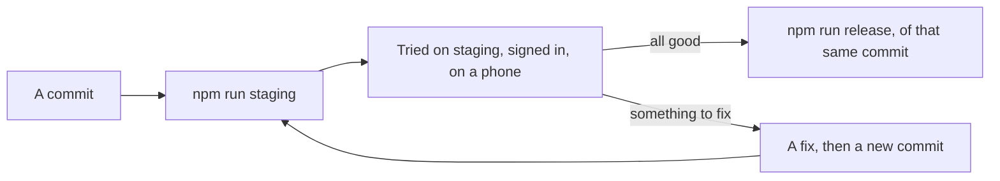

# Runbook: staging

Staging is where every change is tried before it goes live. It's the site as **its own Worker, `staging-courtside`**
(`cloudflare.config.ts` built in staging mode; `staging-<worker>` for a Worker named otherwise): the same code, on its
own database and bucket, behind the site's own sign-in, with test data only. It's for trying a change on real phones, through the real sign-in, Stream and Images, before `npm run release`
puts it live.



- **Address:** https://staging-courtside.<subdomain>.workers.dev (`deploy.config.ts` `staging.host`, with the account's
 workers.dev subdomain): `staging-courtside`'s own workers.dev address, its only one. The live Worker has workers.dev and
 preview URLs off, and each Worker answers only on its own address (`SITE_HOST`; any other gets a bare 404).
- **Worker:** `staging-courtside`, no domain, no cron triggers, no preview URLs, the same placement, observability and
 bindings as the live one (the joiner too, across Workers), with `STAGING=1` and staging's database, bucket and
 Turnstile widget. Its logs: `npm run logs -- --staging`.
- **Who can sign in:** whoever is on staging's teams' lists or its admins table: the site owner's email and four test
 addresses that land in the same inbox (`the admin's address with +watcher, +filmer, +coach and +manager, one a role), by the
 site's own email code (staging's code emails say `[Staging]`). An admin can also try any role with View as. The
 first admins are `deploy.config.ts` `firstAdmins`, made by the first `npm run staging`.
- **Every page says so:** an orange "Staging: test data, not the live site." strip, and its emails' subjects start
 `[Staging]`.

## What's its own, and what's shared

| Piece | Staging | Notes |
| --- | --- | --- |
| Database | D1 `courtside-staging` (its id is `deploy.config.ts` `staging.d1Id`) | Migrated by `npm run staging` before each deploy. Never a copy of the live data: test teams and people only |
| Bucket | R2 `courtside-staging` | Its own key (`courtside-r2-staging`, object read and write on this bucket only); CORS for the staging address; everything deleted after 7 days (`infra/staging/`) |
| Sign-in | The site's own, on staging's database (`sessions`, `sign_in_codes`) | A code on staging doesn't sign anyone in to the live site, and the other way round |
| Platform's Cloudflare figures | With the live site's read-only token (`CF_INSIGHTS_TOKEN`): the Worker's are `staging-courtside`'s own (`WORKER_NAME`), and so are the database's and bucket's | The zone's, Stream's and Workers AI's are the account's, the same as on the live site's Platform |
| Stream, Images | The account's, shared with the live site | Everything staging makes is labelled `site: "staging"` (`src/platform/site-label.ts`): the live site's nightly clean-up never counts it towards its "looks wrong" brake, and removes it once it's a week old. Test videos use the shared Stream minutes: keep them short. So staging's test game loses its video (and its clips) a week after it was uploaded: upload a short one again when it's needed, before taking Help's screenshots say |
| Workers AI, Email Sending | Shared bindings | Ask works as live; emails only ever reach staging's admins, and their links (and the match day message's) are to staging's own address (a new team's welcome goes to the admin who onboarded it, and a support ticket's emails for its team manager to the admin who answered) |
| Jobs | None scheduled (its Worker has no cron triggers) | Platform's **Run the 5-minute job now** runs it (staging only). The 3am job never runs on staging: its clean-up refuses there, as it would take the live site's things for leftovers |

## Using it

```bash
npm run staging -- --dry-run # the live Worker checked (no preview URLs, no Preview), npm run check, then dry runs of staging's migrations and the deploy
npm run staging # the committed code on staging: the same checks, staging's migrations, the first admins (firstAdmins, while staging has none),
 # cf deploy --mode staging with its keys, then staging-courtside's new deployment confirmed before refs/courtside/staging is written
```

It refuses uncommitted changes, so it's always clear what staging runs, and it deploys only the `staging` branch. A change is built on a `feature/<name>` or `fix/<name>` branch off
`staging`, merged into `staging` when it's ready, and put on staging from there; `main` in `courtside-prod` is
fast-forwarded to `staging` for the release. Both live in the `courtside-staging` folder (a git worktree). A small
follow-up to a change under test may be committed on `staging` itself. Then open the address on a phone, sign in,
and try the change.
Uploads and Go live work as live (staging's own bucket, the shared Stream); a video moves to ready when the 5-minute
job runs (Platform).

**Every change goes to staging and is tested there before `npm run release`**. Release the commit
you tested; change anything after and it goes to staging again. Staging doesn't replace any of the release's checks.

Release checks it: once a deploy has worked, `npm run staging` records the commit as the git ref `refs/courtside/staging`
(shared by the worktree and `main`, and never pushed), and `npm run release` refuses a commit unless staging ran it, or
one that differs from it only in docs, tests or notes.

## Setting it up

1. `cf d1 create --name courtside-staging --primary-location-hint oc` and `cf r2 buckets create --name courtside-staging
 --location-hint oc` (`--profile <profile>`, dry runs first); the bucket's CORS and lifecycle from `infra/staging/`.
2. The R2 key, in the dashboard (`cf`'s login can't make API tokens): R2, API tokens, **Create Account API token**,
 `courtside-r2-staging`, Object Read & Write, the `courtside-staging` bucket only. Its Access Key ID and Secret Access Key
 go in `.secrets.staging.json` (git-ignored, beside `.secrets.production.json`; a worktree links both).
3. Staging's address in `deploy.config.ts` `staging.host`: `staging-<worker>.<the account's workers.dev
 subdomain>.workers.dev` (Workers & Pages in the dashboard shows the subdomain).
4. `npm run staging -- setup` (`--dry-run` first; the owner's yes, as it changes the live Worker), before staging's first
 deploy, in this order: turns the live Worker's workers.dev and preview URLs off (`enabled: false`,
 `previews_enabled: false`); deletes its old Preview, `staging`, if there is one (staging was a Preview of the live
 Worker before it was a Worker of its own, and that Preview holds staging's address: `DELETE
 /accounts/<id>/workers/workers/<worker>/previews/staging`, as `cf previews delete staging --worker <worker>` does);
 then puts staging's keys on `staging-courtside` at once, without a deploy, through the API and never printed (on the
 first run that Worker isn't there yet, so it says so and leaves the keys to the first deploy). Run it again after any
 of those keys changes (or just `npm run staging`, which sends them too): a Preview already gone is passed over.
5. `npm run staging`: its first deploy creates the `staging-courtside` Worker. It refuses (read only, a dry run too)
 while the live Worker has workers.dev or preview URLs on or still has any Preview, so staging's address can only be
 its own Worker's. Staging's keys go with every deploy (`cf deploy --secrets-file`, a file only you can read, written
 from the two secrets files just before the deploy and removed as soon as it's done, or when the command ends or is
 stopped with Ctrl-C; the steps run with those seven names taken out of the environment, so a shell's export can't
 send another value), as a Worker that doesn't exist yet can't be given secrets any other way: the live site's Stream
 keys and Insights' read-only token, and staging's own R2 key and Turnstile secret. Once the deploy says it worked, it
 checks that `staging-courtside` has a deployment from just now before recording the commit as on staging.

## Taking it down

Delete the `staging-courtside` Worker (`cf workers delete`, dry run first), then the database, the bucket and the
`courtside-r2-staging` key. Staging's leftovers in Stream and Images go with the live site's nightly clean-up within a
week.
