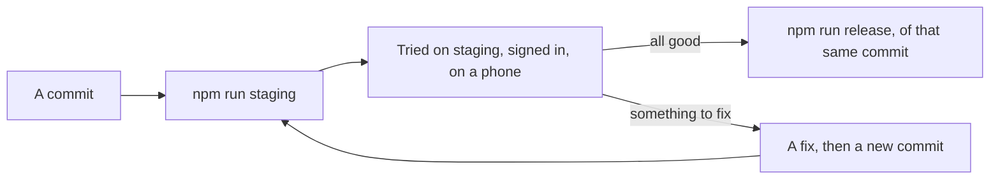

# Runbook: staging

Staging is where every change is tried before it goes live. It's the site as a **Worker Preview** of `courtside`
(Cloudflare's Previews): the same code, on its own database and bucket, behind the site's own sign-in, with test data
only. It's for trying a change on real phones, through the real sign-in, Stream and Images, before `npm run release`
puts it live.



- **Address:** https://staging-courtside.<subdomain>.workers.dev.
- **Who can sign in:** whoever is on staging's teams' lists or its admins table: the site owner's email and four test
 addresses that land in the same inbox (`the admin's address with +watcher, +filmer, +coach and +manager, one a role), by the
 site's own email code (staging's code emails say `[Staging]`). An admin can also try any role with View as. Until
 
- **Every page says so:** an orange "Staging: test data, not the live site." strip, and its emails' subjects start
 `[Staging]`.

## What's its own, and what's shared

| Piece | Staging | Notes |
| --- | --- | --- |
| Database | D1 `courtside-staging` (`eb468a8b-8716-4f91-a59d-01be025b8fc5`, Oceania) | Migrated by `npm run staging` before each deploy. Never a copy of the live data: test teams and people only |
| Bucket | R2 `courtside-staging` | Its own key (`courtside-r2-staging`, object read and write on this bucket only); CORS for the staging address; everything deleted after 7 days (`infra/staging/`) |
| Sign-in | The site's own, on staging's database (`sessions`, `sign_in_codes`) | A code on staging doesn't sign anyone in to the live site, and the other way round |
| Platform's Cloudflare figures | The account's, with the live site's read-only token (`CF_INSIGHTS_TOKEN`) | The same figures as the live site's Platform: they're the account's |
| Stream, Images | The account's, shared with the live site | Everything staging makes is labelled `site: "staging"` (`src/platform/site-label.ts`): the live site's nightly clean-up never counts it towards its "looks wrong" brake, and removes it once it's a week old. Test videos use the shared Stream minutes: keep them short. So staging's test game loses its video (and its clips) a week after it was uploaded: upload a short one again when it's needed, before taking Help's screenshots say |
| Workers AI, Email Sending | Shared bindings | Ask works as live; emails only ever reach staging's admins (a new team's welcome goes to the admin who onboarded it, and a support ticket's emails for its team manager to the admin who answered) |
| Jobs | None scheduled (previews run no cron triggers) | Platform's **Run the 5-minute job now** runs it (staging only). The 3am job never runs on staging: its clean-up refuses there, as it would take the live site's things for leftovers |

## Using it

```bash
npm run staging -- --dry-run # npm run check, then dry runs of staging's migrations and the deploy
npm run staging # the committed code on staging: check, staging's migrations, cf previews deploy staging
```

It refuses uncommitted changes, so it's always clear what staging runs, and it deploys only the `staging` branch. A change is built on a `feature/<name>` or `fix/<name>` branch off
`staging`, merged into `staging` when it's ready, and put on staging from there; `main` in `courtside-prod` is
fast-forwarded to `staging` for the release. Both live in the `courtside-staging` folder (a git worktree). A small
follow-up to a change under test may be committed on `staging` itself. Then open the address on a phone, sign in,
and try the change.
Uploads and Go live work as live (staging's own bucket, the shared Stream); a video moves to ready when the 5-minute
job runs (Platform).

**Every change goes to staging and is tested there before `npm run release`**. Release the commit
you tested; change anything after and it goes to staging again. Staging doesn't replace any of the release's checks.

Release checks it: once a deploy has worked, `npm run staging` records the commit as the git ref `refs/courtside/staging`
(shared by the worktree and `main`, and never pushed), and `npm run release` refuses a commit unless staging ran it, or
one that differs from it only in docs, tests or notes.

## Setting it up

1. `cf d1 create --name courtside-staging --primary-location-hint oc` and `cf r2 buckets create --name courtside-staging
 --location-hint oc` (`--profile <profile>`, dry runs first); the bucket's CORS and lifecycle from `infra/staging/`.
2.
3. The R2 key, in the dashboard (`cf`'s login can't make API tokens): R2, API tokens, **Create Account API token**,
 `courtside-r2-staging`, Object Read & Write, the `courtside-staging` bucket only. Its Access Key ID and Secret Access Key
 go in `.secrets.staging.json` (git-ignored, beside `.secrets.production.json`; a worktree links both).
4. `npm run staging -- setup`: staging's keys into the Worker's Previews base configuration (the live site's Stream
 keys, staging's R2 key; through the API, never printed) and the Worker's Preview URLs on (workers.dev stays off).
 Run it again after any of those keys changes. A key's new value, or a new key, reaches only a preview made after it
 (Cloudflare: the base configuration is copied when a preview is created), so then make staging again:
 `cf previews delete staging --worker courtside --force`, then `npm run staging` (its address,
 database and bucket stay as they are).

A release from code without the `STAGING` config (`main` before the multi-team switchover) turns the Preview URLs off
again (`previewUrls: false`): run setup again after it.

## Taking it down

`cf previews delete staging --worker courtside`, then the database, the bucket and the `courtside-r2-staging` key (dry
runs first), and `previewUrls: false` in the config. Staging's leftovers in Stream and
Images go with the live site's nightly clean-up within a week.
