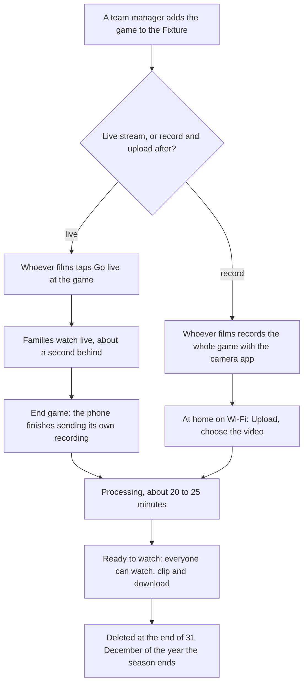

# Courtside: what it does

This is the source of truth for how the site behaves. When the code and this file disagree, one of them is wrong, and
a change to what the site does changes this file in the same commit. Where the site and this file differ, this
file wins. How it's built is in `docs/architecture.md`.

Kept current with every change.
Multi-team arrived (the design notes).

## In short

saints.example is a private site where Saints teams' families keep each season's game footage. Saints B12.1 was
first; it carries any number of teams, each seeing only its own.

- A parent films a game with their phone's ordinary camera app and uploads it at home, or streams it live from the
 site's Go live page, in the phone's browser with no app.
- Members watch it in the browser (full screen on a TV through a computer works) or download it, cut highlight clips
 everyone can watch and download, and see the final score unless they'd rather not know it yet.
- Everyone on the team adds photos, families too, for everyone to see and download.
- Coaches keep private notes on each game. Team managers run the fixture, the members, the squad and the roster, and
 get a Notifications page.

What it isn't: there are no stats, live scores, comments or chat. WhatsApp stays the team chat in most teams (the
Roster's WhatsApp message is pasted into it), and game analysis is for Superstat (superstat.com.au), to which a team
manager or coach can send a game's HD download; Help's "What is the aim here?" says both. Who gets access is each team manager's call. The only email a family gets is its
sign-in code. Players' names appear only on highlight clips and the home page's squad.

**The most important thing is that uploading is dead simple for non-technical parents.** The same goes for going
live: no apps, nothing typed, one phone.

## Who's who

| Role | What they can do |
| --- | --- |
| Watch only | Watch, download the HD MP4, see, add and download photos, make highlight clips, star favourites, and ask for a video, clip or photo to be removed. For grandparents and anyone who watches rather than films |
| Watch and film | Everything Watch only can, plus upload a game's video and Go live. The usual role for a parent, and the default for someone new |
| Coach | Everything Watch and film can, plus export the roster and keep the coaches' notes. Coaches film too. They see the fixture and roster but don't change them |
| Team manager | Everything, plus the fixture, the members, the players (the squad: first name and number, at most 10), the roster and its duties; moving or deleting any video; deleting photos; and removal requests. Only team managers change those |

The site says Watch only, Watch and film, Coach and Team manager; in the code and the database they're `watcher`,
`filmer`, `coach` and `manager`.

- **Roles are per team.** A parent with a son in B12.1 and a daughter in G14.5 is in both, with a role in each. The
 team's name at the top switches team for anyone in two or more teams, with **Switch team** under it to say so, and takes a site admin visiting another team back. Otherwise it's Home, with nothing new on it. Nobody is asked which team when there's only one to choose, and everyone sees only their
 own team.
- **Site admins** run the site. They can open every team, as its team manager,
 through a hidden membership that's never listed or counted, and they manage teams and admins in the admin area.
- **the site owner** (`the admin's email`) is B12.1's team manager and a site admin. Everyone else is added on their
 team's Manage team page.
- **No limit on a team's people**. Manage
 team, the admin area's Teams and Insights still show each team's count. Nor is there a limit on people across teams: the site's own sign-in has no per-person cost.
- **Each team's pages name it and who to ask**: the team's own name to ask, else "your team manager". Help's helper is Virtual Team Manager, named the same way
 (Virtual Sam in B12.1).

## Game day, start to finish

1. A team manager has added the game to the Fixture, set to **Live stream** (the default), **Record and upload
 after**, or **No video**.
2. To record, whoever films records the whole game as one video with the phone's camera app (not one per quarter:
 each game takes one video). At home on Wi-Fi they open the site, which lands on Upload with the game already
 picked, tap **Choose the video** and pick it from their photos, and keep the page open until it says done. The page
 keeps the screen from locking meanwhile.
3. To go live, they open Go live at the game and follow the page (Going live, below). When they stop, the phone
 finishes sending the recording it made.
4. Either way, a big message says the game will be ready in about 20 to 25 minutes, and the game's page says since when and by about when. Then it's in Watch games for everyone,
 and the HD download follows 10 to 15 minutes later.

A full game is roughly 4 to 8 GB. Uploads go in 16 MB parts, and a dropped connection carries on by itself.

## The pages

### The top bar and Home

The top bar has big, labelled buttons: **Upload video** and **Go live** (Watch and film people and team managers) with
**Watch games**, then **Roster**, **Fixture** and **Photos**. Along the bottom are the team manager's **Manage team** and
**Notifications**, and **Admin** for site admins. At the top right sit an oval **Help** button (with Ask Virtual Team Manager
first on Help), then round buttons for light or dark and for signing out. The site starts dark on every phone and
computer, whatever its own setting; a switch to light (or back) is kept on that device. A closed
team's top bar has nothing that adds, so no Upload video or Go live.

**On a computer** everyone sees the same pages laid out like the admin area: the top bar becomes a bottle-green sidebar with the team's name, every link one under
another (Manage team and Notifications after a thin line), and Help, light or dark and sign out at its
foot, with the page beside it. It's one stylesheet, `public/desktop.css`, loaded on every team page, and all of it
inside one media query: a window at least 1024px wide, a pointer as fine as a mouse, and real hover. A phone or a tablet
with a touch screen fails that and keeps the usual view to the pixel; so does a browser that can't say. The desktop view
has no Go live (nobody streams a game from a desktop PC); anyone can **Switch to mobile view** from the sidebar's foot
and, in the mobile view on a computer, **Switch to desktop view** from the strip along the bottom of the top bar. The
choice is kept on that device (`public/view.js`), and the two buttons show on a desktop screen alone.

**Home** is the landing page after sign-in: the court picture, big Upload and Go live (for those who film) and Watch
games buttons, smaller Roster, Fixture, Photos, Manage team and Notifications (team managers) and Help buttons, a link to
the latest game (with its score), and the squad. **The squad** lists the players in number order: a drawing of the
green home singlet (the club's name across the chest, their number) on the left and "Jordan #9" on the right (made-up names after
NBA players in every example: no current player is named outside the team's own pages).

### Upload

For Watch and film people and team managers: two steps (which game, then choose the video), a progress bar, and a few upload tips
(filming is in Help). The latest game without a video is picked already, and the list offers any game in the season's two years
(2026 and 2027 for 2026/27) that has no video, played ones included; it turns over each October by itself.

The video goes straight to private storage in 16 MB parts. A dropped connection pauses and carries on by itself when
the phone is back online, and after a reload, choosing the same file carries on. The page keeps the phone's screen on,
explains that an iPhone converts a video picked from Photos before handing it over (so Help says save it to Files first),
takes a video dragged onto the box on a computer, and has a **Cancel** button (two taps) that stops the upload and
deletes what was sent. The iPhone's conversion can't be avoided from a web page: Safari's file
picker asks Photos for the "compatible" copy, which re-encodes HEVC to H.264 before the page sees a file, and with any
other `accept` it re-encodes the video itself; only the Files picker hands the original over, half the size. Web Share
Target (sharing from Photos into the installed app) isn't in Safari. So the page keeps `accept="video/*"`, and Help says
Files first and the camera settings that keep a game to about 4 GB (1080p at 30 fps, High Efficiency).

### Going live

Every live stream starts from the Go live page, the same on iPhone and Android, with no app. The one exception is a game filmed by an AI
tracking camera, whose own app has to hold the camera: see "From an external app" below. Go live offers only games set to Live stream,
today's and upcoming ones, and says when today's is set to be recorded instead. It picks the game being filmed, else
today's next game still to finish (one starting within half an hour, in its warm-up, before one under way that nobody
is streaming), else the next one coming up.

1. **Start camera.** The phone asks for the camera **and** the microphone, and both must be Allow: the page won't go
 live without picture and sound.
2. **Go live**, during the warm-up. The camera fills the screen (real full screen and landscape where the browser allows).
3. **Pause** and **Resume** for whatever isn't filmed (the warm-up, half-time). Families see a Game Break card (the club head on bottle green with court lines,
 "Live stream will resume shortly") and no sound, the recording leaves the break out, and the filming phone shows a yellow frame until Resume.
4. **End game**, a big red button. It asks **Yes, end game** or **Keep streaming**, so a bump can't end the game.
 Ending the game is final: nothing can stream to that game again, and the page shows **Saving the video** with progress until
 **Saved**. About 20 to 25 minutes later it's in Watch games, like any upload. Families watching see a Full time
 screen in the Game Break screen's look within a few seconds, saying the live stream has ended and when the video
 will be ready.

The page streams to families over WebRTC, about a second behind, and records the game on the phone at the same time,
sending it as it goes, so the saved video is full quality whatever the signal did. A stream under a minute is a test:
it's thrown away the moment End game is tapped (nothing uploaded or processed), with a note on the game page and Go
live, and the game is free again. The minute is what was recorded, pauses left out. The phone switching the camera off
(it locks, a call comes, another app takes it) ends nothing: while it's away families see the Game Break card and the
recording waits. A camera that comes back carries on by itself; one the phone switched off for good comes back with
**Resume camera** (one tap, the same on iPhone and Android), in the same video, the gap left out. The recording is always
landscape, whichever way the phone was held when a camera started. On a weak signal the recording is sent behind the
game; once minutes of it are only on the phone, the camera screen and the Saving panel say how many, and to keep the
page open until Saved.

- **Closed by mistake?** (Safari closed, the phone restarted, the tab killed.) Reopen Go live on the same phone: it
 remembers the recording and offers **Carry on streaming**. The button counts down while the last of the recording
 arrives (up to two minutes after the last part), then the camera starts again and the red **Carry on** button (Go
 live's, renamed) streams and records into a second segment of the same recording: two taps, as Go live is, so the
 recording's sound is set up after the camera's permission prompt, never interrupted by it. The minutes the page was
 closed aren't in the video; families see "Live stream will resume shortly" over the frozen picture meanwhile. End game is as always, and the site joins the segments into one video afterwards (a small container with
 ffmpeg, the joiner: the design notes), so the game stays one video. The same
 phone only (another phone's recording couldn't be joined without re-encoding); the alternatives on every phone are
 **Save what was recorded** (now "End game and save what was recorded" while carrying on is possible) and delete it
 and start again. If the joiner can't join the parts after six tries in an hour, the team manager sees **Keep the
 first part** on the game's page and finishes without an admin; the admins get the joiner alert. Until 9 Nov 2026
 carrying on wasn't built.
- **Data:** 2 to 3 GB a game (an iPhone records at about 4.5 Mbps whatever is asked for).
- **From an external app (RTMPS):** under Start camera, a smaller green **Use an external app instead** puts the
 game's RTMPS details in the camera card's place: the Server and the Stream key (each with Copy), a line on what RTMPS
 is, whether the site is receiving the stream, **End game**, and **Use this phone's camera instead** (until the
 app has streamed). It's for an AI tracking camera whose app can stream to a custom RTMPS server with a stream key
 (XbotGo and Trackd are two examples of many, as they stood at the time of writing: XbotGo's app can, Trackd's can't
 yet, so its games are recorded and uploaded). Stream records the stream, so there's
 no phone recording and no original in R2; families watch in the usual video player about half a minute behind; the
 game's video is Stream's recording, saved after End game or by itself 20 minutes after the app stops. A gap
 under 10 minutes stays one recording; after a longer one the longest part is the game video and the others are clips.
 Under a minute is a test, as from the camera. The saved video is only as good as the signal was. Each change is in
 the admin Log.
- **Browsers:** Chrome on Android (best), Firefox (live picture, WebM recording and Stream processing tested 18 Oct
 2026), and Safari on iPhone (every iPhone browser is Safari underneath).
- **Watching:** the live picture starts with sound where the browser allows it. Where it doesn't (phones only start
 video silently), it plays muted, the first tap anywhere turns the sound on, and a **Turn the sound on** button shows
 until then. A **Live now** card shows on Home and in Watch games while a game is being streamed, and a red **LIVE
 NOW** bar (the game, and Watch live) along the top of the team's other pages, apart from Go live and the game's own
 page. The bar goes by what the 5-minute job saw, so it comes up within 5 minutes of Go live and goes at End game (or
 8 minutes after a phone stops sending without it).

### Watch games

Every game, oldest first, with upcoming ones at the bottom, filtered by competition (no search: a season is a few
dozen games). Watch games names the season and turns over each October by itself. Each card shows its state with its
own look:

- **Ready to watch** (a green tag). A game video you haven't opened is tagged **New** for 21 days after it's added (not
 for whoever uploaded it), and Home shows the count on Watch games.
- **Processing**, **Uploading** or **Saving live stream** (an amber card, a big pulsing label, "Ready to watch soon").
- **Upcoming** (faded, dashed), **Waiting for video** (plain), and **No video** (greyed).

A game without footage shows the court picture. **Your favourites** sit at the top: the games and highlight clips a
member starred with **☆ Favourite** (on a game's page and on each clip), each member's own; a clip opens at the clip.

### A game's page

- **The video:** the player, **Watch full screen** for a computer plugged into the TV, and **Carry on from** (the phone
 or computer remembers how far in you got).
- **Download HD video:** Stream's HD MP4. The first time it may say it's being prepared. Every download is logged.
- **Saving on an iPhone or iPad:** a highlight clip's **Save** opens the share menu, where Save Video puts it in Photos.
 A whole game (1 to 3 GB, too big for the share menu) still goes to Files, with how to move it to Photos, and in the
 Home Screen app it opens in Safari, never on a page with no way back. Computers and Android phones download as usual.
- **The game's details**, and a line under the title ("The Saints take on Northside 2 at Saints Stadium, Court 1."), from
 templates with a little basketball flavour, not AI: the same line for a game every time, kind to both teams, and how
 it went only when there's a score to show; a win by one point is a thriller ("The Saints won by one in a thriller
 against..."). The club's lines are every team's until its team manager changes a group
 (**Manage team**, **Game lines**: one line a row, with {opponent}, at {venue}, {ours} and {them}), checked as
 they're saved and in the Log; an emptied box goes back to the club's.
- **Scores:** during the game's hour it says **In progress**. The final score ("Won 34 to 28", "Lost 28 to 34", "Drew 30
 all") shows on the game's page, Watch games, the Fixture and Home's latest game. A team manager enters or fixes it once
 the game has started (**Save score**, and **Clear score** for one typed in). For a PlayHQ game, the site asks PlayHQ
 from half an hour after tip-off and enters it when PlayHQ says it's final, which ends In progress straight away
 (a fixture's Check now asks at once). A game with a final score, either way, is never
 asked about again.
- **Hide scores:** a switch on Watch games and on a game's page, per member, so it follows them to every phone and
 computer. Hidden means no score or result anywhere on the site. Scores show unless a member hides them, and In
 progress still shows, as it isn't a spoiler.
- **Ask for this video to be removed**, for anyone.
- **For team managers:** move the video to another of the team's games (only games without a video) and delete it.
- **Coaches' notes** (below) for coaches, and the game's **highlight clips** beside the player.

### Highlight clips

Any member marks a start and an end while watching (3 seconds to 5 minutes) and gives it a label, and Stream cuts it as
its own video. Every member sees every clip beside the game's player, can watch it in the main player and download it
as an MP4.

- **Who's in it:** ticking players while making a clip ("#9 Jordan", in number order; optional, any number), shown on
 the clip. The clip's maker or a team manager can change them later. The players are the team manager's, on Manage team,
 so each player's clips can be gathered into a reel at the season's end.
- **Removing:** only a team manager deletes a clip; anyone
 else, its maker and coaches included, asks for it to be removed, and the team manager deletes or keeps it on
 Manage team. Clips are deleted with their game's video.

### Coaches' notes

Private notes on a game, optionally at a time in the video. Only members whose role is exactly Coach see them, not
Watch only, Watch and film or team managers, and the panel says so. Either coach can delete any coach's note.

### Fixture

Everyone sees the games (date, tip-off, venue, video status) without any controls. Team managers also add, edit and
delete games, each with its video status (has video, processing, upload failed, waiting for video, upcoming, no video).
New games default to **the coming Friday, at the team's usual tip-off**: 6:40pm for U12, 7:40pm for
U14, 8:40pm for U16 and 9:40pm for U18, boys and girls the same (an age between takes the younger group's). A PlayHQ
game with no time yet, and a game a fixture page gives no time for, get it too.

- **Each game's Video** is **Live stream** (the default), **Record and upload after**, or **No video**. It shows on the
 Fixture, Watch games, the game's page and the match day message. **No video** is for a game that won't be filmed, or
 wasn't, or whose footage was lost: it drops out of Upload and Go live, nobody's rostered to film it, and Live stream or
 Record puts it back. It can't be chosen while the game has a video (a failed one doesn't count). A game is
 **Waiting for video** for a week after tip-off; with nothing uploaded or streamed by then, the 5-minute job sets it
 to No video, with a line in the Log by the site (a Go live that was only opened is closed). A team manager who sets
 the game back to Video, to upload it after all, gives it another week from then. A game whose video a
 person deleted is left alone, and a week's or a PlayHQ fixture's Video switch leaves the site's No video as it is
 (Edit undoes it, one game at a time).
- **Add game**, by hand (a practice match, say).
- **Add fixture** takes a PlayHQ team link (VJBL or Tournament) and brings in all its games. Added fixtures are listed
 with **Check now** and **Remove**, and each is checked again every 8 hours until it's over: six weeks after its last
 game for VJBL (later rounds after a break, and finals, still come in). A tournament runs over four days (Friday to
 Monday) and its finals appear on the team's fixture as they're made, so it's checked every hour from its first game's
 day to the end of its fourth (its last game's, if PlayHQ lists one later), then stops. A fixture
 that never gets a game stops 60 days after it was added. Each says on Fixture when it's checked and the day it stops. Opponents are shortened ("Hillcrest 3"). A check never removes a game: one PlayHQ drops (grading
 games) is marked "Not on PlayHQ any more". Adding a PlayHQ fixture brings back its games deleted
 earlier (if they have no video); later checks leave deletions alone.
- **Any public fixture page** works too: the site fetches it and Workers AI (Gemma 4, JSON mode) reads out the
 team's games, looking for the team by the name its code gives it (b12.1 is "Saints U12 Boys 1", as on PlayHQ, and
 the other ways a draw writes it), so nothing is typed. A page that only draws its fixture with
 JavaScript can't be read, and it says so.
- **A spreadsheet**: a CSV with Date, Time, Competition, Round, Opponent, Venue and Video (Australian dates; there's a
 sample to download).
- **Checking first:** however they come in, the games are shown to check first, with problems listed and games already
 in the fixture left out (the same day and time, or the same day against the same opponent), and only the ticked ones
 are added.
- **No video for these games:** a tick for a tournament that doesn't allow filming marks them No video. A PlayHQ
 fixture remembers it, so games PlayHQ adds later (finals, during the tournament) come in No video too. It's per
 fixture, never per competition, and each PlayHQ fixture
 has a **No video** / **Allow video** switch that changes its games and the ones it adds later.

### Roster

A page every member sees; the team manager runs it. Each week (Monday to Sunday) of the season with a game needs two
families scoring, one on lollies and one on video. There's no video duty when every game that week is No video.

- **Duties**: always two scorers. The extra duty (Lollies, which a team manager can rename) and
 video can each be switched off for the team, and either can go to one family every week, who then gets no other duty
 (a parent who films every game rather than score). A duty switched off goes from this week on, and saving shares out
 the weeks from next week on again. **No video this week** marks a week's games No video (a tournament that doesn't
 allow filming, say). **Scorers only this week** drops the extra duty for that week as well as marking its games No video,
 so a tournament weekend has its two scorers and nothing else; **All duties this week** undoes it. The week's card,
 the match day message and the spreadsheet say "No lollies" (or the duty's own name) for it.
- **Generate roster:** the team manager adds families by surname, a row each like Add people, and taps **Generate roster**. Every week from next
 week on is shared out fairly: each slot to the family with the fewest of that duty, then the fewest overall, then the
 longest since their last duty, never two duties in a week. This week is kept, and so are duties set by hand. Every
 family's total, and each duty, end up within one of each other: each week goes to the families with the fewest duties,
 the duties are shared among them as evenly as possible (where it's as fair, not to a family that had the same duty
 the week before or after), then families swap duties (in the same week, or two weeks
 where each is free) while it evens things out. Tested for 4 to 16 families and seasons up to 30 weeks, in a few
 milliseconds.
- **Time off the roster**: taking a family off
 starts its time away, and adding the same surname back ends it. Each week it was off, and each week before a family
 added partway through the season was added, counts as its share of that week's duties (the week's duties over the
 families on the roster then; a family on one duty every week isn't sharing, so isn't counted). So a family back
 takes turns like everyone else instead of duty after duty to catch up. Roster fairness counts it too: the verdict
 includes it, and "Time off the roster" says who was off, for how many weeks, and what that counts as.
- **New games** get their week's duties by themselves when the roster is next opened, and a week whose games went is
 cleared.
- **Changes by hand**: **Change** on any week gives each duty a family picked by hand, or leaves it
 as **Roster's pick** (showing the family the roster chose). A family picked comes off any other duty that week, and a
 duty it leaves is filled fairly. Generate keeps duties set by hand and shares out the rest around them, and the week
 says "Set by hand: Video." for the team manager. **Save week** changes only the duties picked (and any a picked family
 leaves), so an earlier week stays as it was, even with a family since taken off. Generate gives a duty left with a
 family that's off the roster to one on it.
- **Your duty:** a member whose last name matches a family sees that family's next duty.
- **Roster fairness**, for everyone at the bottom (after the team manager's families panel): a plain verdict ("Fair:
 every family has as close as possible to an equal share of duties", or "Not even yet" when families are more than
 one apart, which tells the team manager to Generate roster), a short "How duties are shared" in plain words
 (including why a No video week has fewer video turns), a table of each family's scoring, lollies and video with their
 total, and a week-by-week chart of who's on. Only families on the roster now are counted (one taken off keeps their
 duty on the week they did). The chart keeps one square size for the whole season (October to September), with month
 names, slides sideways on a narrow screen and opens at this week (`public/roster.js`). Percentage rings and duty-mix
 bars were tried and dropped.
- **The WhatsApp message**:
 the match day message for the team chat in the site owner's layout ("Opponent: …", the venue and time, arrive 30 minutes early, and the uniform, from the club's list in
 `src/club.ts`: chosen each time when there's more than one, packing the other, the clash uniform, "Navy uniform, pack
 White just in case."; a club with one kit or a reversible singlet gets "Uniform: Reversible singlet." and no choice), then 💻 Scorers, 🍬 Lollies and 🎥 Video
 from the roster, with **Copy** and **Open WhatsApp**.
- **Compact**: each week is
 its games (a weekend's shared venue once), then Scoring, Lollies and Video each beside its families on a line or two,
 then the team manager's WhatsApp message and Change on one row. The next six weeks show; **Later weeks** folds the
 rest of the season, as **Earlier weeks** folds the ones played, and a link to a folded week opens it.
- **Duties per game**:
 every game has its own two scorers, and its own lollies and video where the team has them (`roster_slots.game_id`,
 migrations 0036 and 0037), rotating fairly across games. A weekend whose games are all a tournament's starts as
 scorers only (no lollies; its games are usually No video from the fixture) until the team manager taps **All duties
 this week**. A weekend with several games shows each game's duties under that game, in Change (a field a slot, named
 for the game), in its own WhatsApp message and in the Excel export (a line a game). A family still gets at most one duty a week, unless a weekend has more slots than families: then a family
 takes a second game: never the same game twice, not straight before or after its own game while another family can
 take it, then fewest duties and fewest of that duty first, then the family whose own game is furthest away. Slots from before slots knew their game are
 their week's one game's; a week that had several keeps them as the week's.
- **Export to Excel** (Watch and film people, coaches and team managers, not Watch only): the season's weeks as an.xlsx, a
 row a week (week of, games, venues, scoring, lollies, video or No video), with a bold, frozen header row.

### Photos

Everyone on the team gets **Add photos** (**Choose photos**, any number, or on a computer drag
them onto the box; sent three at a time after the first when it went up quickly, else one at a time (a weak signal), with
progress; one the site turns down, or that can't be opened, is listed and the rest carry on; a page left part way says
how many weren't added the next time Photos is opened). Everyone sees and downloads
them.

- **Not linked to games**: newest first by when each was taken, under a heading for
 each day, three across on a phone, 60 a page (**Newer photos**, **Older photos**). The date is the photo's own (EXIF
 DateTimeOriginal, read on the phone before it's made smaller); a photo with none (a screenshot), or a date still to
 come, gets the time it was added.
- **On the phone**, each photo is redrawn at most 2560 px along its longer side as a JPEG, which turns it upright and
 leaves off everything else the camera saved, where it was taken included. The site checks it's a JPEG and strips any
 metadata still there.
- **Several at once**: **Select photos**, tap the ones wanted, then **Download** (one zip; on an
 iPhone **Save to Photos**, the share menu with them all) or **Delete** (shown only when every chosen one is the
 person's own, or for a team manager). Each photo is named in Cloudflare Images as it downloads.
- **A photo's page:** the photo and when it was taken, Newer and Older (on a phone, a swipe left or right slides to the next photo in place, like a camera roll), **Download photo** (the JPEG as stored,
 `saints-b12-1-<date>-photo-<id>.jpg`; on an iPhone or iPad it's **Save photo**, which opens the share menu, where Save
 Image puts it in Photos), and **Ask for this photo to be removed**. Whoever added it gets **Delete photo** instead
 (added by mistake, say), and a team manager sees who added any photo and when, and **Delete photo**
 (it asks first, and it's for good).
- **Kept privately** in Cloudflare Images and shown only through signed links that run out after 6 hours: a 512 px
 square thumbnail and a 1600 px view, neither with any metadata.

### Manage team

Called Members, at `/manage`; the old
address, `/members`, goes there. For team managers: add a person, edit names and roles, remove people, handle removal requests
(videos, clips, and photos with the photo shown), and the squad (**Players**: number and name, a first name or a full name, at most 10; Home's
squad and the clips' player tags read it).

**Who films needs Watch and film**: People says, beside Add a person,
that anyone who'll film games, everyone on the roster's video duty included, needs Watch and film (or Coach or Team
manager), as Watch only can't upload a game's video or Go live; the team manager's Help says it in Adding people, The
four roles, and Families and duties (when the team has video duty).

**Add a person** is one row at the foot of the People list, as
Add a player is under the squad: their email, name and role (Watch and film unless another is picked), then **Add a
person**; the page reads People, Who's using the site, then End of season. A name with no email, or an address that
isn't one, is refused and nothing is added. An email already on the list never changes that person. Before that it was an Add people box above the list with a row a person and + Add another, which Add families on the
Roster still has; before that, one box of pasted addresses with one role for all.

**Add from a spreadsheet**, under Add a person: a template to download (Name, Email, Role, with
made-up people), filled in and saved as CSV. Every row is shown first: new, on the team already (left exactly as they
are), or a problem with its row number. A blank role is Watch only, and the usual wordings of each role are understood.
The new people are then added and logged as Add a person adds one; 200 a sheet at most.

**Getting the team ready**, at the very top until every step's done, while the season's on: the
setup checklist, each step ticked or with where to do it: the squad entered; someone set to Watch and film, the coach and a team manager added, one step as they're added
together, saying how far each has got; the fixture in; and the roster made. The admin area's Teams shows each running
team's "3 of 4" and what's left.

**End of season: keep it all**, at the very bottom, closed teams too: when the season's videos,
clips and photos are deleted (the team's own date once it's closed), every game's HD video to download, with **Get every
HD copy ready** (Stream makes a game's HD copy the first time it's asked for; this asks for every game's at once), each
player's highlight clips under their name (and those with no one tagged), and links to save the photos and the roster.
Home's "videos and photos go after…" notice points team managers to it.

**Waiting to sign in**, at the top while anyone is: the team's people who asked for too many sign-in codes (10 in an
hour, or 20 in a day) or typed too many wrong ones (15 in a day), and are waiting, each with when they can ask again and
**Let them sign in**, which ends the wait now.

**Who's using the site**, below the People list: how many people (by role; there's no limit), and how many last opened the
site in the last 7 days, 8 to 30 days ago, longer ago, or haven't signed in yet (from each person's Last seen, which the
site writes at most hourly; the team manager looking counts as now). The list sorts by **Name**, **Role** (team
managers, coaches, Watch and film, Watch only) or **Last seen** (most recent first, never last) from the Sort by chips,
and Save, Remove and Add a person keep the order. Each person's name and role can be changed in place: their **Save**,
at the end of the row beside **Remove**, shows only once one of them differs from what's saved (and goes again if it's put
back), keeping its space so the row doesn't move.

### Notifications

For team managers: what's uploading, processing or waiting for its HD MP4, and a 30-day feed (uploads, ready, failed,
HD ready, clips, and removal requests for videos, clips and photos). It refreshes every 2 minutes. The admin Log shows
the same for every team: its Right now, and the feed as Videos and Photos lines.

### Help, and Ask Virtual Team Manager

**On a computer**, Help is laid out as the admin area's Documentation: the contents and a search down the
left, one section at a time in the middle (a team manager's own questions a section for each of their headings, and
Contact support one too) with cards to the sections either side, and On this page (the section's questions) down the
right on a wide screen. A search shows every section's matching questions. It's `public/help-desk.js` and rules in
`desktop.css`'s media query; on a phone none of it shows and Help is exactly as it was.

**A team manager's Help is in two parts**: **Running your team** (their own sections, ending with removal requests and Contact support), then **For
everyone on the team** (Getting started, filming, watching, photos, the roster, the aim and child safety). Each part's
name heads it on the page, and on a computer it labels its sections in the contents. Everyone else's Help is as it was.

Help is at `/help` (old `/faq` links still go there), from the **Help** button at the top right of every page and on
Home. Its questions open when tapped, with a search box that narrows them as you type (a heading inside a section shows
only while one of its questions matches). There are no section chips: there aren't many sections.

**Each person sees only what they do**:

- everyone starts with getting started: signing in, installing as an app, the site on a computer (the desktop view and its
 switch), and who can see what;
- Watch only then gets why they can't see Upload video or Go live, watching, photos, the roster, child safety and what
 the site is for. Watch only people don't film, so they never get the video duty checklist;
- Watch and film gets filming next: video duty, recording on an iPhone and on Android, uploading, and live
 streaming;
- a coach gets no filming, but their notes;
- a team manager gets their own questions next, then filming, then everyone's, with their clips, photos and removal
 requests, then child safety, last.

Help is plain and to the point: how to use the site, with no in-jokes, filler examples or the
obvious spelt out, and the same words for boys' and girls' teams. The roster is "game day duties", whatever a team's
duties are. Every section reads right for its team: who to ask and its own season's date; the site owner's own line (Sunday
training) only where the site owner is the name to ask. It also says the site's admins can
open any team to help, and how someone in two teams switches. Fiddly steps have mock screens (installing on an iPhone,
Save to Files and Choose File, Go live's Pause and Stop), and the questions about a page of the site show a screenshot of
it (`public/help/`, taken on staging with test data): signing in, the home page's buttons, Watch
games, making a highlight clip and the clip it makes, Upload, Go live, Photos, the Roster, and for a team manager Add a person, Waiting to sign in,
Players, the Fixture and the roster's panels. Virtual Team Manager reads none of them. "What is the aim here?" is the last question.

**A team manager's Help** is everything a team manager does, a question at a time: a first-week checklist (taking it
that they have the team's WhatsApp group, with every family in it, and their emails), members and roles, players, the
fixture and PlayHQ, the roster and its duties, videos, live streaming, notifications and scores, and the end of the
season. Removal requests (with deleting clips and photos) come after everyone's questions, then child safety, then the support form at the bottom of the page. Every button it names is checked against the page it names, so it can't drift from the site.

**Ask Virtual Team Manager** (named for the team's manager: Virtual Sam in B12.1) sits at the top of Help, for every member: "Ask anything about using the site." Workers AI (Google's Gemma 4, quick and cheap, its thinking off) answers in plain text from the asker's own
Help page only (so it stays in step with it), declines anything off-topic, and says to ask the team's name to ask (or "your team
manager") when Help doesn't cover it, and for a team manager it points to the support form. It's told only whether the asker is on an iPhone, Android or a computer, so it gives the steps for their
phone. Nothing is stored. If the AI isn't answering, it says the helper can't answer just now. Twenty
questions a member a day at most.

### Support, for team managers

A team manager asks the site's admin for help with **Contact support** (the form at the
bottom of their Help, and on **Support**),
choosing what it's about and saying how to reach them. Each question is a ticket the admins answer on the site.
**Your requests**, on Support, lists theirs with where each is at:

| They see | Meaning |
| --- | --- |
| Sent | Waiting for the site's admin to pick it up |
| Being looked at | The site's admin is on it |
| Waiting for you | The site's admin is waiting for their answer |
| Resolved | If there's more, replying opens it again |

A ticket's page shows the conversation (never the admins' private notes) and a box to reply. Replies are emailed both
ways with a link to the ticket, and kept there. Five questions and twenty replies a day at most. It works for a closed
team too.

**Feature requests**: Feature request in the form's dropdown sends an
idea for the site. The admins have it in its own queue, and it goes by its stage, which the team manager is emailed
and sees: Sent (not looked at yet), Under consideration, Planned, Shipped, or Not planned. An admin can move a ticket
between the two types.

### The admin area

For site admins only, on a computer or a phone: a bottle-green sidebar on a computer (Switch to mobile view, light or
dark and sign out at its foot, as on the team pages), one row of sections that scrolls sideways on a phone, with
Support's counts beside it (tickets waiting, and alerts that aren't ok). Anyone else gets "Page not found" there.

- **Insights**, the landing page (`/admin`): first, is the site all right: "All green" when it is, else how
 many urgent and warnings, first; then what needs an admin (support tickets waiting, families' removal requests in
 any team, a running team without a team manager), every check as a light (green, amber, red, or grey before its first
 check), worst first: the alerts as they stand, and what it checks as it opens (the nightly backup and clean-up, Stream
 answering, videos processing over 4 hours, uploads failed in a week, the Worker's errors in a day, sign-ins refused),
 and what's going on now (live streams open, uploads under way, devices signed in). Then the whole site in numbers on
 three boards (teams and people; footage; watching and asking), each figure with its last 12 weeks, first views week by
 week, when families watch (a day-by-hour heatmap), the rest as small charts, mobile against desktop (the devices
 signed in now in each view, and the devices that opened the site in each, week by week), the
 teams side by side, then what stands out. Counts only, never anyone's email.
- **Teams** (`/admin/teams`): **Onboard a team**, and for each team **Open** and a **More** menu: View as Watch only,
 Watch and film, coach or team manager, Edit, **End season and close team**, Reopen, and Delete tonight.
 Each running team's setup ("3 of 4" and what's still to add, as Manage team's checklist).
- **Support** (`/admin/support`): a ticket queue (what needs an answer, yours, waiting on the team manager, resolved,
 all), each ticket's conversation, reply, private notes, owner and status, and the site's own tickets from its
 monitoring.
- **Platform**: the site's health, each thing once: a row for each thing watched with its figure, its limit and its
 alert, the nightly backup and clean-up, and Cloudflare's last 30 days.
- **Costs**: what each team costs on Cloudflare, laid out as cloud cost tools do, in Australian
 dollars at the day's exchange rate (the European Central Bank's) or Cloudflare's own US dollars: this month and its
 change on last month, the season so far and estimated, a player a season and a month, Stream's storage against the bundle, every
 team's months stacked by kind of cost (shared, video storage, watching, uploads), the running teams against their
 budgets, every team's season on one scale, every team month by month in one grid with their total (Team by team),
 where the money goes this month and over the season, and what the teams used this month, as a dashboard of tiles and widgets. Download for Excel gives the season, in the currency shown, as a workbook: the figures, each team, each team's months by kind of cost, Team by team and Cloudflare's bill, as numbers Excel can add up. Each
 team has its own page with its budget, set there, its months against a twelfth of it, and what a
 player and a game cost. A team's own storage, watching and uploads are its own; the site's fixed costs are shared by
 the days each team ran in the month. The estimate: 30 games a season, an hour of video, three clips and nine
 families each watching twice, until the team has three games of its own. Over budget so far, or estimated to go over,
 is the Team budgets alert.
- **Documentation** (`/admin/docs`), laid out as documentation sites are: the contents in groups and a search box down the left (behind a button
 on a phone), one section at a time with a breadcrumb and cards to the sections either side, and "On this page" down
 the right on a wide screen. The search finds words in any heading, paragraph, table row or caption and goes to the
 place. It is written for a
 new admin, numbered 1 to 29 in groups: Getting
 started (Start here: the admin pages, the routine, the rules, what to read; the site at a glance), The platform
 (Cloudflare setup, where the code lives: Artifacts and Workers Builds), How it works (requests, signing in, teams and
 roles, people and players, the fixture and PlayHQ, the roster, videos and live streaming, watching, clips and coaches'
 notes, photos, Home, notifications and removal requests, Help, Ask and support, privacy and child safety, fair use),
 Running it (the admin area and its figures, common admin tasks, the jobs step by step, the data, monitoring and
 support, costs and billing), Changing it (setting up a computer, the environments and how each is deployed, when
 something goes wrong, where things are in the code; setting up a computer step by step by hand, including the clone
 from Artifacts and the courtside-staging worktree, and working with an AI coding agent, with its instructions,
 `docs/agent-setup.md`, to copy into an AI coding agent, another agent or similar) and Reference (a glossary of Cloudflare's words
 in plain English), with thirty-one diagrams; the **Documentation AI assistant** at its top, which answers an admin's question
 from the sections it's about, names them with links, and takes 50 questions an admin a day; and carries the **fair use policy**: one video a game, a few clips, photos of the team's own games and events, downloads for the household only,
 the daily Ask and Support limits and the $200 season budget, each beside the limit the code enforces. Written for
 teams and to be shared with them later; admins only for now.
- **Admins**, the **Changelog** (release notes, newest first, from `CHANGELOG.md`, under a heatmap of the last twelve months' features, enhancements and fixes, a square a day like a contribution graph, narrowed with the kind chips) and the **Log**: one page, in
 place of Activity and the Log as two. First its **Right now**: every team's live streams, uploads,
 processing and HD downloads, and removal requests waiting, each with Open; it follows the Team filter alone. Then
 everything that happened, in six groups: Admins (and the site); Teams (people, players, games, game lines); Videos
 (uploads, processing, clips, Go live: who went live, how the game ended, a test thrown away, a stream saved; removal
 requests); Photos (added, deleted, removal requests and what the team manager did; one person's run of photos within
 half an hour is one line); Sign-ins; and **Problems**, failures of any kind: a page or request that
 failed, a job's step, an email that didn't send, Stream, PlayHQ, Images, Cloudflare or the AI not answering, and what
 the phones report (Go live's camera or sound lost, its connection dropping, Go live refused, an upload or photos that
 stopped), the same one again within half an hour counted on its line. Every line from a person says which device it
 came from, iPhone or Android and the browser. As a table that filters on everything (group, who,
 team, event, device, words, only warnings, the days) and downloads for Excel.

In a team they open, a strip says "Admin: you're seeing Saints G14.5 as its team manager." with **Back to Admin**, or
"Viewing Saints G14.5 as Watch only." with **Stop**.

**Onboarding a team** asks only for its code, its season (this or next), the team manager's name and email, and who
members are told to ask. The site emails the team manager a welcome to get them started (Reply-To the admin), and the
welcome page shows it, to copy or email again. **Ending a season** closes the team: read-only at once, and deleted
when its season's footage is due (31 December of the year its season ends, as Help tells families) or at 3am that
night, with its code typed. It can be reopened until deleting starts. Deleting takes every photo, video, clip, original
and record of the team, except what the download log names (kept its two years).

### Smaller pages

- **Which team?**, for someone in several teams who hasn't picked one yet, or a site admin. A link to another of your
 teams' games or photos offers to switch.
- **Not on the list:** a friendly page for an email that got past sign-in but isn't on any team's list ("Ask your team
 manager to sub you in"), with Try again.
- **On the Home Screen:** the site can be added to a phone's Home Screen as "Courtside" and opens full screen like
 an app, on a the club's deep colour launch screen rather than a white one: the club's mark, the club's name and a basketball
 bouncing (drawn in SVG), gone the moment Home arrives. Help's "How to install as an app" has the iPhone
 (Safari's Share menu) and Android (Chrome's menu) steps with mock screens, and an Install button where the browser
 offers one (not on iPhones: Apple doesn't allow it). It must keep working both ways, in the app and in Safari or
 Chrome, except Go live, which is only from Safari or Chrome (in the app, a phone locked for a moment loses its sound
 for good). In the app a page can be pulled down to refresh (never mid Go live, mid upload or while
 photos are being added), and an iPhone keeps the app's sign-in apart from Safari's, so it asks once.
- **Sign out:** an exit door furthest right of the top bar on every page. It asks first, signs out without leaving
 the page (so the Home Screen app isn't stranded), and offers **Sign in again**, which takes a new code from email.

## Rules that hold everywhere

- **Every delete or remove asks first:** **Delete**, then **Yes, delete it** or **Keep it**, for a game, a game with its
 footage (team managers only), a video, a clip, a photo, a member, a player and a roster family. The server refuses a
 delete that didn't come through the question.
- **A closed team is read-only** until its delete date. Watching, downloads, removal requests, the team manager's
 deletes and Support still work; nothing new can be added; and every page says until when.
- **Times** are 12-hour, local time ("6:40pm"); the site never shows a 24-hour time.
- **Words** are plain Australian English for non-technical parents: no dashes as punctuation, "for example" written
 out, and "Round", not "Rd".
- **One season a team.** Each team is one season's squad (B12.1 is 2026/27). Game footage only: VJBL, tournaments and
 practice matches, no training. Team managers create every game in the Fixture ahead of time. Seasons start in
 October.
- **One video per game.** A game with its video can't be uploaded to again; to replace one, a team manager deletes it
 first. A game filmed in several clips goes to the team manager, who joins them with
 `scripts/join-clips.mjs` before it's uploaded.

## Privacy, safety and security

- **Child safety:** the site is checked against the Child Safe Standards in `docs/child-safety.md`. Help's
 child safety question, Standards, says the site makes its best efforts to meet the standards body's Child Safe
 Standards (linked), that only game footage is filmed, and that the Saints handbook and
 website cover child safety policies (the site isn't the club's own, so it doesn't speak for it). Help is for using
 the site, so it doesn't restate the standards or tell people what not to do, and nor do the
 download panels.
- **Invite only:** the site's own sign-in guards everything, pages and files alike (the Worker runs before the static
 files): a code by email, sent only to an address on a team's list or an admin's, then a 30-day session per device;
 the Worker checks the team's list on every request. Codes are limited per address (10 an hour, then a 15-minute wait
 that the team manager can end on Manage team), per IP address and for the whole site, with a ticket for the admins
 if the site is flooded. `workers.dev` is off, and the one preview address,
 staging's, is behind the same sign-in.
- **Every team sees only its own.** Every write says which team its page was for, so nothing can be saved into
 another team from a page left open.
- **Videos** play only through short-lived signed tokens. Originals are in a private bucket behind pre-signed links
 that expire within six hours (the upload's parts, and Stream fetching the finished file), and are never downloaded.
- **Photos** carry no EXIF and no location (the phone redraws each one, and the site strips anything left), and are
 seen only through signed links that run out after 6 hours.
- **At the edge:** a human check (Cloudflare Turnstile's managed challenge) on page loads before sign-in, never once
 signed in (so switching from Wi-Fi to mobile data doesn't ask again) and never on the API or static files, which a
 challenge would break. WhatsApp's link previews skip it too: a shared link shows the sign-in page's card (the
 site's name, a line and the logo), never anything of a team's. Cloudflare's always-on DDoS protection, the WAF managed rules, a list of allowed methods, and
 rate limiting on form posts and the API. HTTPS only, with HSTS.
- **Not public:** pages send `noindex`, `robots.txt` turns every crawler away, AI bots are blocked at the zone, and a
 strict Content Security Policy applies.
- **Players' names stay in the team,** on highlight clips and Home's squad: a first name or a full name, as the team
 manager likes. No comments
 or messaging. Deleting a video removes its
 Stream copy, its original and its clips.

## How long things are kept

- **Videos and clips** (their Stream copies) are deleted automatically at the end of **31 December of the year their
 team's season ends**, local time: 31 Dec 2027 for a 2026/27 team, 31 Dec 2028 for 2027/28. A team is one
 season's squad, so every one of its videos goes then, a practice game's from the September before too, and Help shows that date.
 Once a team's videos are gone, its games aren't offered for upload. A video can be moved to any of its team's games.
- **Photos** go the same way, with their team's season, whenever they were taken (once a team's photos are gone, no
 more are added).
- **A deleted video, clip, game or photo's row** (its media already gone) is kept 90 days, then goes for good, unless
 the download log (two years) or a removal request names it: those records stay.
- **The uploaded original** in R2 is only Stream's source, and is deleted 30 days after upload.
- **The download log** is kept 2 years: a game's video, and each clip and photo, each photo in a zip too, with who took it. **Activity** (Notifications, and the Log's Videos and Photos) is kept 90 days, the Log's problems and sign-in events a month, and who opened each video 30 days.
- **A video someone deletes** leaves the site at once, but its media is kept a day in case it was a mistake.

## Emails and monitoring

The site sends email from alerts@saints.example, and never to families:

- to the **site's admins**: support tickets and their replies, the site's own monitoring tickets, admins being added or
 removed, and Platform's test email;
- to a **new team's team manager**: their welcome (Reply-To the admin who onboarded the team), in the site's style
 (its green bar with Courtside and the logo, a card a section). Only what they need to start:
 signing in, the five setup steps, and Help for the rest;
- to a **team manager about their own ticket**: the admin's replies and when it's resolved (Reply-To the admin).

**Monitoring** watches video storage, photos against Images' 100,000, the sign-in (Platform's Sign-ins row, and a ticket when codes are paused), the
database's size, server errors, emails not going, the month's emails, the 3am and 5-minute jobs, each team against
its season's budget (Costs), and, at 6am every Friday (the **Friday check**, also run from Platform's button), whether the
weekend's live games are good to go: Stream answering with 150 minutes free a game, each game's Go live input still
there, the video joiner answering, the 5-minute job running and no other alert up. Insights' Alerts section shows them all in one place, with what it checks as it opens. When something needs doing, it raises
a ticket from the site saying what to do, emailed to the admins once; it emails again only if it gets worse, and
resolves itself when it clears. There are no reminders.

## Settled decisions

| Topic | Decision |
| --- | --- |
| Address | saints.example, its own zone. The old an earlier address redirected here until it was retired. |
| Sign-in | The site's own: a six-digit code by email, only for an address on a team's list or an admin's (anyone else is told to ask their team manager, and gets no code), then a fixed 30-day session per device, several devices at once. Limits per address, per IP address and site-wide. The sign-in page has the club's logo and colours. Cloudflare Access did this from 15 to 31 Oct 2026 (the team `courtside` from 28 Oct). |
| Who gets in | The sign-in checks the teams' lists and the admins table before sending a code, and the site checks them again on every request, so removal is instant. A person sees their current team (remembered for a year on each phone or computer); someone in several teams picks on Which team?; anyone on no list sees "Ask your team manager to sub you in". |
| Filming | The phone's camera app, 1080p at 30 frames a second (High Efficiency on an iPhone: about 4 GB a game, a third of 4K), landscape on a tripod. Help and the Upload page say so. Stadiums have no Wi-Fi, so upload at home. |
| Live streaming | From the Go live page's camera, the same on every phone. Phone apps as the usual way were dropped: Moblin on iPhone, and no Android app was good enough (Larix, IRL Pro, PRISM, LifeStreamer, Streamlabs). An external app over RTMPS came back as the quiet second way, for AI tracking cameras only (XbotGo's app could, at the time of writing): Stream's recording, a 10-minute reconnect window and a 20-minute wait, as before. A page closed mid-game carries on from the same phone, the segments joined into one video by a Cloudflare container (the joiner). |
| Downloads | Stream's HD MP4 only. No agreement to click. |
| Photos | Kept in Cloudflare Images, and not linked to games. |
| Teams | Every table has `team_id`. Other Saints teams asked to join, and multi-team went live. The same addresses for every team (`saints.example/games/12`), the site remembering each person's team. Codes like `b12.1` (boys U12 1s) and `g14.5`. Team managers run their own team; site admins onboard and close teams. |
| Consent | Each team manager collects it outside the site, on the club's form; the site's Help and the welcome email take it as done. |
| Support | A ticket desk answered on the site and emailed both ways. |
| Monitoring | Tickets only when there's something to do, one email when it starts, one if it gets worse, none when it clears, and no reminders. |
| Branding | the club's deep colour, white and black, and the club's logo (approved). |
| Cloudflare plan | **No Enterprise-only features**, ever. Everything works on Free and self-serve plans. Paid add-ons like Stream are fine; Workers Paid was bought. |
| Accounts | Everything is in the club's Cloudflare account. Nothing Saints-related goes in no other account.org), and nothing there changes. |
| Not doing | Live scores. Watching from the start while a game is still live. Renaming Highlights to Moments. Comments, chat and stats. |

## Cost (rough, US dollars)

For one team: about 40 games a year at about 60 minutes each, and about 25 viewers. Each team adds roughly its own
Stream storage and viewing. These were the first sums; the admin area's **Costs** now shows each team's real costs
and its season estimated, in Australian or US dollars.

| Item | Roughly |
| --- | --- |
| Stream storage, steady from the second year (about 4,800 minutes) | $24 a month |
| Stream viewing (about 60,000 minutes a year) | $60 a year |
| R2 originals (about 6 GB × 80 games, each kept 30 days) | $7 a month |
| Workers Paid, on Courtside | $5 a month |
| The Images and Stream bundle ($5 a month: the first 1,000 minutes of the storage above, and 100,000 photos) | In the storage |
| D1, WAF (free tiers); the site's own sign-in (no Zero Trust seats) | $0 |
| Workers AI for Ask Virtual Team Manager (about 40 of the free 10,000 neurons a day a question, so about 250 free a day) | $0 |
| Cloudflare Images for photos (the account's Images and Stream bundle includes 100,000 stored and 100,000 deliveries a month) | $0 extra |
| Email Sending (Workers Paid includes 3,000 a month) | $0 |
| **Steady total** | **About $36 a month, plus about $60 a year** |

## Later, not now

- Each player's highlight reel at the season's end, from the clips they're tagged in.
